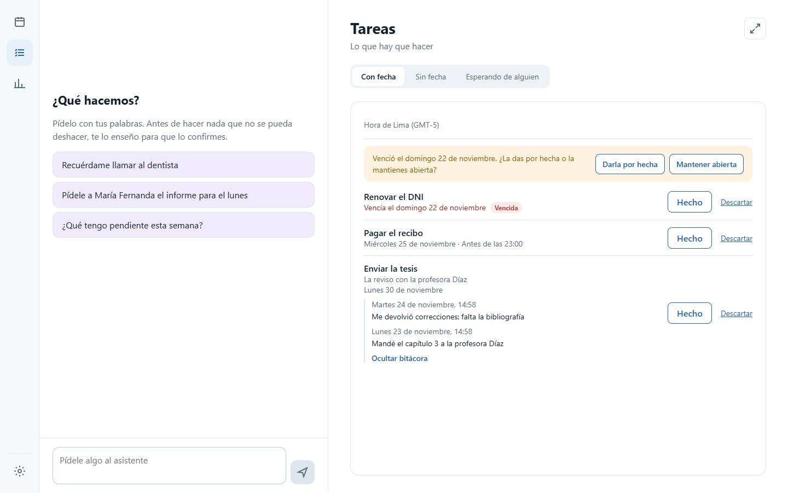
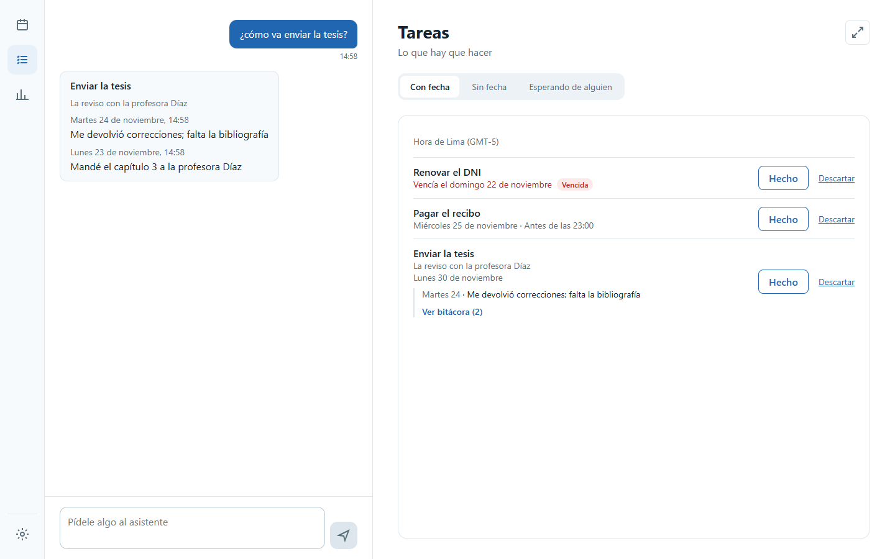
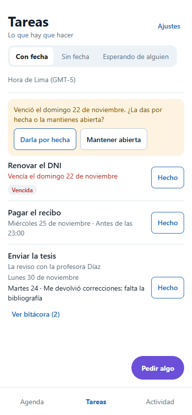
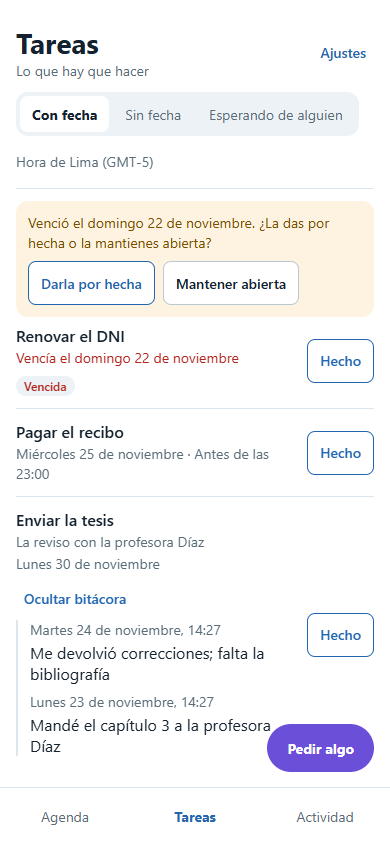
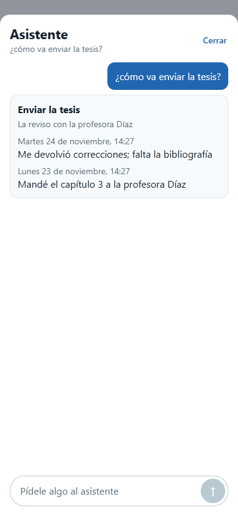

# Informe — Bitácora de una tarea, ficha y aviso al vencer

**Fecha:** 25 de noviembre de 2026 · **Rama:** `version_parcial`, solo local · **`SPEC.md`:** 2.27.0
**Pedido por:** Franco · **Implementado por:** Claude Code
**Área:** `specs/09-tareas-personales/` §6 bis (REQ-CUN03-21 a 27), plan §13, tareas T-125 a T-128

---

## 1. Qué se pidió y qué quedó

| Pedido | Dónde quedó | Estado |
|---|---|---|
| Guardar los avances de cada tarea fuera del chat, como fuente de verdad | Bitácora de la tarea: tabla `avance_tarea`, REQ-CUN03-21 y 22 | Hecho |
| Lo que falta («me falta hablar con Rosa») | Va como texto dentro del avance, sin lista aparte (tu decisión) | Hecho |
| Que el asistente discierna de qué tarea se habla | **Ficha de la tarea**: texto, contexto, cuándo o de quién, y tres últimos avances (H-TP-26, precisada por ti) | Hecho |
| Caracterizar más la tarea | **Contexto opcional** al pedirla («lo veo con Juan y Rosa»), REQ-CUN03-26 | Hecho |
| Preguntar «¿cómo va X?» | La bitácora tal como está, armada por el código (REQ-CUN03-23, H-TP-29) | Hecho |
| Ver la bitácora en Tareas | Último avance bajo la tarea y «Ver bitácora (N)» que la despliega (REQ-CUN03-24) | Hecho, web y móvil |
| Pasada la fecha, avisar para cerrar o mantener abierto | Aviso «¿La das por hecha o la mantienes abierta?» con dos botones (REQ-CUN03-27, H-TP-28) | Hecho, web y móvil |
| Un avance equivocado | Se corrige anotando otro (H-TP-27, aceptada) | Hecho |
| Actualizar el SDD en el camino | `SPEC.md` 2.26.0 y 2.27.0, spec, plan, tareas, glosario y trazabilidad | Hecho |

---

## 2. Cómo funciona, en un ejemplo

| Paso | Le escribes al asistente | Qué pasa |
|---|---|---|
| 1 | «Recuérdame el presupuesto de la cocina, lo veo con Juan y Rosa» | Tarjeta «Nueva tarea» con **Contexto: Lo veo con Juan y Rosa**. Al confirmar, la tarea queda con su contexto |
| 2 | «Sobre el presupuesto de la cocina: ya hablé con Juan, me falta hablar con Rosa» | Tarjeta **«Anotar avance · Presupuesto de la cocina»**. Al confirmar, el avance queda en la bitácora, con fecha y hora |
| 3 | «Ya hablé con Rosa: pasa el precio el viernes» | El título no nombra a Rosa, pero su ficha sí (contexto): propone anotar en «Presupuesto de la cocina» |
| 4 | «¿Cómo va el presupuesto de la cocina?» | Muestra los avances con su fecha, el más reciente primero. No propone nada |
| 5 | (pasa la fecha de la tarea) | En Tareas, sobre la tarea: «Venció el … ¿La das por hecha o la mantienes abierta?» |
| 6 | «Mantener abierta» | El aviso desaparece para esa fecha; la tarea sigue pendiente, marcada «Vencida», y sigue aceptando avances. Si cambias la fecha y vuelve a pasar, el aviso vuelve |

Si dos tareas encajan («avancé con el presupuesto: …» con cocina y baño), el asistente muestra las dos para que elijas, y la elegida lleva el avance que dijiste. Si ninguna encaja, pregunta a qué tarea corresponde. Si la tarea ya está hecha, dice que la reabras primero.

---

## 3. Capturas

### 3.1 Web (1440 × 900)

| # | Qué muestra | Captura |
|---|---|---|
| 1 | Tareas, «Con fecha»: aviso sobre «Renovar el DNI» y, bajo «Enviar la tesis», su contexto y su último avance |  |
| 2 | «Ver bitácora (2)» desplegado: los dos avances con fecha y hora |  |
| 3 | Después de «Mantener abierta»: sin aviso, la tarea sigue «Vencida» |  |
| 4 | Conversación: «¿cómo va enviar la tesis?» muestra la bitácora |  |
| 5 | Conversación: «sobre enviar la tesis: ya agregué la bibliografía» propone «Anotar avance» |  |

### 3.2 Móvil (390 × 844)

| # | Qué muestra | Captura |
|---|---|---|
| 1 | Tareas, «Con fecha»: aviso y último avance |  |
| 2 | Bitácora desplegada |  |
| 3 | Después de «Mantener abierta» |  |
| 4 | Capa de captura: «¿cómo va enviar la tesis?» |  |
| 5 | Capa de captura: tarjeta «Anotar avance» |  |

---

## 4. Casos de prueba

### 4.1 Datos que se necesitan

| Dato | Para qué | Cómo se prepara |
|---|---|---|
| Una cuenta de Plan Personal, sin Google conectado | La bitácora no necesita el calendario (REQ-CUN03-20) | `crear-cuenta --nueva-organizacion "Prueba bitácora" --tipo personal --correo <correo> --rol usuario_personal --plan personal` |
| «Presupuesto de la cocina», sin fecha, con contexto «Lo veo con Juan y Rosa» | Casos de la ficha y el contexto | Pedirla al asistente (caso CP-B-01) |
| «Presupuesto del baño», sin fecha | Candidatas | Pedirla al asistente |
| «Renovar el DNI» con fecha de ayer | Aviso al vencer | Pedirla con «para ayer», o con una fecha pasada |
| «Pagar el recibo de la luz», hecha | Anotar en una tarea hecha | Pedirla y pulsar «Hecho» |
| El asistente | Casos por conversación | `MODELO_PROVEEDOR=simulado` (frases exactas del guion) o Groq (frases libres) en `.env` |

En las pruebas automáticas, la cuenta `tareas` (web) y `tareasBitacora` (móvil) traen ya «Enviar la tesis», con contexto «La reviso con la profesora Díaz» y dos avances, y «Renovar el DNI» vencida (`apps/web/e2e/arrancar-api.mjs`).

### 4.2 Casos y resultados

| # | Caso | Requisito | Resultado esperado | Prueba automática | Resultado |
|---|---|---|---|---|---|
| CP-B-01 | Pedir una tarea con contexto | REQ-CUN03-26 | La tarjeta dice «Contexto»; la tarea lo guarda y se ve en Tareas | `agente.tareas-anotar-avance`, `web.tareas-bitacora`, `movil.tareas-bitacora` | Pasa |
| CP-B-02 | «Sobre X: …» anota en esa tarea, con tarjeta; sin confirmar no anota | REQ-CUN03-21 | Tarjeta «Anotar avance»; al confirmar, un avance con fecha y hora; separador «Se anotó un avance en «…»» | `agente.tareas-anotar-avance`, `tareas.bitacora` | Pasa |
| CP-B-03 | Confirmar dos veces anota uno | REQ-CUN03-22 | Un solo avance | `tareas.bitacora` | Pasa |
| CP-B-04 | Encaja por el contexto | H-TP-26 | «Ya hablé con Rosa: …» va a «Presupuesto de la cocina» | `agente.tareas-anotar-avance` | Pasa |
| CP-B-05 | Encaja por un avance anterior | H-TP-26 | «Ya hablé con el gasfitero, …» va a la tarea cuyo avance lo nombra | `agente.tareas-anotar-avance` | Pasa |
| CP-B-06 | Dos que encajan | REQ-CUN03-21 | Candidatas; elegir una propone el avance dicho | `agente.tareas-anotar-avance` | Pasa |
| CP-B-07 | Ninguna encaja | REQ-CUN03-21 | «¿A qué tarea corresponde?», sin anotar | `agente.tareas-anotar-avance` | Pasa |
| CP-B-08 | Tarea hecha | REQ-CUN03-25 | Ofrece reabrirla, sin anotar; por HTTP, 409 | `agente.tareas-anotar-avance`, `tareas.bitacora` | Pasa |
| CP-B-09 | Sin asistente | REQ-CUN03-25 | Lo pedido queda en espera, sin anotar; la bitácora sigue visible | `agente.tareas-anotar-avance` | Pasa |
| CP-B-10 | Anotar no es un control directo | R-42 | 403 | `tareas.bitacora` | Pasa |
| CP-B-11 | La bitácora sobrevive a la retención de la transcripción | REQ-CUN03-22 | Con el ciclo de vida a 120 días, los avances siguen | `tareas.bitacora` | Pasa |
| CP-B-12 | «¿Cómo va X?» | REQ-CUN03-23 | Los avances tal cual, el más reciente primero, sin propuesta | `agente.tareas-bitacora`, `web.tareas-bitacora`, `movil.tareas-bitacora` | Pasa |
| CP-B-13 | «¿Cómo va?» de una tarea sin avances | REQ-CUN03-23 | «Esta tarea no tiene avances anotados.» | `agente.tareas-bitacora` | Pasa |
| CP-B-14 | «¿Cómo va?» con dos candidatas | REQ-CUN03-23 | Elegir una muestra su bitácora, sin propuesta | `agente.tareas-bitacora` | Pasa |
| CP-B-15 | Bitácora en Tareas | REQ-CUN03-24 | Último avance «Martes 24 · …»; «Ver bitácora (2)» despliega y pliega | `web.tareas-bitacora`, `movil.tareas-bitacora` | Pasa |
| CP-B-16 | Aviso al vencer | REQ-CUN03-27 | Solo en la vencida de «Con fecha»; «Darla por hecha» = «Hecho» con «Deshacer» | `tareas.aviso-al-vencer`, `web.tareas-bitacora`, `movil.tareas-bitacora` | Pasa |
| CP-B-17 | «Mantener abierta» | REQ-CUN03-27 | Sin aviso, también al recargar; sigue «Vencida»; queda en la auditoría como control directo | `tareas.aviso-al-vencer`, `web.tareas-bitacora`, `movil.tareas-bitacora` | Pasa |
| CP-B-18 | Otra fecha que también pasa | H-TP-31 | El aviso vuelve | `tareas.aviso-al-vencer` | Pasa |
| CP-B-19 | Sin aviso: con fecha futura, sin fecha, y lo que se espera de alguien | H-TP-30 | Ninguno muestra aviso | `tareas.aviso-al-vencer` | Pasa |
| CP-B-20 | Cambiar y quitar el contexto | REQ-CUN03-26 | Tarjeta con el antes y el ahora | `tareas.aviso-al-vencer` | Pasa |
| CP-B-21 | Aislamiento entre organizaciones | P-10 | Los avances de otra organización no se leen | `plataforma.aislamiento-entre-organizaciones` | Pasa |

### 4.3 Frases para la prueba a mano con el simulado

Con `MODELO_PROVEEDOR=simulado`, el guion de demostración entiende estas formas (con Groq se puede hablar libremente):

- «recuérdame el presupuesto de la cocina, lo veo con Juan y Rosa»
- «sobre el presupuesto de la cocina: ya hablé con Juan, me falta hablar con Rosa»
- «avancé con el presupuesto: ya llamé al gasfitero»
- «ya hablé con Rosa: pasa el precio el viernes»
- «¿cómo va el presupuesto de la cocina?»

---

## 5. Verificación

Resultados de la verificación completa del monorepo (`turbo run typecheck build test`) y de `tools/trazabilidad.py --check`, sobre esta rama:

| Parte | Resultado |
|---|---|
| Tipos y compilación (contratos, API, web, móvil) | Bien |
| API (Vitest) | **515 pasan**, 1 saltada (`equipos.disponibilidad-afiliada`, por INC-37, como antes). 19 nuevas: 8 en `test/tareas/bitacora.spec.ts` y 11 en `test/agente/tareas-bitacora.spec.ts`; y la de aislamiento, ampliada con `AvanceTarea` |
| Contratos | **128 de 128** (una nueva para el avance, la bitácora y `anotado`) |
| Web, extremo a extremo | **57 de 57** (3 nuevas, `web.tareas-bitacora`) |
| Móvil, extremo a extremo | **29 de 29** (4 nuevas, `movil.tareas-bitacora`) |
| Trazabilidad | **231 requisitos, 0 problemas** |

La migración `20261125120000_bitacora_tarea` se aplicó a la base de desarrollo y a las de prueba. No se probó con Groq: el guion simulado cubre las frases de la §4.3.

---

## 6. Decisiones y lo que queda abierto

| # | Qué | Estado |
|---|---|---|
| H-TP-26 | La ficha de la tarea para discernir de cuál se habla | Precisada por Franco |
| H-TP-27 | Un avance no se corrige: se anota otro | Aceptada por Franco |
| H-TP-28 | Al vencer, aviso para darla por hecha o mantenerla abierta; sin cierre por tiempo | Decidida por Franco |
| H-TP-29 | «¿Cómo va X?» con los avances tal cual, sin resumen del modelo | Aceptada por Franco |
| H-TP-30 | El aviso vale para toda vencida de «Con fecha», tenga o no bitácora; lo que se espera de alguien no lleva aviso | **Pendiente de aval** |
| H-TP-31 | «Mantener abierta» sin tarjeta, y por esa fecha: si la fecha cambia y vuelve a pasar, el aviso vuelve | **Pendiente de aval** |
| H-TP-32 | El aviso se ve en Tareas; no es una notificación del teléfono ni un correo | **Pendiente de aval** |
| — | Texto del aviso: «Venció el … ¿La das por hecha o la mantienes abierta?»; último avance como «Martes 24 · …» | Igual en web y móvil |
| — | En el móvil, la tarjeta plegada ahora muestra «Tarea» y nunca pliega «Avance» | Cambio de presentación |
| — | Límite de 5 ingresos por minuto: el móvil usa una cuenta de pruebas propia (`tareasBitacora`) y la web hace un solo ingreso | Solo pruebas |
| T-040 | Nota de continuidad del asistente | **Siguiente**, por tu decisión |
| — | Probar con Groq las frases libres de la bitácora | Pendiente: gasta cuota, se avisa antes |
