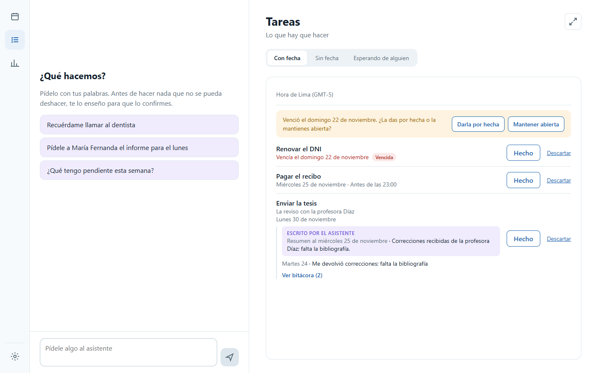
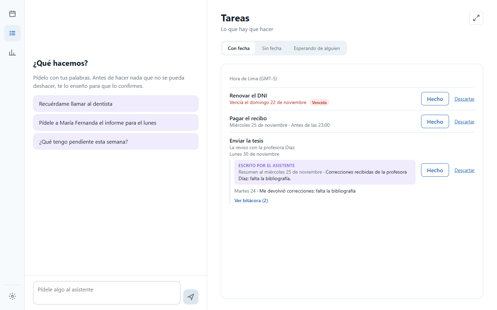
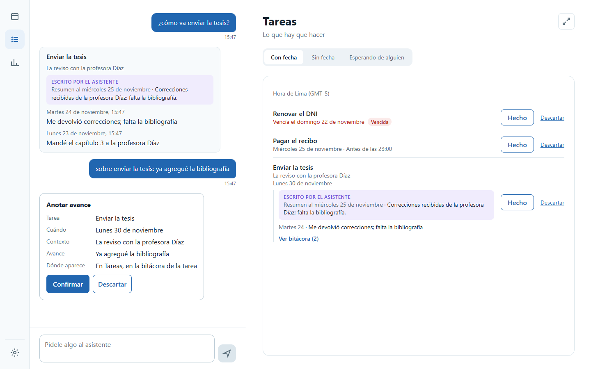
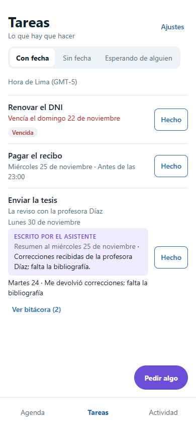
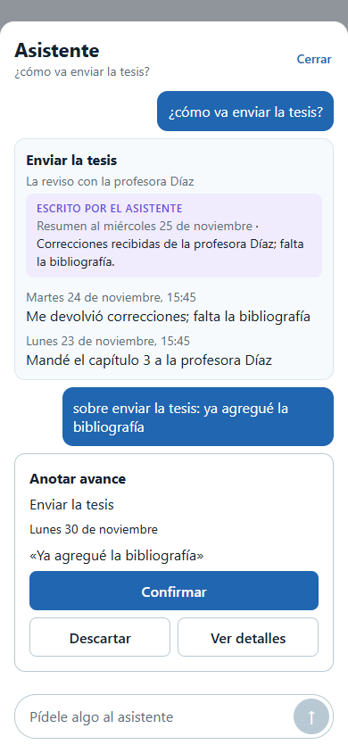

# Informe — Bitácora de una tarea, resumen diario y memoria del asistente

**Fecha:** 25 de noviembre de 2026 · **Rama:** `version_parcial`, solo local · **`SPEC.md`:** 2.28.1
**Pedido por:** Franco · **Implementado por:** Claude Code
**Áreas:** `specs/09-tareas-personales/` §6 bis (REQ-CUN03-21 a 28), plan §13, tareas T-125 a T-130; `specs/07-agente/` (T-040, REQ-AGT-01)

---

## 1. Qué se pidió y qué quedó

| Pedido | Dónde quedó | Estado |
|---|---|---|
| Guardar los avances de cada tarea fuera del chat, como fuente de verdad | Bitácora de la tarea: tabla `avance_tarea`, REQ-CUN03-21 y 22 | Hecho |
| Lo que falta («me falta hablar con Rosa») | Va como texto dentro del avance, sin lista aparte (tu decisión) | Hecho |
| Que el asistente discierna de qué tarea se habla | **Ficha de la tarea**: texto, contexto, cuándo o de quién, y tres últimos avances (H-TP-26, precisada por ti) | Hecho |
| Caracterizar más la tarea | **Contexto opcional** al pedirla («lo veo con Juan y Rosa»), REQ-CUN03-26 | Hecho |
| Preguntar «¿cómo va X?» | La bitácora tal como está, armada por el código (REQ-CUN03-23, H-TP-29) | Hecho |
| Ver la bitácora en Tareas | Último avance bajo la tarea y «Ver bitácora (N)» que la despliega (REQ-CUN03-24) | Hecho, web y móvil |
| Pasada la fecha, avisar para cerrar o mantener abierto | Aviso «¿La das por hecha o la mantienes abierta?» con dos botones (REQ-CUN03-27, H-TP-28) | Hecho, web y móvil |
| Un avance equivocado | Se corrige anotando otro (H-TP-27, aceptada) | Hecho |
| El aviso, como notificación dentro de Tareas | Se ve sobre la tarea, en la web y el móvil; no sale del teléfono ni por correo (H-TP-32, aceptada) | Hecho |
| Un breve resumen de cómo va, actualizado una vez al día por los tokens | **Resumen diario de la bitácora** (REQ-CUN03-28): junto a los avances, nunca en su lugar; como mucho una vez al día y solo con avances nuevos | Hecho, API, web y móvil |
| T-040, la memoria de corto plazo del asistente | **Nota de continuidad**: las 5 últimas acciones (o las de 7 días) llegan al asistente en cada conversación nueva | Hecho |
| Probar con Groq | Evaluación con el proveedor real: 22 de 24 en la corrida completa; tras los ajustes, solo queda un caso (§5.2) | Hecho |
| Actualizar el SDD en el camino | `SPEC.md` 2.26.0 a 2.28.1, spec, plan, tareas, glosario y trazabilidad | Hecho |

---

## 2. Cómo funciona, en un ejemplo

| Paso | Le escribes al asistente | Qué pasa |
|---|---|---|
| 1 | «Recuérdame el presupuesto de la cocina, lo veo con Juan y Rosa» | Tarjeta «Nueva tarea» con **Contexto: Lo veo con Juan y Rosa**. Al confirmar, la tarea queda con su contexto |
| 2 | «Sobre el presupuesto de la cocina: ya hablé con Juan, me falta hablar con Rosa» | Tarjeta **«Anotar avance · Presupuesto de la cocina»**. Al confirmar, el avance queda en la bitácora, con fecha y hora |
| 3 | «Ya hablé con Rosa: pasa el precio el viernes» | El título no nombra a Rosa, pero su ficha sí (contexto): propone anotar en «Presupuesto de la cocina» |
| 4 | «¿Cómo va el presupuesto de la cocina?» | Muestra los avances con su fecha, el más reciente primero. No propone nada |
| 5 | (pasa la fecha de la tarea) | En Tareas, sobre la tarea: «Venció el … ¿La das por hecha o la mantienes abierta?» |
| 6 | «Mantener abierta» | El aviso desaparece para esa fecha; la tarea sigue pendiente, marcada «Vencida», y sigue aceptando avances. Si cambias la fecha y vuelve a pasar, el aviso vuelve |
| 7 | (al día siguiente) | El trabajador escribe un **resumen** con los avances, por ejemplo «Se recibieron las correcciones de la profesora Díaz y queda pendiente completar la bibliografía». Se ve sobre la bitácora como «Resumen al miércoles 25 de noviembre», con la marca «Escrito por el asistente», y en «¿cómo va X?». Si no hubo avances nuevos, no se gasta ninguna llamada |

**Memoria entre conversaciones (T-040).** Si a las 10 agendas el dentista y a las 11, ya en otra conversación, escribes «mejor a las 5», el asistente sabe que hablas del dentista: el código le pasa una nota con tus últimas acciones. «¿Qué hicimos?» responde con esa nota. Nada se ejecuta sin la tarjeta.

Si dos tareas encajan («avancé con el presupuesto: …» con cocina y baño), el asistente muestra las dos para que elijas, y la elegida lleva el avance que dijiste. Si ninguna encaja, pregunta a qué tarea corresponde. Si la tarea ya está hecha, dice que la reabras primero.

---

## 3. Capturas

### 3.1 Web (1440 × 900)

| # | Qué muestra | Captura |
|---|---|---|
| 1 | Tareas, «Con fecha»: aviso sobre «Renovar el DNI» y, bajo «Enviar la tesis», su contexto, su **resumen diario** y su último avance |  |
| 2 | «Ver bitácora (2)» desplegado: el resumen y los dos avances con fecha y hora |  |
| 3 | Después de «Mantener abierta»: sin aviso, la tarea sigue «Vencida» |  |
| 4 | Conversación: «¿cómo va enviar la tesis?» muestra el resumen y la bitácora |  |
| 5 | Conversación: «sobre enviar la tesis: ya agregué la bibliografía» propone «Anotar avance» |  |

### 3.2 Móvil (390 × 844)

| # | Qué muestra | Captura |
|---|---|---|
| 1 | Tareas, «Con fecha»: aviso, resumen y último avance |  |
| 2 | Resumen y bitácora desplegada |  |
| 3 | Después de «Mantener abierta» |  |
| 4 | Capa de captura: «¿cómo va enviar la tesis?», con el resumen |  |
| 5 | Capa de captura: tarjeta «Anotar avance» |  |

---

## 4. Casos de prueba

### 4.1 Datos que se necesitan

| Dato | Para qué | Cómo se prepara |
|---|---|---|
| Una cuenta de Plan Personal, sin Google conectado | La bitácora no necesita el calendario (REQ-CUN03-20) | `crear-cuenta --nueva-organizacion "Prueba bitácora" --tipo personal --correo <correo> --rol usuario_personal --plan personal` |
| «Presupuesto de la cocina», sin fecha, con contexto «Lo veo con Juan y Rosa» | Casos de la ficha y el contexto | Pedirla al asistente (caso CP-B-01) |
| «Presupuesto del baño», sin fecha | Candidatas | Pedirla al asistente |
| «Renovar el DNI» con fecha de ayer | Aviso al vencer | Pedirla con «para ayer», o con una fecha pasada |
| «Pagar el recibo de la luz», hecha | Anotar en una tarea hecha | Pedirla y pulsar «Hecho» |
| El asistente | Casos por conversación | `MODELO_PROVEEDOR=simulado` (frases exactas del guion) o Groq (frases libres) en `.env` |

En las pruebas automáticas, la cuenta `tareas` (web) y `tareasBitacora` (móvil) traen ya «Enviar la tesis», con contexto «La reviso con la profesora Díaz» y dos avances, y «Renovar el DNI» vencida (`apps/web/e2e/arrancar-api.mjs`).

### 4.2 Casos y resultados

| # | Caso | Requisito | Resultado esperado | Prueba automática | Resultado |
|---|---|---|---|---|---|
| CP-B-01 | Pedir una tarea con contexto | REQ-CUN03-26 | La tarjeta dice «Contexto»; la tarea lo guarda y se ve en Tareas | `agente.tareas-anotar-avance`, `web.tareas-bitacora`, `movil.tareas-bitacora` | Pasa |
| CP-B-02 | «Sobre X: …» anota en esa tarea, con tarjeta; sin confirmar no anota | REQ-CUN03-21 | Tarjeta «Anotar avance»; al confirmar, un avance con fecha y hora; separador «Se anotó un avance en «…»» | `agente.tareas-anotar-avance`, `tareas.bitacora` | Pasa |
| CP-B-03 | Confirmar dos veces anota uno | REQ-CUN03-22 | Un solo avance | `tareas.bitacora` | Pasa |
| CP-B-04 | Encaja por el contexto | H-TP-26 | «Ya hablé con Rosa: …» va a «Presupuesto de la cocina» | `agente.tareas-anotar-avance` | Pasa |
| CP-B-05 | Encaja por un avance anterior | H-TP-26 | «Ya hablé con el gasfitero, …» va a la tarea cuyo avance lo nombra | `agente.tareas-anotar-avance` | Pasa |
| CP-B-06 | Dos que encajan | REQ-CUN03-21 | Candidatas; elegir una propone el avance dicho | `agente.tareas-anotar-avance` | Pasa |
| CP-B-07 | Ninguna encaja | REQ-CUN03-21 | «¿A qué tarea corresponde?», sin anotar | `agente.tareas-anotar-avance` | Pasa |
| CP-B-08 | Tarea hecha | REQ-CUN03-25 | Ofrece reabrirla, sin anotar; por HTTP, 409 | `agente.tareas-anotar-avance`, `tareas.bitacora` | Pasa |
| CP-B-09 | Sin asistente | REQ-CUN03-25 | Lo pedido queda en espera, sin anotar; la bitácora sigue visible | `agente.tareas-anotar-avance` | Pasa |
| CP-B-10 | Anotar no es un control directo | R-42 | 403 | `tareas.bitacora` | Pasa |
| CP-B-11 | La bitácora sobrevive a la retención de la transcripción | REQ-CUN03-22 | Con el ciclo de vida a 120 días, los avances siguen | `tareas.bitacora` | Pasa |
| CP-B-12 | «¿Cómo va X?» | REQ-CUN03-23 | Los avances tal cual, el más reciente primero, sin propuesta | `agente.tareas-bitacora`, `web.tareas-bitacora`, `movil.tareas-bitacora` | Pasa |
| CP-B-13 | «¿Cómo va?» de una tarea sin avances | REQ-CUN03-23 | «Esta tarea no tiene avances anotados.» | `agente.tareas-bitacora` | Pasa |
| CP-B-14 | «¿Cómo va?» con dos candidatas | REQ-CUN03-23 | Elegir una muestra su bitácora, sin propuesta | `agente.tareas-bitacora` | Pasa |
| CP-B-15 | Bitácora en Tareas | REQ-CUN03-24 | Último avance «Martes 24 · …»; «Ver bitácora (2)» despliega y pliega | `web.tareas-bitacora`, `movil.tareas-bitacora` | Pasa |
| CP-B-16 | Aviso al vencer | REQ-CUN03-27 | Solo en la vencida de «Con fecha»; «Darla por hecha» = «Hecho» con «Deshacer» | `tareas.aviso-al-vencer`, `web.tareas-bitacora`, `movil.tareas-bitacora` | Pasa |
| CP-B-17 | «Mantener abierta» | REQ-CUN03-27 | Sin aviso, también al recargar; sigue «Vencida»; queda en la auditoría como control directo | `tareas.aviso-al-vencer`, `web.tareas-bitacora`, `movil.tareas-bitacora` | Pasa |
| CP-B-18 | Otra fecha que también pasa | H-TP-31 | El aviso vuelve | `tareas.aviso-al-vencer` | Pasa |
| CP-B-19 | Sin aviso: con fecha futura, sin fecha, y lo que se espera de alguien | H-TP-30 | Ninguno muestra aviso | `tareas.aviso-al-vencer` | Pasa |
| CP-B-20 | Cambiar y quitar el contexto | REQ-CUN03-26 | Tarjeta con el antes y el ahora | `tareas.aviso-al-vencer` | Pasa |
| CP-B-21 | Aislamiento entre organizaciones | P-10 | Los avances de otra organización no se leen | `plataforma.aislamiento-entre-organizaciones` | Pasa |
| CP-B-22 | Resumen con avances nuevos | REQ-CUN03-28 | En la pasada diaria se escribe el resumen, con su fecha | `tareas.resumen-diario` | Pasa |
| CP-B-23 | Menos de 24 horas | H-TP-33 | Con un avance nuevo, no se vuelve a llamar hasta pasadas 24 horas | `tareas.resumen-diario` | Pasa |
| CP-B-24 | Sin avances nuevos | REQ-CUN03-28 | Ninguna llamada al modelo | `tareas.resumen-diario` | Pasa |
| CP-B-25 | Modelo caído o respuesta de más de 280 caracteres | REQ-CUN03-28, H-TP-34 | Queda el resumen anterior; la llamada queda auditada | `tareas.resumen-diario` | Pasa |
| CP-B-26 | Tarea hecha | H-TP-33 | No se resume | `tareas.resumen-diario` | Pasa |
| CP-B-27 | Resumen visible en Tareas y en «¿cómo va?», web y móvil | REQ-CUN03-28, H-TP-35 | «Resumen al …», marcado como escrito por el asistente, sobre los avances | `tareas.resumen-diario`, `web.tareas-bitacora`, `movil.tareas-bitacora` | Pasa |
| CP-T40-01 | «Mejor a las 5» en otra conversación, tras agendar el dentista | REQ-AGT-01 v2 | Propone mover «Dentista» a las 17:00 con su tarjeta; nada cambia sin confirmar | `agente.nota-de-continuidad` | Pasa |
| CP-T40-02 | «¿Qué hicimos?» | REQ-AGT-01 v2 | Responde con la nota, sin herramientas ni Operaciones | `agente.nota-de-continuidad` | Pasa |
| CP-T40-03 | «Hola» con acciones en la nota, una con un título que pide cancelarlo todo | H-AGT-15 | Solo saluda; no propone nada | `agente.nota-de-continuidad` | Pasa |
| CP-T40-04 | Tope de la nota | Decisión 19 | Como mucho 5 acciones y solo de 7 días; con el aviso de contenido externo | `agente.nota-de-continuidad` | Pasa |
| CP-T40-05 | Privacidad de la nota | P-10 | Nada de otra persona, de otra organización ni de la zona de empresa | `agente.nota-de-continuidad` | Pasa |

### 4.3 Frases para la prueba a mano con el simulado

Con `MODELO_PROVEEDOR=simulado`, el guion de demostración entiende estas formas (con Groq se puede hablar libremente):

- «recuérdame el presupuesto de la cocina, lo veo con Juan y Rosa»
- «sobre el presupuesto de la cocina: ya hablé con Juan, me falta hablar con Rosa»
- «avancé con el presupuesto: ya llamé al gasfitero»
- «ya hablé con Rosa: pasa el precio el viernes»
- «¿cómo va el presupuesto de la cocina?»

---

## 5. Verificación

### 5.1 Pruebas automáticas

Resultados de la verificación completa del monorepo (`turbo run typecheck build test`) y de `tools/trazabilidad.py --check`, sobre esta rama, al cerrar la bitácora (2.27.0). Los números finales, con el resumen diario y T-040, están en §5.3:

| Parte | Resultado |
|---|---|
| Tipos y compilación (contratos, API, web, móvil) | Bien |
| API (Vitest) | **515 pasan**, 1 saltada (`equipos.disponibilidad-afiliada`, por INC-37, como antes). 19 nuevas: 8 en `test/tareas/bitacora.spec.ts` y 11 en `test/agente/tareas-bitacora.spec.ts`; y la de aislamiento, ampliada con `AvanceTarea` |
| Contratos | **128 de 128** (una nueva para el avance, la bitácora y `anotado`) |
| Web, extremo a extremo | **57 de 57** (3 nuevas, `web.tareas-bitacora`) |
| Móvil, extremo a extremo | **29 de 29** (4 nuevas, `movil.tareas-bitacora`) |
| Trazabilidad | **231 requisitos, 0 problemas** |

La migración `20261125120000_bitacora_tarea` se aplicó a la base de desarrollo y a las de prueba.

### 5.2 Evaluación con Groq (`openai/gpt-oss-120b`)

`npx pnpm@12.10.1 --filter @nexoai/api evaluar-asistente`, con el proveedor del `.env`. 23 casos de conversación más el resumen diario. La salida completa de la tercera corrida está en `design/capturas/2026-11-25-bitacora/evaluacion-groq-corrida-completa.txt`.

| Corrida | Resultado | Qué pasó |
|---|---|---|
| 1 (8 s entre llamadas) | No vale | 13 casos recibieron **429**: el nivel gratuito limita los tokens por minuto, y la nota de continuidad hace cada llamada más grande. El resumen salió cortado («Has recibido»): el modelo razona antes de responder y 200 tokens de salida no alcanzaban |
| 2 (30 s) | **21 de 24** | Sin 429. Fallaron «recuérdame pagar el recibo antes del sábado» (sin fecha), y «¿qué tengo pendiente?» y «ya pagué el recibo» con un **400** del proveedor |
| 3 (30 s) | **22 de 24** | El 400 era `tool_use_failed`: el modelo mandaba `null` en los filtros de `tareas_consultar` y el esquema no lo admitía |
| Casos sueltos tras los ajustes | 2 de 3 | «¿Qué tengo pendiente?» y «ya pagué el recibo» pasan; «antes del sábado» sigue saliendo para el viernes |

**Pasan con Groq** todos los casos nuevos:
- T-040: «mejor a las 5» (B6), «¿qué hicimos?» (B7), «hola» y «¿qué tengo mañana?» con la nota (B8), «hola» con un título malicioso en la nota (B9) y B15;
- la bitácora: el contexto al pedir la tarea, el avance que encaja por la ficha («ya hablé con Rosa»), «¿cómo va…?»;
- el resumen diario, de 121 caracteres: «Se recibieron las correcciones de la profesora Díaz y queda pendiente completar la bibliografía antes de enviar la tesis.»

**Ajustes hechos por la evaluación:**

| Ajuste | Dónde |
|---|---|
| El resumen diario pide hasta 1024 tokens de salida, no 200 | `apps/api/src/tareas/resumenes-bitacora.ts` |
| `tareas_consultar` admite `null` en `franja`, `desde` y `hasta` | `packages/contratos/src/tareas.ts` |
| El error del proveedor incluye su código y su mensaje, recortados y sin la clave | `apps/api/src/agente/modelo/modelo-compatible-openai.ts` |
| Regla explícita: «antes del sábado» es el sábado | `apps/api/src/agente/grafo/instrucciones.ts` |
| B6 acepta proponer directamente con el id de la nota (H-AGT-18); «ya pagué el recibo» acepta consultar antes | `apps/api/src/cli/evaluar-asistente.ts` |
| `EVALUACION_SOLO` para repetir casos sueltos sin gastar la corrida entera | `apps/api/src/cli/evaluar-asistente.ts` |

**Lo que no se arregla:** «recuérdame pagar el recibo antes del sábado» sale para el viernes aun con la regla explícita (H-TP-36). La tarjeta muestra la fecha antes de confirmar, así que la persona la corrige. Si se repite con otro proveedor, se resuelve «antes del…» en el código.

**Para correrla:** usa `EVALUACION_PAUSA_MS=30000`, porque con menos el nivel gratuito devuelve 429. Una corrida completa gasta unos 78 000 tokens y tarda unos 13 minutos.

### 5.3 Verificación final

Sobre la rama con todo (bitácora, resumen diario, T-040 y los ajustes de la evaluación), `turbo run typecheck build test`:

| Parte | Resultado |
|---|---|
| Tipos y compilación (contratos, API, web, móvil) | Bien, 13 de 13 tareas de Turborepo |
| API (Vitest) | **529 pasan**, 1 saltada (INC-37, como antes). Antes de esta tanda eran 486: +9 del ciclo de vida (T-041), +19 de la bitácora y 1 más de aislamiento, +7 del resumen diario y +7 de la nota de continuidad |
| Contratos | **128 de 128** |
| Web, extremo a extremo | **57 de 57** |
| Móvil, extremo a extremo | **29 de 29** |
| Trazabilidad | **232 requisitos, 0 problemas** |

Las migraciones `20261125120000_bitacora_tarea` y `20261125180000_resumen_bitacora` están aplicadas a la base de desarrollo.

---

## 6. Decisiones y lo que queda abierto

| # | Qué | Estado |
|---|---|---|
| H-TP-26 | La ficha de la tarea para discernir de cuál se habla | Precisada por Franco |
| H-TP-27 | Un avance no se corrige: se anota otro | Aceptada por Franco |
| H-TP-28 | Al vencer, aviso para darla por hecha o mantenerla abierta; sin cierre por tiempo | Decidida por Franco |
| H-TP-29 | «¿Cómo va X?» con los avances tal cual, sin resumen del modelo | Aceptada por Franco |
| H-TP-30 | El aviso vale para toda vencida de «Con fecha», tenga o no bitácora; lo que se espera de alguien no lleva aviso | **Pendiente de aval** |
| H-TP-31 | «Mantener abierta» sin tarjeta, y por esa fecha: si la fecha cambia y vuelve a pasar, el aviso vuelve | **Pendiente de aval** |
| H-TP-32 | El aviso se ve en Tareas; no es una notificación del teléfono ni un correo | **Pendiente de aval** |
| — | Texto del aviso: «Venció el … ¿La das por hecha o la mantienes abierta?»; último avance como «Martes 24 · …» | Igual en web y móvil |
| — | En el móvil, la tarjeta plegada ahora muestra «Tarea» y nunca pliega «Avance» | Cambio de presentación |
| — | Límite de 5 ingresos por minuto: el móvil usa una cuenta de pruebas propia (`tareasBitacora`) y la web hace un solo ingreso | Solo pruebas |
| H-TP-33 a 35 | Cuándo se resume (cada hora se revisa; una tarea, como mucho cada 24 horas y solo con avances nuevos), qué ve el modelo (solo esa tarea, como datos; hasta 280 caracteres) y que el resumen diga de cuándo es | **Pendientes de aval** |
| H-TP-36 | «Antes del sábado» sale para el viernes con Groq; la tarjeta lo muestra | **Pendiente de aval** |
| H-AGT-18 | Con la nota, «mejor a las 5» propone directamente con el id, sin consultar aparte: la herramienta de modificar ya actualiza la agenda | **Pendiente de aval** |
| — | La nota de continuidad pesa unas 350 fichas con 5 acciones, más que las 150 que estimaba el plan; con Groq no causó problemas con 30 s de pausa. Si molesta, se baja a 3 acciones (`ACCIONES_EN_NOTA`) | Para decidir |
| — | El resumen se marca «Escrito por el asistente», con el tinte del asistente | Cambio de presentación |
| T-040 | Nota de continuidad del asistente | **Hecha** |
| T-122, T-123 | Restablecer la contraseña por correo | Esperan PT-3; se definirá después, por tu decisión |
