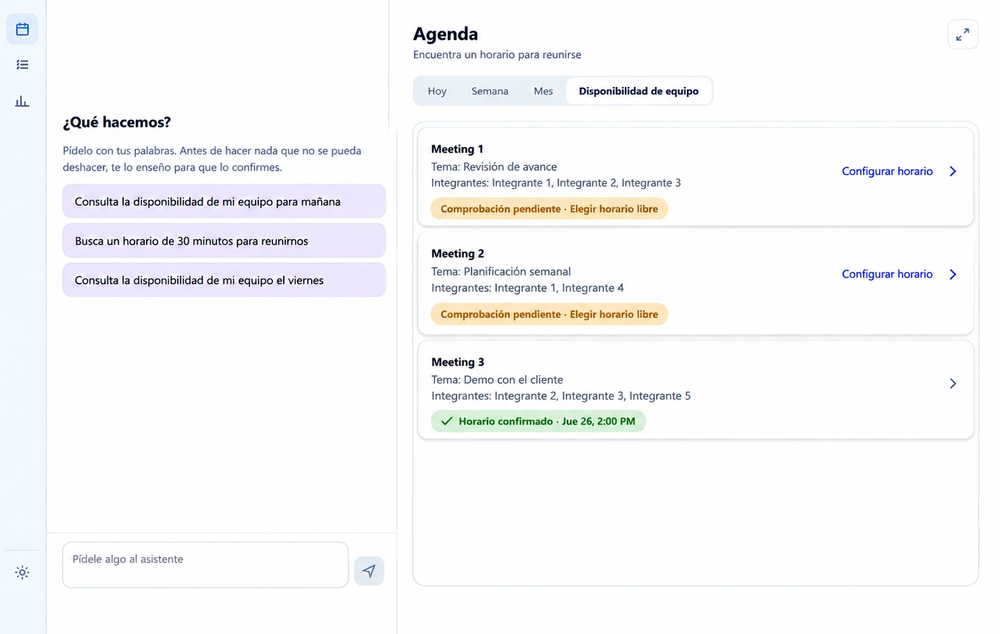
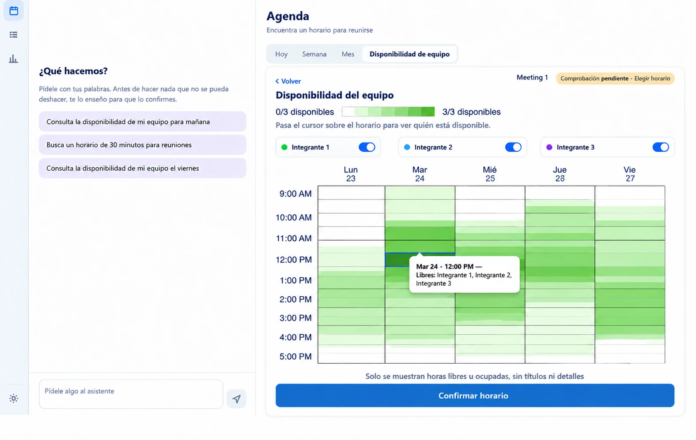

# Propuesta — Reestructuración del bloque de disponibilidad del equipo

**Fecha:** 25 de noviembre de 2026 · **Rama de partida:** `franco-vasco` (sale de `version_parcial`, se fusiona en `main`)
**Pedido por:** Franco, sobre dos bocetos propios: la vista de lista de reuniones y la vista de detalle con mapa de calor
**Estado:** **propuesta, pendiente de aval del equipo**, y en particular de Vasco, autor de CUN-05. No cambia ningún requisito ni código hasta que se avale. Al avalarse, lo que aquí es propuesta pasa a `specs/05-equipos/spec.md` (CUN-05) y a un área nueva para CUN-06, con su línea en `SPEC.md`.

---

## 1. Por qué

La consulta de disponibilidad funciona (CUN-05, T-099 a T-120), pero se construyó como un **formulario de consulta**, y el resultado es largo:

| Problema | Dónde se ve |
|---|---|
| Lo mismo dicho tres veces: los horarios libres (texto, rejilla y lista), que el resultado es parcial (párrafo y aviso) y quién no se pudo consultar (cifra, lista y filas rayadas) | Captura `33b-reuniones-resultado-completo-con-rejilla.png`; observaciones U-04 a U-08 |
| Un solo día por consulta, y hay que llenar equipo, fecha, duración y banda antes de ver nada | Formulario actual |
| La autorización propia («Mi autorización de disponibilidad») está en medio de la consulta | Misma pantalla |
| No hay reunión: se ven horarios, pero no hay nada que **elegir ni convocar** (CUN-06 está sin especificar) | `SPEC.md` §6, CUN-06 |
| La premisa del producto dice que **la facilidad está en el agente** (§1), pero hoy la persona hace el trabajo del agente: elige parámetros, lee la rejilla y saca la conclusión | `SPEC.md` §1 |

## 2. La idea en una frase

**El asistente propone y la persona elige.** El asistente lee la disponibilidad del resto del grupo, calcula los rangos libres en los días hábiles pedidos y **propone pocos horarios**. La persona elige uno, en la conversación o en la vista de detalle si quiere ver más. Al confirmar, la reunión pasa a **agendada**.

```
 1. PROPUESTA                 2. ELECCIÓN                      3. AGENDADA
 «Reunión de avance con       Lista de reuniones: «Meeting 1   La persona confirma la tarjeta.
 Ana y Beto esta semana,      · Elegir horario» (ámbar)        El evento se crea en su Google
 1 hora»                       ├─ en la conversación: elige     Calendar con los invitados, y la
   → el código calcula los     │   una de las 3 propuestas      reunión pasa a «Horario
     rangos libres de los       └─ o abre el detalle: mapa de    confirmado · Jue 26, 2:00 PM»
     días hábiles               calor de la semana, quién está   (verde)
   → el asistente propone 3     libre en cada hora, el horario
     horarios                   sugerido marcado
```

## 3. Las dos vistas (los bocetos de Franco)

### 3.1 Lista de reuniones — la entrada de «Disponibilidad de equipo»

Reemplaza el formulario (equipo, fecha, duración, banda).

| Elemento | Contenido |
|---|---|
| Tarjeta por reunión | Título, tema e integrantes, con la tipografía, los colores y la escala de la app |
| Estado por color | **Ámbar**: «Comprobación pendiente · Elegir horario libre», con «Configurar horario ›». **Verde con ✓**: «Horario confirmado · Jue 26, 2:00 PM», solo con el chevron en gris |
| Sin rejilla | La lista no carga la disponibilidad; aparece al abrir una tarjeta |
| Asistente | Sigue a la izquierda, con sus sugerencias («Busca un horario de 30 minutos para reunirnos») |
| Lista vacía | «Todavía no hay reuniones. Pídele al asistente que busque un horario con tu equipo», con un ejemplo pulsable |

**De dónde salen las reuniones.** Una reunión **se crea pidiéndosela al asistente** (R-42, P-11: no hay camino manual paralelo para crear). La lista muestra las que existen; elegir el horario de una es un control sobre algo que ya existe (DP-01).

### 3.2 Detalle de una reunión — elegir el horario, al estilo When2meet

| Elemento | Contenido |
|---|---|
| Cabecera | «‹ Volver», el título y la píldora de su estado |
| Leyenda | Escala de «0/3 disponibles» a «3/3 disponibles», y «Pasa el cursor sobre el horario para ver quién está disponible» |
| Integrantes como fichas con interruptor | Activan o desactivan a cada persona en el cálculo, para simular escenarios («¿y si Beto no viene?»). **Puntos neutros**, sin color: el verde ya significa disponibilidad (observación del boceto) |
| Mapa de calor | Columnas de lunes a viernes, filas en franjas de 30 minutos dentro de la banda; más verde, más personas libres |
| Tooltip | La franja y quién está libre: «Mar 24 · 12:00 PM — Libres: Ana, Beto, Lucía». Nunca títulos ni detalles |
| Horario sugerido | Celda con borde azul: el que propuso el asistente, con más personas libres y la duración pedida |
| Sin autorización o sin calendario | La ficha de esa persona en gris con «No autorizó» o «Sin calendario»; **no cuenta** en «x/n» y se dice una vez, no tres |
| Duración | Selector de la duración de la reunión (faltaba en el boceto); el sugerido y las celdas que no alcanzan se recalculan |
| Aviso de privacidad | «Solo se muestran horas libres u ocupadas, sin títulos ni detalles» |
| «Confirmar horario» | Abre la tarjeta del asistente con la reunión, el horario y los invitados; nada se crea sin confirmarla (P-03) |

**Elegir:** tocar una celda elige su inicio, con la duración de la reunión. Arrastrar queda para después (decisión abierta D-REU-04).

## 4. Qué hace el asistente y qué hace el código

La regla de siempre: **el modelo entiende lo que se pide y el código calcula** (P-02). El cálculo de libre u ocupado es RN-CAL-01 y ya está en código.

| Paso | Lo hace | Detalle |
|---|---|---|
| Entender el pedido | Modelo | Quiénes (todo el equipo o algunos), qué días («esta semana», «el jueves o el viernes»), duración, tema |
| Rango de días hábiles | Código | Lunes a viernes dentro del rango pedido; por defecto, los próximos 5 días hábiles; la banda habitual de 08:00 a 20:00 de cada persona, en su zona (P-05) |
| Leer el resto del grupo | Código | Solo de quienes autorizaron y tienen calendario (REQ-CUN05-14 a 16), solo libre u ocupado (RN-CAL-01, P-10) |
| Rangos libres comunes | Código | Lo que ya hace CUN-05 (`intervalos comunes`), ahora en varios días |
| **Proponer 3 horarios** | Código, con el modelo solo para decirlo | Los de más personas libres, con la duración pedida, el más cercano primero y repartidos en días distintos (como DP-02). El modelo no elige: recibe la lista armada |
| Mostrar las propuestas | Código | Un turno nuevo en la conversación con 3 opciones pulsables, y la reunión en la lista con su estado ámbar |
| Elegir | Persona | Una de las 3 en la conversación, o el detalle si quiere ver más |
| Convocar | Código, por Operación | `reunion.convocar` (AD-09) crea el evento en el Google Calendar de quien convoca, con los integrantes como invitados. La tarjeta dice quiénes reciben la invitación y que eso no se deshace (P-03). Nunca lee el correo (P-08) |
| Recordar | Código | La reunión queda en la lista; su hilo, en la nota de continuidad (T-040): «mejor el viernes» la vuelve a proponer |

**Por qué el asistente reduce la pantalla.** Si el asistente ya propone los 3 mejores horarios, la mayoría de las veces la persona elige uno en la conversación y no abre el detalle. El mapa de calor queda para cuando ninguna propuesta sirve o se quiere simular quién falta.

## 4 bis. Cómo se agenda una reunión

Añadido el 25 de noviembre de 2026, a pedido de Franco. Recorre la reunión entera, de que alguien la pide hasta que existe en el calendario de todos, y después.

### 4 bis.1 Estados

```
                 elegir y confirmar               mover (con aviso)
 pendiente  ─────────────────────────►  agendada ◄──────────┐
 (ámbar)                                (verde)  ───────────┘
    │  pasan los días pedidos              │
    ├──────────────► vencida (gris)        │ cancelar (con aviso), o el evento
    │  descartar                           │ se borra en Google
    └──────────────► cancelada ◄───────────┘
```

| Estado | Qué significa | Quién la ve en su lista |
|---|---|---|
| `pendiente` | Existe, con su grupo, tema, duración y rango de días, pero sin horario | **Solo quien la pidió.** Nadie más se entera hasta que se agenda (D-REU-10) |
| `agendada` | Tiene horario y un evento en Google Calendar con los invitados | Quien la convocó y cada invitado |
| `vencida` | Pasó el último día del rango sin elegir horario | Solo quien la pidió; se puede pedir de nuevo con otros días |
| `cancelada` | Se descartó estando pendiente, o se canceló estando agendada | Se retira de la lista; queda en Actividad |

### 4 bis.2 Paso a paso

| # | Momento | Qué pasa | Regla |
|---|---|---|---|
| 1 | **Pedir** | «Busca una hora con Ana y Beto esta semana para el avance». El modelo saca quiénes, qué días, cuánto dura y el tema. Si falta quiénes, lo pregunta; si falta la duración, una hora (como un compromiso, H-AG-01); si faltan los días, los próximos 5 días hábiles | REQ-CUN01-07 (lo que falta se pregunta en orden) |
| 2 | **Calcular** | La herramienta `reuniones.proponer` comprueba plan y pertenencia, lee libre u ocupado de quienes autorizaron, calcula los rangos comunes en los días hábiles y arma **3 propuestas** | P-02, RN-CAL-01, REQ-CUN05-14 a 18 |
| 3 | **Queda pendiente** | La misma herramienta crea la reunión `pendiente`, **sin tarjeta**: no tiene efecto fuera de NexoAI y solo la ve quien la pidió. Queda auditada | D-REU-10, P-07 |
| 4 | **Proponer** | Turno nuevo en la conversación: «Encontré 3 horarios en los que están libres los 3» con las opciones pulsables y «Ver todos los horarios», que abre el detalle. Si no hay ninguno común, lo dice y ofrece ampliar los días, la banda o quitar a alguien; la reunión sigue pendiente | DP-02 (reparto de las propuestas) |
| 5 | **Elegir** | Pulsar una propuesta, o «Confirmar horario» en el detalle, **propone la Operación `reunion.convocar`** con ese horario, sin pasar por el modelo. Elegir no escribe nada: es como elegir una alternativa en la agenda | AD-09 |
| 6 | **Tarjeta** | Muestra: título y tema; día, hora y zona; duración; **los invitados con la dirección a la que llega la invitación**; quién no autorizó, con «no se comprobó su disponibilidad»; si un invitado tiene otra zona, su hora («Para Ana, en Madrid: 20:00»); y lo irreversible: «Google enviará la invitación por correo a 3 personas. Deshacerlo es cancelar la reunión, que también les avisa». Botones: Confirmar, Elegir otro horario, Descartar | P-03, P-05 |
| 7 | **Comprobar de nuevo** | Al confirmar, se sincroniza y se vuelve a calcular. Si alguien se ocupó o el horario ya pasó, **no se escribe nada** y la tarjeta vuelve con «Beto ya no está libre a esa hora» y las siguientes propuestas | Como H-AG-07 en la agenda |
| 8 | **Agendar** | Se crea el evento en el **Google Calendar de quien convoca**, con los invitados y **con aviso de Google** a cada uno. La reunión pasa a `agendada` con el id del evento. El evento entra en la agenda de quien convoca por la réplica de siempre | AD-10, P-08 (lo envía Google, no `gmail.send`) |
| 9 | **Lo que ve cada invitado** | La invitación de Google en su correo; en NexoAI, el compromiso en su Agenda con la marca de invitado que ya existe, y la reunión en su lista como «Convocada por Franco · Jue 26, 2:00 PM». Acepta o rechaza **en Google**: NexoAI no responde por él en esta versión | P-09 |

### 4 bis.3 Después de agendada

| Situación | Qué pasa |
|---|---|
| **Respuestas de los invitados** | El detalle muestra «Ana aceptó · Beto no asistirá», leído de Google. Es información: una negativa no cancela ni mueve nada (P-09, R-16) (D-REU-13) |
| **Mover** («pasa la reunión al viernes») | El asistente vuelve a proponer con el mismo grupo; el evento sigue donde está hasta confirmar la Operación `reunion.mover`, que lo cambia **con aviso** a los invitados |
| **Cancelar** | Operación `reunion.cancelar`, con tarjeta que dice que Google avisará a los invitados. Se puede desde la conversación o como control directo en el detalle (DP-01) |
| **Quién puede mover o cancelar** | Solo quien la convocó: el evento vive en su calendario (D-REU-15) |
| **Cambios hechos en Google** | Manda Google (AD-10). Si el evento se borra, la reunión pasa a `cancelada`; si se mueve, su horario se actualiza. Sin preguntar |
| **La agenda y la reunión** | `agenda.modificar` y `agenda.cancelar` no avisan a los invitados (H-AG-11). Cuando el compromiso es una reunión de NexoAI, el asistente usa `reunion.mover` o `reunion.cancelar`, que sí avisan |
| **Pendiente que nadie elige** | La tarjeta de la Operación caduca a las 24 horas (H-AG-08), pero **la reunión no**: sigue pendiente en la lista hasta el último día del rango, y entonces pasa a `vencida` (D-REU-14) |

### 4 bis.4 Hallazgo: a qué dirección llega la invitación

NexoAI **no guarda la dirección de la cuenta de Google** que cada persona conectó (`consentimiento_integracion` guarda el token, no el correo), y el correo de la cuenta de NexoAI puede ser otro: en las cuentas de prueba, `personal@nexoai.test` está conectada a un Gmail real. Si la invitación va al correo de NexoAI, puede no llegar a ningún calendario.

**Propuesta (D-REU-11):** al conectar Google se guarda la dirección del calendario principal (en Google, el id del calendario `primary` es esa dirección) y la invitación va ahí. Quien no tiene Google conectado recibe la invitación en su correo de NexoAI, y la tarjeta lo dice.

## 5. Quién ve qué, por tipo de cuenta

| Cuenta | Lista de reuniones | Detalle | Convocar |
|---|---|---|---|
| Personal | No (REQ-CUN05-18) | No | No |
| Empresarial, integrante | Las reuniones que pidió y a las que lo convocaron | Sí | **Sí** (REQ-CUN05-17: cualquier miembro autorizado convoca) |
| Empresarial, responsable | Igual que el integrante | Sí | Sí. El panorama de su equipo va aparte, en «Mi equipo» de la zona (D-F4, INC-36) |
| Administrador sin equipo | No | No | No |

**En el móvil**, la lista y las propuestas del asistente sí entran; el mapa de calor no, porque necesita ancho (como la rejilla, H-EMP-03). Abrir una reunión pendiente en el móvil muestra las 3 propuestas y «Confirmar».

## 6. Qué se reutiliza y qué es nuevo

| Pieza | Hoy | Con la propuesta |
|---|---|---|
| Consentimiento por Operación, membresía, bandas, estados de disponibilidad | Hecho (CUN-05) | Se reutiliza tal cual |
| Intervalos comunes y por participante | Hecho, un día por consulta en la pantalla | **La API ya acepta un rango `desde`/`hasta`**: falta usarlo en varios días y contar libres por franja de 30 minutos |
| Alternativas | Hecho | Pasa a ser «las 3 propuestas» |
| Herramientas del asistente `equipo.listar`, `equipo.consultar_disponibilidad` | Hechas, no crean reuniones | Nueva `reuniones.proponer` (crea la reunión pendiente y devuelve las 3 propuestas) y `reuniones.convocar` (propone la Operación) |
| Reunión | No existe | Tabla nueva `reunion`: equipo, quien convoca, tema, integrantes, duración, rango de días, estado (`pendiente`, `agendada`, `vencida`, `cancelada`), horario elegido, evento de Google creado (§4 bis) |
| Convocar, mover y cancelar | No existe (CUN-06 sin especificar) | Operaciones `reunion.convocar`, `reunion.mover` y `reunion.cancelar`, con Google Calendar, los integrantes como invitados y **con aviso** de Google (hoy el adaptador escribe siempre con `sendUpdates=none`) |
| Dirección de Google de cada persona | No se guarda | Se guarda al conectar, para invitar a esa dirección (§4 bis.4) |
| Formulario actual | Pantalla principal | Se retira de la entrada; el cálculo queda detrás de la lista y el detalle |

## 7. Decisiones abiertas

| # | Decisión | Propuesta |
|---|---|---|
| D-REU-01 | ¿La reunión es una entidad nueva o solo un evento de Google con invitados? | Entidad nueva `reunion`: necesita un estado antes de tener horario, que Google no tiene |
| D-REU-02 | ¿Cuántas propuestas da el asistente y con qué reglas? | 3; más personas libres, duración completa, la más cercana primero, en días distintos |
| D-REU-03 | ¿Qué cuenta como «disponible» si alguien no autorizó? | No cuenta en «x/n»; la reunión se puede convocar igual, y la tarjeta lo dice |
| D-REU-04 | ¿Elegir tocando o arrastrando? | Tocar; arrastrar después |
| D-REU-05 | ¿A quién le llega la invitación y cómo? | Invitación de Google Calendar desde el calendario de quien convoca; los participantes externos siguen fuera (D-8) |
| D-REU-06 | ¿Qué pasa si después de confirmar alguien se ocupa? | Nada automático en esta versión: la reunión sigue agendada (R-16, P-09) |
| D-REU-07 | ¿El corte se sigue llamando «Disponibilidad de equipo»? | «Reuniones», que dice lo que hay en la lista; sigue como corte de Agenda (R-32) |
| D-REU-08 | ¿Fichas con color por persona? | Neutras (observación del boceto) |
| D-REU-09 | ¿Qué pasa con el formulario y la rejilla actuales? | Se retiran de la pantalla; su código se reutiliza detrás |
| D-REU-10 | ¿Crear la reunión pendiente pide tarjeta? | No: no tiene efecto fuera de NexoAI y solo la ve quien la pidió. La crea el asistente (R-42) y queda auditada. La única tarjeta es la de convocar. **Se aparta del patrón de las tareas**, que se crean con tarjeta (H-TP-08) |
| D-REU-11 | ¿A qué dirección va la invitación? | A la del Google conectado, que hoy no se guarda; sin Google, al correo de NexoAI (§4 bis.4) |
| D-REU-12 | ¿Enlace de videollamada? | Solo si se pide («con Meet»); por defecto, sin enlace |
| D-REU-13 | ¿Se muestran las respuestas de los invitados? | Sí, en el detalle y solo como información (P-09). Si no entra en el plan, queda para después |
| D-REU-14 | ¿Cuándo vence una reunión pendiente? | Al terminar el último día del rango pedido, no a las 24 horas |
| D-REU-15 | ¿Quién mueve o cancela una reunión agendada? | Solo quien la convocó |
| D-REU-16 | ¿Se avisa a los invitados al convocar, mover y cancelar? | Sí, siempre, por Google. Es la excepción a H-AG-11, que vale para los compromisos propios |

## 8. Plan de trabajo

Cada paso cierra con sus pruebas, la trazabilidad y `SPEC.md` al día (método de `AGENTS.md`). Las tareas se numeran desde **T-131**.

| # | Paso | Qué incluye | Depende de | Sesiones |
|---|---|---|---|---|
| 0 | **Rama `franco-vasco`** | Franco sube `version_parcial` como `franco-vasco` y abre la fusión hacia `main` (script aparte) | — | — |
| 1 | **Aval y especificación** | Vasco y el equipo revisan esta propuesta. Con el aval: enmiendas a `05-equipos` (lista, detalle, varios días, propuestas) y **área nueva de CUN-06, coordinar reunión** (REQ-CUN06-01…), con el recorrido de §4 bis y las decisiones D-REU-01 a 16 resueltas; `SPEC.md` §5, §6 y §11 | 0 | 1 |
| 2 | **T-131 · Disponibilidad en varios días y mapa de calor (API)** | Consulta de lunes a viernes con el rango que ya acepta la API; conteo de libres por franja de 30 minutos; horario sugerido calculado en código; contratos | 1 | 1 |
| 3 | **T-132 · La reunión y convocar (API)** | Tabla `reunion` y su migración; la dirección de Google guardada al conectar; Operaciones `reunion.convocar`, `reunion.mover` y `reunion.cancelar` con invitados y aviso de Google, y la comprobación al confirmar; la réplica actualiza la reunión si el evento cambia en Google; vencimiento en el trabajador; rutas de lista y detalle | 2 | 3 |
| 4 | **T-133 · El asistente propone (agente)** | `reuniones.proponer` (crea la reunión pendiente y arma 3 propuestas en código), `reuniones.mover` y `reuniones.cancelar`; turno nuevo con opciones pulsables; elegir sin pasar por el modelo; una reunión de NexoAI no se toca con `agenda.*`; instrucciones; guion; evaluación con Groq | 3 | 2 |
| 5 | **T-134 · Lista y detalle en la web** | Lista de reuniones con estados; detalle con mapa de calor, fichas con interruptor, tooltip, sugerido, duración y «Confirmar horario»; retiro del formulario | 3, 4 | 2 |
| 6 | **T-135 · Lista y propuestas en el móvil** | Lista y las 3 propuestas con «Confirmar», sin mapa de calor | 3, 4 | 1 |
| 7 | **Cierre** | Pruebas de extremo a extremo, capturas por tipo de cuenta, informe y zip | 5, 6 | 1 |

**Total:** unas 11 sesiones después del aval (una más que la primera versión, por mover, cancelar y la dirección de Google). Los pasos 5 y 6 pueden ir en paralelo.

**Fuera de este plan:** el panorama del responsable en «Mi equipo» (D-F4, INC-36), los participantes externos (D-8), el reporte del equipo (CUN-08, que espera a delegar, CUN-07) y avisar a los invitados si la reunión cambia.

## 9. Coordinación

- El código de la disponibilidad es de **Vasco** (CUN-05). Esta propuesta reutiliza su servicio y su componente; conviene que la revise antes del paso 1.
- Los cambios de esquema (tabla `reunion`) se generan con `prisma migrate diff`, sin tocar migraciones aplicadas.
- Los bocetos de referencia, de Franco, están en `design/bocetos/2026-11-25-reuniones/`: `01_vista_lista_reuniones.md` y `02_vista_detalle_disponibilidad.md`, con sus imágenes.




