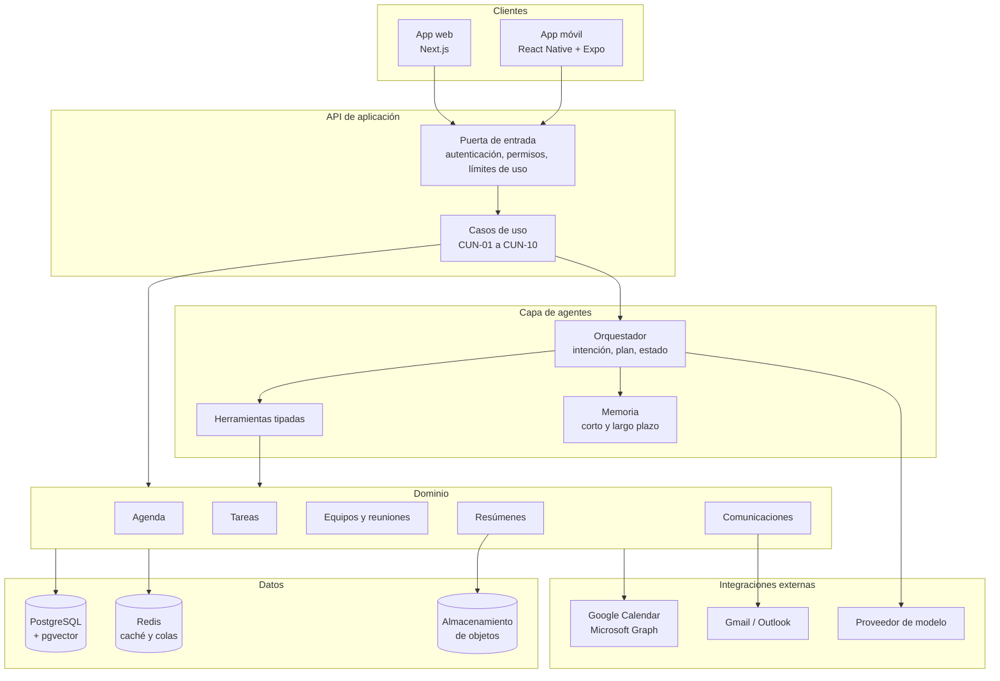
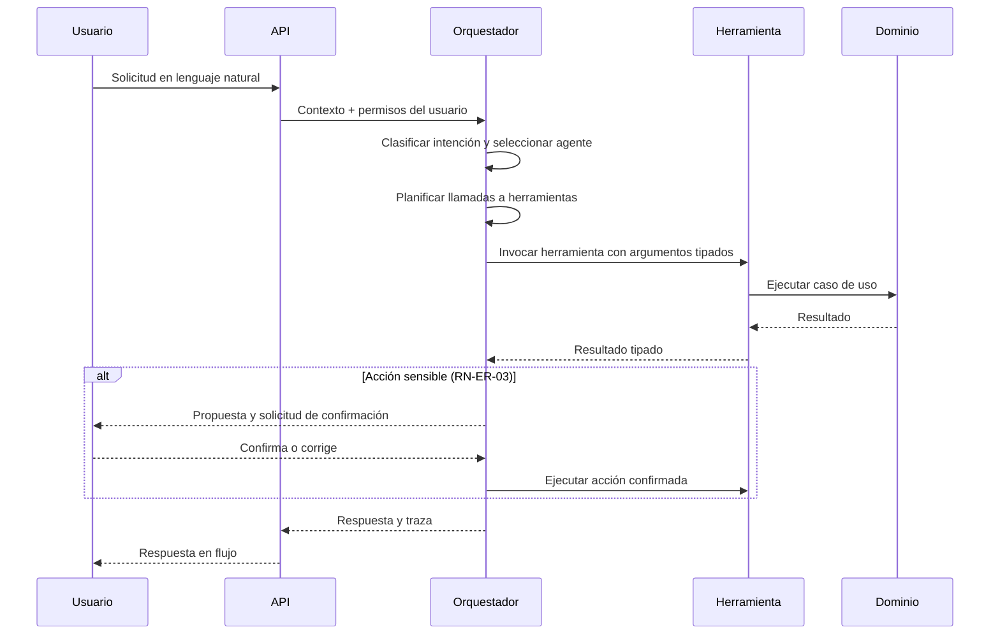

# NexoAI — Propuesta técnica para la implementación

**Proyecto:** NexoAI — Asistente Personal Inteligente
**Curso:** Diseño de Software
**Documento:** insumo para la segunda parte del proyecto (arquitectura e implementación)
**Base:** modelo del negocio del Entregable 1 (actores, CUN-01 a CUN-10, trabajadores, entidades y reglas)

---

## 1. Propósito y criterio de selección

Este documento propone la arquitectura y las tecnologías para implementar NexoAI. Cada decisión se justifica contra tres criterios, en este orden:

1. **Trazabilidad con el modelo del negocio.** Todo componente debe poder señalarse contra un caso de uso, un trabajador, una entidad o una regla ya declarados. Lo que no se pueda trazar, sobra.
2. **Capacidad real del equipo.** Tres integrantes y un ciclo académico. Una arquitectura que no se puede terminar no es una buena arquitectura.
3. **Reversibilidad.** Preferir decisiones baratas de revertir, y aislar detrás de interfaces las caras (proveedor de modelo de lenguaje, proveedor de calendario).

---

## 2. Del modelo del negocio a la arquitectura

La traducción no es libre: el modelo del Entregable 1 ya fija la mayor parte de la estructura.

| Elemento del negocio | Se implementa como |
|---|---|
| Usuario Personal, Gerente, Colaborador | Roles de autorización; determinan qué herramientas puede invocar el agente en cada sesión |
| TN-01 Asistente Personal Inteligente | Agente de organización individual, con su propio conjunto de herramientas y su propio prompt de sistema |
| TN-02 Coordinador Empresarial Inteligente | Agente de coordinación entre personas, con herramientas que leen datos de varios usuarios |
| CUN-01 a CUN-10 | Cada caso de uso es un **caso de uso de aplicación** con su endpoint, y a la vez una **herramienta** que el agente puede invocar |
| CUN-06 incluye CUN-05 | Composición de herramientas: coordinar reunión invoca consultar disponibilidad, no la reimplementa |
| EN-01 a EN-08 | Tablas del modelo de datos y agregados del dominio |
| RN-OP-01, RN-OP-04 (autorización) | Middleware de permisos y filtrado por propietario en cada consulta |
| RN-ER-03 (acción sensible requiere confirmación) | Interrupción del flujo del agente y confirmación explícita del usuario antes de ejecutar |
| RN-CAL-01 (disponibilidad común) | Algoritmo determinista de intersección de intervalos. **No lo resuelve el modelo de lenguaje** |
| RN-INF-01, RN-INF-02 | Reglas evaluadas en código, no inferidas por el modelo |

**Consecuencia de diseño más importante:** los dos trabajadores del negocio no son dos servidores distintos ni dos productos. Son dos configuraciones de agente sobre la misma plataforma, que se diferencian por el conjunto de herramientas habilitadas y por el alcance de los datos que pueden leer.

---

## 3. Arquitectura de diseño

### 3.1 Estilo arquitectónico

**Monolito modular con capa de agentes separada**, desplegado como dos procesos: la API de dominio y el trabajador de tareas asíncronas.

No microservicios. Con tres personas, microservicios significa gastar el semestre en infraestructura, contratos entre servicios y depuración distribuida, en lugar de en el producto. El monolito modular conserva las fronteras (módulos con interfaces explícitas, sin importar entre sí por dentro) y permite extraer un módulo a servicio propio más adelante si hiciera falta. Esta es una decisión que conviene poder defender en la sustentación.

### 3.2 Vista de capas

### 3.3 Módulos de dominio

Un módulo por grupo de entidades, con frontera explícita:

| Módulo | Entidades | Casos de uso |
|---|---|---|
| Identidad y perfil | EN-01 Perfil de Usuario | Transversal; soporta RN-OP-01 |
| Agenda | EN-02 Evento de Agenda | CUN-01 |
| Planificación | EN-03 Planificación de Jornada | CUN-02 |
| Tareas | EN-04 Tarea | CUN-03, CUN-07, CUN-08, CUN-09 |
| Equipos y reuniones | EN-05 Equipo de Trabajo, EN-06 Reunión | CUN-05, CUN-06 |
| Comunicaciones | EN-07 Comunicación | CUN-04 |
| Resúmenes | EN-08 Resumen de Reunión | CUN-10 |

La regla de dependencia: un módulo puede llamar a otro solo por su interfaz pública. Agenda no lee la tabla de Tareas directamente; Planificación pide los datos a ambos. Esto es lo que mantiene el diagrama de clases del Entregable 1 vigente en el código.

### 3.4 Decisiones arquitectónicas

| # | Decisión | Razón | Alternativa descartada |
|---|---|---|---|
| AD-01 | Monolito modular | Tamaño del equipo y del plazo | Microservicios: costo operativo desproporcionado |
| AD-02 | **Backend en TypeScript con NestJS** (decidido el 22 de octubre de 2026, PT-1) | Un solo lenguaje en todo el monorepo: el servidor, el agente, la web y el móvil comparten tipos y contratos sin generar código intermedio. El ecosistema de agentes tiene equivalente en TypeScript (LangGraph.js) | Python con FastAPI: más maduro para agentes, pero obliga a mantener dos lenguajes y a generar los tipos del cliente |
| AD-03 | Una sola base de datos relacional | Las entidades están fuertemente relacionadas; las multiplicidades del diagrama de clases se expresan mejor con claves foráneas | Base documental: relaciones y consistencia más costosas |
| AD-04 | El agente no escribe SQL ni ejecuta código | Superficie de ataque y falta de garantías; las herramientas tipadas acotan lo que puede hacer | Agente con acceso directo a datos |
| AD-05 | Cálculos y reglas en código determinista | RN-CAL-01, RN-INF-01, RN-INF-02 deben ser verificables y repetibles | Delegar el cálculo al modelo de lenguaje |
| AD-06 | Proveedor de modelo detrás de una interfaz propia | Permite cambiar de modelo o proveedor sin tocar el dominio | Llamadas al SDK del proveedor esparcidas por el código |
| AD-07 | Trabajos largos en cola, no en la petición HTTP | Resúmenes y planificación tardan; no deben bloquear la interfaz | Todo síncrono |
| AD-08 | **Contratos en un único paquete de esquemas zod** (`packages/contratos`) | Los importan la API para validar, el agente para definir sus herramientas, y la web y el móvil para tipar. El OpenAPI se genera desde ellos, solo como documentación | Validar con decoradores de clase en la API y repetir los esquemas para el agente |
| AD-09 | **Toda escritura con efecto pasa por una Operación**: se propone, se confirma y se ejecuta una sola vez | Hace que RN-ER-03 se cumpla en el servidor y no solo en la interfaz. El identificador de la operación sirve de clave de idempotencia, y la misma entidad es la cola del modo degradado (P-11) | Confiar la confirmación a la interfaz o al grafo del agente |
| AD-10 | **Google Calendar es la fuente de verdad de la agenda**; `evento_agenda` es una réplica sincronizada | Sin permiso de calendario no hay agenda (REQ-ACC-08), y los eventos creados fuera de NexoAI tienen que verse igual. La réplica permite consultar rangos y calcular disponibilidad sin llamar a Google en cada consulta | Agenda propia sincronizada hacia Google: dos fuentes de verdad y conflictos de escritura |

---

## 4. Stack tecnológico

### 4.1 Cuadro general

| Capa | Tecnología propuesta | Por qué | Alternativa razonable |
|---|---|---|---|
| Lenguaje | TypeScript en todo el proyecto, sobre Node.js LTS | Tipado compartido entre servidor, agente, web y móvil (AD-02) | — |
| App móvil | React Native + Expo | Una base de código para iOS y Android; el equipo reutiliza React | Flutter (si nadie sabe React) |
| App web | Next.js (React) | Renderizado en servidor para el panel, rutas y despliegue sencillos | Vite + React Router |
| Monorepo | pnpm workspaces + Turborepo | La API, la web, el móvil y los contratos en un solo repositorio | Dos repositorios separados |
| Backend | NestJS | Módulos con fronteras explícitas, que es justo lo que pide el monolito modular (AD-01); inyección de dependencias para aislar proveedores (AD-06) | Express o Fastify sin marco: más libertad, menos estructura |
| Validación y contratos | zod, en `packages/contratos` | Un esquema sirve para la API, las herramientas del agente y los clientes (AD-08) | class-validator: solo sirve en la API |
| ORM | Prisma + Prisma Migrate | Migraciones versionadas; el modelo de clases se refleja en `schema.prisma`. pgvector se maneja con tipo no soportado y consultas aisladas en un único repositorio | Drizzle, si pgvector pesa más de lo previsto |
| Base de datos | PostgreSQL | Relacional, transaccional, maduro | — |
| Búsqueda semántica | pgvector | Evita introducir una base vectorial aparte | Qdrant, si el volumen crece |
| Caché y sesiones | Redis | Caché de disponibilidad, límites de uso, estado efímero | — |
| Cola de trabajos | BullMQ sobre Redis | Resúmenes, planificación, sincronización de calendarios | pg-boss, si se quiere solo Postgres |
| Orquestación de agentes | LangGraph.js | Grafo de estados con persistencia en Postgres e interrupción para confirmación humana, que es lo que pide RN-ER-03 | Orquestador propio sobre llamadas a herramientas |
| Modelo de lenguaje | Un modelo grande para planificación y redacción; uno pequeño para clasificar intención | Control de costo y latencia | Un solo modelo para todo |
| Voz | Reconocimiento y síntesis de voz vía API | El servicio declara interacción por voz | Solo texto en la primera versión |
| Autenticación | **Credenciales propias**, con cuentas creadas por la organización, más JWT de acceso y token de renovación rotativo. Google se conecta aparte, solo como integración de calendario y correo | Así lo fija `specs/06-acceso` (REQ-ACC-01 a 07): sin registro abierto, y con los permisos de Google explicados uno por uno después del primer ingreso | Iniciar sesión con Google: mezcla identidad con permisos de integración, que la especificación separa |
| Tiempo real | WebSocket para respuesta en flujo | El agente responde token a token; sin esto la espera se siente rota | Sondeo periódico |
| Notificaciones | Expo Notifications sobre FCM y APNs | Recordatorios y avisos de delegación (RN-ER-02) | Solo correo |
| Almacenamiento de objetos | Compatible con S3; MinIO en desarrollo | Adjuntos y audio de reuniones | Sistema de archivos local |
| Observabilidad | OpenTelemetry + Langfuse | Trazas de aplicación y trazas de agente con costo por ejecución | Solo registros de texto |
| Pruebas | Vitest en todo el monorepo (en la API con SWC para los decoradores), Supertest para HTTP y Playwright para extremo a extremo | Un solo ejecutor de pruebas | Jest, el ejecutor por defecto de NestJS |
| Integración continua | GitHub Actions + Docker | Pruebas y despliegue automáticos | — |
| Despliegue | PaaS con contenedores (Railway, Render o Fly) | No gastar el semestre en infraestructura | Kubernetes: desproporcionado |

### 4.2 Integraciones externas

| Servicio | Uso | Caso de uso |
|---|---|---|
| Google Calendar API | Leer compromisos, crear eventos de reunión. Fuente de verdad de la agenda (AD-10) | CUN-01, CUN-05, CUN-06 |
| Gmail API, solo `gmail.send` | Enviar el correo asistido. Nunca se lee el buzón (R-31, REQ-ACC-07) | CUN-04 |

Microsoft Graph queda fuera de esta versión: REQ-ACC-07 solo pide permisos de Google.
| Servicio de transcripción | Audio de reunión a texto | CUN-10 |

**Advertencia que conviene levantar temprano:** los permisos de lectura de correo son de categoría restringida en Google y exigen una evaluación de seguridad para uso en producción, que un proyecto de curso no va a obtener. Para la implementación académica corresponde trabajar en modo de prueba con usuarios autorizados, o simular la integración de correo tras la misma interfaz. Es mejor declararlo en el documento de arquitectura que descubrirlo a dos semanas de la entrega.

---

## 5. Aplicación móvil

El móvil es el cliente principal: la agenda, los recordatorios y la interacción por voz se usan en movimiento.

**Enfoque:** React Native con Expo, TypeScript, navegación por pestañas.

| Aspecto | Decisión |
|---|---|
| Pantallas mínimas | Conversación con el asistente, Agenda, Tareas, Detalle de tarea delegada, Perfil y permisos |
| Interacción principal | Conversacional. La agenda y las tareas son vistas de consulta; no hay camino manual paralelo al asistente (R-42) |
| Voz | Grabación, transcripción en el servidor, confirmación del texto antes de ejecutar cualquier acción |
| Estado y datos | TanStack Query para el estado del servidor; almacenamiento local cifrado para la sesión |
| Modo sin conexión | Lectura de agenda y tareas desde caché; las escrituras se encolan y se reintentan |
| Notificaciones | Recordatorios, tarea delegada recibida (RN-ER-02), reunión coordinada |
| Confirmaciones | Toda acción con efecto externo (enviar correo, crear reunión, delegar) se confirma en una tarjeta con el detalle exacto antes de ejecutarse |

**Criterio de diseño:** el asistente propone, el usuario dispone. La interfaz nunca debe ejecutar una acción irreversible por interpretación del modelo sin que el usuario vea antes qué se va a hacer. Esto no es una preferencia estética: es la regla RN-ER-03 del propio modelo.

---

## 6. Aplicación web

La web es el cliente del Gerente: coordinar, delegar y supervisar se hace mejor en pantalla grande.

**Enfoque:** Next.js con React y TypeScript.

| Aspecto | Decisión |
|---|---|
| Jerarquía de pantalla | **Tres columnas: navegación 72 px solo iconos, conversación 528 px, lienzo 840 px.** La conversación es efímera y se vacía al cerrar una operación; el lienzo conserva el objeto y el registro. Definida en `design/ARQUITECTURA-VISUAL-WEB.md` |
| Pantallas mínimas | Panel del equipo, Disponibilidad y coordinación de reuniones, Delegación y seguimiento de tareas, Resúmenes de reunión, Administración del equipo, Actividad |
| Actividad | Interfaz del registro de auditoría de §9. Alcance personal en todos los planes; alcance de equipo solo en Plan Empresarial y solo sobre objetos del equipo, nunca la agenda ni las comunicaciones del colaborador |
| Vista de disponibilidad | Rejilla de intervalos por participante con las franjas comunes resaltadas. Es la representación visual de RN-CAL-01 |
| Seguimiento (CUN-08) | Tabla filtrable por colaborador y por estado, con el estado que define la enumeración del diagrama de clases |
| Componentes | Biblioteca de componentes accesibles y sistema de diseño compartido con el móvil mediante tokens |
| Reutilización | Web y móvil importan los esquemas de `packages/contratos`, los mismos que valida la API (AD-08) |

---

## 7. Gestión del agente

Esta es la parte donde un proyecto así se gana o se pierde. Un asistente que responde bonito pero ejecuta acciones equivocadas sobre la agenda de una persona es peor que no tener asistente.

### 7.1 Flujo de una solicitud

### 7.2 Herramientas del agente

Cada caso de uso del negocio se expone como una herramienta con contrato explícito. El agente no tiene otra forma de tocar los datos.

| Herramienta | CUN | Entidades | Permiso | Confirmación previa |
|---|---|---|---|---|
| `agenda.consultar` | CUN-01 | EN-02 | Propietario | No |
| `agenda.registrar_evento` | CUN-01 | EN-02 | Propietario | Sí |
| `agenda.modificar_evento` | CUN-01 | EN-02 | Propietario | Sí |
| `agenda.cancelar_evento` | CUN-01 | EN-02 | Propietario | Sí (decisión 2 de `specs/02-agenda`) |
| `planificacion.generar` | CUN-02 | EN-02, EN-03, EN-04 | Propietario | No (propone, no ejecuta) |
| `tareas.consultar` | CUN-03, CUN-08 | EN-04 | Propietario o responsable | No |
| `tareas.registrar` | CUN-03 | EN-04 | Propietario | Sí |
| `tareas.actualizar_estado` | CUN-09 | EN-04 | Responsable (RN-OP-04) | Sí |
| `comunicaciones.preparar` | CUN-04 | EN-07 | Autorización de correo | No (redacta borrador) |
| `comunicaciones.enviar` | CUN-04 | EN-07 | Autorización de correo | Sí, siempre |
| `disponibilidad.consultar` | CUN-05 | EN-01, EN-02, EN-05 | Gerente del equipo | No |
| `reuniones.coordinar` | CUN-06 | EN-05, EN-02, EN-06 | Gerente del equipo | Sí |
| `tareas.delegar` | CUN-07 | EN-04, EN-05 | Gerente autorizado (RN-OP-03) | Sí |
| `resumenes.generar` | CUN-10 | EN-06, EN-08 | Participante autorizado | No |

Reglas que cumple toda herramienta:

- **Argumentos y salidas tipados** y validados antes de ejecutar. Si el modelo alucina un argumento, falla la validación, no la base de datos.
- **El permiso se evalúa en el servidor**, con la identidad del usuario, nunca con lo que diga el modelo.
- **Idempotencia** mediante clave de operación, para que un reintento no cree dos reuniones.
- **Toda invocación queda registrada** con sus argumentos, su resultado y su costo.

### 7.3 Qué no hace el modelo de lenguaje

Delimitarlo es una decisión de arquitectura, no un detalle:

- No calcula la disponibilidad común. Eso es intersección de intervalos en código (RN-CAL-01).
- No decide si una delegación está autorizada (RN-OP-03).
- No da por completada una tarea; eso lo determina la regla RN-INF-02 sobre el estado registrado.
- No accede a datos de otros usuarios salvo a través de una herramienta que ya filtró por permisos.

El modelo interpreta la solicitud, elige herramientas, redacta y explica. Las decisiones con consecuencia las toma el código o la persona.

### 7.4 Memoria y contexto

| Tipo | Contenido | Dónde vive |
|---|---|---|
| Conversación | Turnos recientes del diálogo | Estado del grafo, en Postgres |
| Perfil y preferencias | Horario laboral, zona horaria, cómo prefiere que se le escriba | EN-01 Perfil de Usuario |
| Semántica | Comunicaciones y resúmenes pasados, para consulta por significado | pgvector |
| Operativa | Eventos, tareas y reuniones vigentes | Tablas del dominio, consultadas en el momento |

El contexto se arma por caso de uso: no se envía toda la agenda al modelo, se envían las franjas relevantes. Esto baja costo, latencia y riesgo de filtración de datos ajenos.

### 7.5 Confiabilidad y costo

| Preocupación | Tratamiento |
|---|---|
| Acción equivocada | Confirmación previa para todo lo que tenga efecto externo |
| Alucinación de argumentos | Validación de esquema y rechazo antes de ejecutar |
| Indisponibilidad del proveedor | Reintento con retroceso, modelo de respaldo, y cola de solicitudes con consulta de lo existente (R-42) |
| Latencia | Respuesta en flujo; trabajos largos a la cola con aviso al terminar |
| Costo | Modelo pequeño para clasificar intención; caché de resultados; presupuesto por usuario |
| Evaluación | Conjunto fijo de casos con resultado esperado, ejecutado en integración continua ante cada cambio de prompt o de herramienta |

Ese último punto es el que suele faltar: si se cambia un prompt y no hay forma de medir si el sistema empeoró, no hay ingeniería, hay ensayo y error.

---

## 8. Modelo de datos

Traducción directa del diagrama de clases del Entregable 1:

| Tabla | Origen | Notas |
|---|---|---|
| `perfil_usuario` | EN-01 | Zona horaria y preferencias; raíz de la mayoría de las relaciones |
| `evento_agenda` | EN-02 | Marcas de tiempo con zona horaria; índice por usuario y rango |
| `planificacion_jornada` | EN-03 | Referencia a los eventos y tareas considerados |
| `tarea` | EN-04 | Estado según la enumeración del diagrama; responsable y quien delegó |
| `equipo_trabajo` | EN-05 | Relación muchos a muchos con perfil, según RN-EST-03 |
| `reunion` | EN-06 | Participantes como relación aparte |
| `comunicacion` | EN-07 | Tipo distingue correo de llamada |
| `resumen_reunion` | EN-08 | Borrado en cascada con su reunión, por la composición de RN-EST-04 |

Tablas adicionales que no son del negocio pero sí del sistema: `organizacion`, `sesion_renovacion`, `consentimiento_integracion`, `operacion` (AD-09), `sesion_agente`, `invocacion_herramienta`, `evento_auditoria`. El detalle de cada una está en el `plan.md` del área que la introduce.

**Las fechas se guardan siempre con zona horaria.** Un asistente de agenda que se equivoca de hora es un asistente inútil, y las zonas horarias son la fuente más común de ese error.

---

## 9. Seguridad y privacidad

- Permisos por ámbito: el consentimiento a calendario y el consentimiento a correo son independientes y revocables por separado.
- Cifrado en tránsito y cifrado en reposo de los tokens de integración.
- Registro de auditoría de toda acción ejecutada por el agente en nombre del usuario, consultable por el usuario.
- Minimización: no se almacena el contenido completo de los correos si basta con metadatos y el fragmento necesario.
- Aislamiento entre organizaciones clientes: toda consulta filtra por organización, sin excepción.

---

## 10. Alcance realista para el curso

Intentar los diez casos de uso a la vez es la forma más segura de no entregar ninguno terminado. Propuesta por fases, cada una utilizable por sí misma:

| Fase | Contenido | Casos de uso |
|---|---|---|
| 1 | Autenticación, modelo de datos, agenda y tareas personales sin agente | CUN-01, CUN-03 |
| 2 | Capa de agente sobre lo anterior: intención, herramientas, confirmación | CUN-01, CUN-03 vía conversación |
| 3 | Planificación de jornada | CUN-02 |
| 4 | Equipos: disponibilidad, coordinación de reuniones, delegación y seguimiento | CUN-05 a CUN-09 |
| 5 | Comunicaciones asistidas y resúmenes | CUN-04, CUN-10 |

Las fases 1 y 2 son el núcleo demostrable. Las fases 4 y 5 son las que dependen de permisos externos y por eso son las más expuestas a bloquearse por causas ajenas al equipo.

---

## 11. Riesgos

| Riesgo | Impacto | Mitigación |
|---|---|---|
| Permisos restringidos de correo en Google | Bloquea CUN-04 en producción | Modo de prueba con usuarios autorizados; interfaz que permita simular el proveedor |
| Costo por token mayor al previsto | Limita las pruebas | Modelo pequeño para intención, caché, presupuesto por usuario |
| Errores de zona horaria | Rompe agenda y disponibilidad | Zona horaria explícita en todo el sistema; pruebas con usuarios en husos distintos |
| Alcance excesivo | Nada terminado | Entrega por fases, con la fase 2 como mínimo defendible |
| Dependencia de un proveedor de modelo | Costo de cambio alto | Interfaz propia sobre el proveedor |
| Sobrecarga de infraestructura | Tiempo gastado fuera del producto | PaaS con contenedores, no orquestadores |

---

## 12. Decisiones que el grupo debe tomar

1. ~~**Lenguaje del backend**~~ — **RESUELTO el 22 de octubre de 2026: TypeScript con NestJS.** Ver AD-02 y §4.1.
2. **Alcance de la voz:** si entra en la primera versión o se deja declarada para una posterior.
3. **Integración de correo:** real con usuarios de prueba, o simulada tras la misma interfaz.
4. ~~**Criterio de "mejor horario" (RN-CAL-01)**~~ — **RESUELTO el 26 de septiembre de 2026.** El criterio aprobado está en `specs/05-equipos/spec.md` sección 1: filtro por duración solicitada, banda horaria admisible de 08:00 a 20:00 con techo duro a las 22:00, la más temprana primero, desempate por mayor duración, y a partir del día siguiente salvo petición expresa. Queda incorporar la segunda oración al texto de la regla en el Entregable 1.
5. **Alcance del Plan Personal.** Rutina, bienestar, nutrición, agendas médicas, automatización de pedidos y gestión de gastos exceden los diez casos de uso modelados. Hay que decidir si se revisa el Entregable 1 o si se declara como visión de producto fuera del alcance modelado. Los pedidos automatizados son el punto delicado: es la única función donde el asistente gasta dinero del usuario, y choca de frente con RN-ER-03.
6. **Cifras de los límites del Plan Gratuito.** Sin ellas no hay contador ni aviso de límite que diseñar.

Los puntos 5 y 6 son ahora los que conviene resolver primero: el 5 porque decide si el modelo del negocio se revisa, y el 6 porque bloquea una pieza de interfaz.
