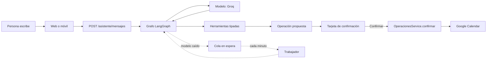
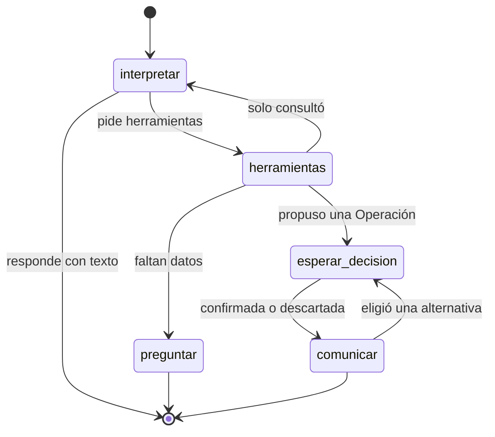

# Sílabo — Cómo se construyó el agente de NexoAI

**Para qué es:** material de estudio personal. Recorre el desarrollo técnico del asistente de NexoAI (fase 2, T-029 a T-036) **siguiendo las decisiones que se tomaron**, y relaciona cada una con el concepto que la explica.
**No es especificación:** la fuente de verdad sigue siendo `SPEC.md` y `specs/07-agente/`. Si algo de aquí no coincide con ellos, mandan ellos.
**Estado del código que describe:** 29 de octubre de 2026, commit `72a15da` y la corrección posterior de la conversación.

---

## Cómo leerlo

Cada unidad tiene cuatro partes:

| Parte | Qué contiene |
|---|---|
| **Concepto** | La idea general, válida para cualquier agente |
| **Decisión en NexoAI** | Qué se eligió, qué se descartó y por qué |
| **Dónde mirarlo** | Archivos del repositorio |
| **Para pensar** | Preguntas que podrían hacerte en la sustentación |

Orden recomendado: 1 → 2 → 3 (temperatura) → 4 → 5 → 6 → 7 → 8 → 9 → 10.

---

## Mapa general

**La idea que atraviesa todo el sílabo:** el modelo **interpreta**; el código **decide**. Casi todas las decisiones de diseño salen de esa frase (principio P-02 de `SPEC.md`).

---

## Unidad 1 · Qué es un agente aquí

### Concepto
Un **modelo de lenguaje** recibe texto y devuelve texto. Se convierte en **agente** cuando, además, puede pedir que se ejecuten **herramientas** (funciones con argumentos definidos) y ver su resultado, en un bucle: *interpretar → actuar → observar → volver a interpretar*. A ese patrón se le suele llamar **ReAct** (*reason + act*).

Piezas mínimas:
- **Instrucciones de sistema** (*system prompt*): quién es y qué puede hacer.
- **Mensajes**: la conversación.
- **Herramientas**: nombre, descripción y **esquema JSON** de sus argumentos.
- **Bucle**: quien ejecuta las herramientas y devuelve los resultados al modelo.

### Decisión en NexoAI
- **El agente solo actúa con herramientas tipadas** (P-01, AD-04): no escribe SQL ni ejecuta código.
- **Ninguna herramienta escribe**: solo consultan o **proponen** una Operación. Ejecutar es siempre la confirmación de la persona (AD-09, P-03).
- **Alcance de la primera versión, decidido por el equipo:** solo agenda y solo texto (sin voz, PT-2). Una tarea se reconoce y queda en espera (REQ-AGT-02).

### Dónde mirarlo
`specs/07-agente/plan.md` §1 y §5 · `apps/api/src/agente/herramientas/`

### Para pensar
- ¿Qué pasaría si el modelo pudiera escribir directamente en Google Calendar? ¿Quién respondería por un error?
- ¿Por qué «proponer» y «ejecutar» son dos pasos distintos y no uno?

---

## Unidad 2 · El proveedor del modelo detrás de una interfaz

### Concepto
**Patrón puerto–adaptador** (arquitectura hexagonal): el dominio habla con una **interfaz propia** (el puerto), y cada proveedor concreto es un **adaptador** que la cumple. Cambiar de proveedor es cambiar de adaptador, no reescribir el sistema.

**Prueba de contrato:** un mismo conjunto de pasos que **todas** las implementaciones deben pasar. Así el simulado y el real se comportan igual ante el resto del código.

**Doble de prueba (simulado):** una implementación falsa, predecible, para probar sin red, sin costo y sin azar.

### Decisión en NexoAI

| Decisión | Alternativa descartada | Por qué |
|---|---|---|
| Interfaz `ProveedorModelo` propia (P-06) | Usar el SDK de un proveedor en todo el código | Cambiar de modelo no debe tocar el dominio |
| Tres adaptadores: **simulado**, **no configurado**, **compatible con OpenAI** | Uno por proveedor | Groq, Cerebras, OpenRouter y Ollama hablan el mismo formato: un adaptador sirve a todos |
| **Sin SDK**: `fetch` directo | El SDK oficial de cada uno | Menos dependencias; una prueba impide cualquier SDK fuera de `src/agente/modelo/` |
| Sin proveedor configurado = **asistente no disponible** (H-AGT-01) | Fallar al arrancar | El sistema sigue funcionando y lo pedido queda en espera |
| Simulado con **guion de frases** (H-AGT-02) | Un intérprete de reglas | Es para probar y demostrar, no para entender lenguaje |
| Groq, nivel gratuito, para probar (29 de octubre de 2026) | Pagar desde el inicio | Probar sin costo; el proveedor definitivo sigue abierto |

### Dónde mirarlo
`apps/api/src/agente/modelo/proveedor-modelo.ts` (el puerto) · `modelo-simulado.ts` · `modelo-compatible-openai.ts` · `contrato.ts` · `test/agente/contrato-del-proveedor.spec.ts`

### Para pensar
- Si mañana el equipo elige Claude, ¿qué archivos cambian y cuáles no?
- ¿Por qué el contrato acepta que un proveedor diga «no disponible» y lo considera correcto?

---

## Unidad 3 · Parámetros de generación: la temperatura y compañía

Esta es la unidad que pediste. Conviene separar **qué es** cada parámetro de **cómo lo usa (o no) este agente**.

### Concepto
Un modelo no elige la siguiente palabra (token) de forma fija: calcula una **probabilidad** para cada candidata y **muestrea**.

| Parámetro | Qué regula | Efecto típico |
|---|---|---|
| **Temperatura** | Cuánto se «aplana» la distribución de probabilidades antes de muestrear | Baja (≈0): elige casi siempre lo más probable, más repetible. Alta (≈1 o más): más variedad y más riesgo de salirse |
| **top_p** (*nucleus sampling*) | Solo muestrea entre las opciones que suman ese porcentaje de probabilidad | Recorta las opciones raras |
| **top_k** | Solo entre las *k* más probables | Parecido a top_p, con un número fijo |
| **max_tokens** | Cuánto puede escribir como mucho | Si se queda corto, la respuesta se corta |
| **Esfuerzo de razonamiento** (*reasoning effort*) | En modelos que razonan antes de responder, cuánto piensan | Más esfuerzo: mejores decisiones difíciles, más tokens y más latencia |
| **tool_choice** | Si el modelo puede, debe o no puede usar herramientas | `auto` deja que decida |

Idea clave: **la temperatura controla la variedad, no la verdad.** Una temperatura baja hace que el modelo se equivoque *de la misma forma* cada vez; no lo hace acertar.

### Cómo está en NexoAI hoy

| Parámetro | Valor | Dónde |
|---|---|---|
| Temperatura | **No se envía.** Groq usa su valor por defecto; en la API compatible con OpenAI es 1. *Compruébalo en la documentación de Groq para `openai/gpt-oss-120b`* | `modelo-compatible-openai.ts` (el cuerpo de la petición) |
| top_p / top_k | No se envían | Ídem |
| max_tokens | **1024** por llamada | `grafo/grafo-asistente.ts`, nodo `interpretar` |
| tool_choice | **`auto`** | `modelo-compatible-openai.ts` |
| Llamadas por mensaje | Como mucho **4** (H-AGT-10) | `TOPE_VUELTAS` en el grafo |
| Tiempo por llamada | **30 s**, dos reintentos de 1 y 3 s (H-AGT-03) | `llamador-modelo.ts` |

**Dato útil para la sustentación:** algunos proveedores **ya no aceptan** `temperature`. Según la documentación de Anthropic, desde el 21 de octubre de 2026 una petición a su API que la envía (o `top_p`, o `top_k`) recibe un error: el control pasa a otros mecanismos, como el esfuerzo de razonamiento. Es otra razón para no apoyar la fiabilidad del agente en ese parámetro.

### Por qué NexoAI no depende de la temperatura
En lugar de pedirle al modelo que «sea preciso», **el diseño quita de sus manos lo que tiene que ser exacto**:

| Riesgo de un modelo que varía | Cómo lo neutraliza el código |
|---|---|
| Inventa una hora de fin | No se le pide: si falta, la pone el código (H-AG-01, REQ-CUN01-01) |
| Escribe mal un desfase horario | Da fecha y hora **locales**; el código convierte con la zona del perfil (P-05) |
| Inventa un compromiso al resumir la agenda | La lista la arma el código con la réplica (REQ-CUN01-13) |
| Pregunta todo a la vez | La pregunta la escribe el código, una sola y fija (R-20) |
| Da por hecho algo que no se hizo | El resultado sale de la Operación ejecutada (REQ-CUN01-04) |
| Argumentos con forma rara | Validación con zod antes de ejecutar; si no valen, no se hace nada |
| Calcula mal un solape | Función pura en código (P-02) |

**Conclusión:** la temperatura afecta **cómo redacta** el asistente y, en menor medida, **qué herramienta elige**. Lo que tiene consecuencias está blindado por el código. Por eso se mide con evaluación (unidad 8) y no se «afina a ojo».

### Para pensar
- ¿Bajarías la temperatura a 0 para este agente? ¿Qué ganarías y qué perderías? *(Pista: con 0 la elección de herramienta es más repetible, pero un error repetible sigue siendo un error.)*
- Si quisieras fijarla, sería una decisión de diseño: un hallazgo para el equipo (por ejemplo `MODELO_TEMPERATURA` en `.env`), medido con la evaluación antes y después.

---

## Unidad 4 · Herramientas, contratos y validación

### Concepto
- **Function calling / tool calling:** el modelo no ejecuta nada; devuelve *«quiero llamar a X con estos argumentos»* y el programa decide si lo hace.
- **Esquema JSON:** describe los argumentos válidos. El modelo lo lee para saber qué pasar.
- **Validación en el servidor:** nunca se confía en lo que dice el modelo (P-04).
- **Idempotencia:** repetir la misma llamada no repite el efecto.
- **Minimización de datos:** enviar al proveedor solo lo necesario.

### Decisión en NexoAI
- Los argumentos se definen **una sola vez** con zod en `packages/contratos` (AD-08); de ahí sale el esquema JSON que ve el modelo.
- Los argumentos de registrar son **todos opcionales**: así el modelo no tiene que inventar lo que la persona no dijo. Si falta algo, la herramienta responde qué falta.
- Nombres con guion bajo (`agenda_consultar`), porque varios proveedores no admiten el punto.
- **Idempotencia:** cada llamada se **reserva** en la base antes de ejecutarse; si se repite, incluso a la vez, se devuelve lo guardado (P-07).
- **Lo que ve el proveedor** de tu agenda: solo título, horas y estado del rango pedido; nunca invitados, lugar ni descripción (H-AGT-12).

### Dónde mirarlo
`packages/contratos/src/agente.ts` · `apps/api/src/agente/herramientas/ejecutor-herramientas.ts` · `herramientas-agenda.ts`

### Para pensar
- ¿Por qué validar dos veces (zod en la herramienta y otra vez en Operaciones)?
- ¿Qué podría salir mal si las herramientas devolvieran al modelo toda la información del evento?

---

## Unidad 5 · El grafo: estado, nodos e interrupción

### Concepto
- **Grafo de estados:** el flujo del agente como nodos (pasos) y aristas (a dónde ir después), con un **estado** compartido.
- **Human-in-the-loop:** el flujo se **detiene** esperando una decisión humana y se **reanuda** con ella.
- **Punto de control** (*checkpoint*): el estado se guarda, así una pausa sobrevive a un reinicio.

### El grafo de NexoAI

| Nodo | ¿Usa el modelo? | Por qué |
|---|---|---|
| `interpretar` | Sí | Es lo único que necesita lenguaje |
| `herramientas` | No | Ejecuta, valida y audita |
| `preguntar` | No | Frase fija: una pregunta, siempre igual |
| `esperar_decision` | No | `interrupt()`: el grafo queda guardado esperando a la persona |
| `comunicar` | No | El resultado sale de la Operación, no de lo que el modelo crea |

### Decisiones en NexoAI
- **LangGraph.js** (decidido en la propuesta técnica) por su interrupción nativa.
- **La confirmación no la hace el grafo**: la hace `OperacionesService`, la misma que usan los controles directos (AD-09). El grafo solo espera y se reanuda con el desenlace.
- **Punto de control propio sobre Prisma**: una subclase del de memoria de LangGraph que guarda una fila por conversación. Se descartó el paquete de Postgres de LangGraph porque crea tablas fuera de las migraciones y del aislamiento por organización.
- **Al reanudar, LangGraph vuelve a ejecutar el nodo interrumpido** desde el principio. Por eso `esperar_decision` no hace nada antes de `interrupt()`. *(Se comprobó con un script antes de escribir el grafo.)*
- **Tras proponer, el grafo no vuelve al modelo**: la tarjeta ya lo dice todo. Una llamada menos, menos costo y menos riesgo.

### Dónde mirarlo
`apps/api/src/agente/grafo/grafo-asistente.ts` · `punto-control-prisma.ts` · `asistente.service.ts`

### Para pensar
- ¿Qué pasa si el servidor se reinicia mientras una tarjeta espera tu confirmación?
- ¿Por qué elegir una alternativa de horario no pasa por el modelo?

---

## Unidad 6 · Memoria y contexto

### Concepto
- **Ventana de contexto:** lo que el modelo «ve» en cada llamada. No recuerda nada entre llamadas: hay que reenviarle la conversación.
- **Memoria de corto plazo:** los turnos recientes. **De largo plazo:** datos guardados fuera (perfil, búsqueda semántica).
- **Referencia temporal:** para resolver «mañana», el modelo necesita saber qué día es hoy.

### Decisión en NexoAI
- La conversación recuerda lo hablado **hasta que se cierra su acción** (REQ-AGT-01). Así «mejor a las 5» se entiende con la propuesta anterior, pero una conversación nueva empieza limpia.
- Como mucho **20 mensajes** de contexto (H-AGT-05), siempre empezando en un mensaje de la persona.
- **No se manda la agenda entera**: el modelo pide el rango que necesita con `agenda_consultar`.
- Las instrucciones dicen **la fecha, la hora, el día de la semana y la zona**. Las fechas relativas las resuelve el modelo con esa referencia (H-AGT-11), y la tarjeta muestra la fecha larga para que la persona compruebe.
- Lo encolado se interpreta con la hora **de la captura**, no la del proceso (REQ-CAP-24): «mañana» significa el día después de cuando lo pediste.
- Sin memoria semántica (pgvector) en esta versión: todavía no hay nada que buscar por significado.

### Para pensar
- ¿Por qué resolver «mañana» respecto de la captura y no del momento en que se procesa?
- ¿Qué pierdes y qué ganas cerrando la conversación al confirmar?

---

## Unidad 7 · Confiabilidad: cuando el modelo no responde

### Concepto
- **Tiempo límite** (*timeout*) y **reintentos con espera** (*backoff*).
- **Límite de uso** (*rate limit*): el proveedor responde 429 cuando se piden demasiados tokens por minuto.
- **Degradación elegante** (*graceful degradation*): el sistema sigue sirviendo lo que puede.
- **Trabajo en segundo plano:** una cola y un proceso aparte que reintenta.

### Decisión en NexoAI
- Errores clasificados en dos: **no disponible** (sin red, 429, 5xx, clave rechazada) y **fallo** (respuesta inutilizable). Solo lo primero se reintenta.
- **Modo en espera** (P-11): lo pedido se guarda como Operación `en_espera` con su **motivo**: asistente caído, permiso de calendario que falta o tarea por llegar. Nada se crea.
- Un **trabajador** (BullMQ, cada minuto) lo retoma cuando el motivo deja de aplicar. Si lo interpretado es una acción, **la misma fila** pasa a propuesta; si no, se cierra sin efecto (H-AGT-04).
- **Groq gratuito tiene un límite bajo** de tokens por minuto (H-AGT-13): por eso las instrucciones son cortas y la evaluación espera 8 s entre frases.

### Dónde mirarlo
`llamador-modelo.ts` · `en-espera.ts` · `trabajador-en-espera.ts` · `operaciones.service.ts` (`encolar`)

### Para pensar
- ¿Por qué un 401 (clave rechazada) cuenta como «no disponible» y no como fallo?
- ¿Por qué el trabajador se detiene en cuanto el asistente no responde, en lugar de seguir intentando con el resto?

---

## Unidad 8 · Evaluar en lugar de adivinar

### Concepto
- **Conjunto de evaluación** (*eval set*): frases fijas con el resultado esperado. Se ejecuta antes y después de cada cambio de instrucciones, herramientas o modelo.
- **Regresión de prompt:** un cambio en las instrucciones puede empeorar otra cosa sin que se note.

### La historia de NexoAI (un buen ejemplo para la sustentación)
1. Primera evaluación contra `openai/gpt-oss-120b`: **4 de 8**. Las fechas estaban bien, pero en cuatro frases el modelo **pedía confirmación en texto** en vez de usar la herramienta.
2. **Diagnóstico:** las instrucciones decían «nada se hace hasta que la persona confirma», y el modelo entendió que tenía que preguntar él.
3. **Cambio:** «llama a la herramienta enseguida; la persona confirma en una tarjeta que le muestra la aplicación» y «si falta un dato, no lo preguntes tú».
4. Segunda evaluación: **8 de 8**.

La lección: **una instrucción bien intencionada puede causar el comportamiento contrario**, y solo se ve midiendo.

### Dónde mirarlo
`apps/api/src/cli/evaluar-asistente.ts` · `npx pnpm@12.10.1 --filter @nexoai/api evaluar-asistente` (gasta cuota: se ejecuta a mano)

### Para pensar
- ¿Por qué la evaluación no corre en la integración continua?
- ¿Qué frase añadirías al conjunto para medir el riesgo de las fechas relativas?

---

## Unidad 9 · Auditoría y costo

### Concepto
- **Tokens de entrada y salida:** lo que se cobra.
- **Trazabilidad:** poder responder después *qué hizo el agente, con qué datos y cuánto costó*.

### Decisión en NexoAI
- Cada llamada al modelo se guarda en `llamada_modelo`: proveedor, modelo, tokens, **costo**, duración, intentos y desenlace, **también las que fallan** (P-07).
- Cada herramienta, en `invocacion_herramienta`: argumentos, resultado y la Operación creada.
- **Costo nulo significa desconocido, nunca gratis**: si el modelo no tiene precio registrado, no se inventa un cero. Con Groq gratuito se declara `MODELO_PRECIOS=0,0`.
- Sin presupuesto por usuario en esta versión (H-AGT-08), pero los datos ya permiten fijarlo.

### Para pensar
- ¿Cuántos tokens gasta un mensaje típico? *(La evaluación de 8 frases usó unos 12.000.)*

---

## Unidad 10 · La interfaz: mostrar sin mentir

### Concepto
- **Estados distinguibles:** lo que significa cosas distintas tiene que verse distinto.
- **Respuesta optimista** (*optimistic UI*): mostrar al instante lo que la persona hizo, sin esperar al servidor, y corregir si algo falla.

### Decisión en NexoAI
- Cada turno tiene un **tipo** (`persona`, `texto`, `agenda`, `propuesta`, `pregunta`, `resultado`, `en_espera`, `fallo`) y cada uno se ve distinto. En especial, **en espera no se parece a un error** (REQ-CAP-23).
- La tarjeta la escribe la API; la web y el móvil solo la pintan. Por eso se ven iguales.
- **Corrección tras tu prueba del 29 de octubre de 2026:** el mensaje solo aparecía al llegar la respuesta. Ahora se muestra al instante con «Pensando…», y la respuesta lo reemplaza por el definitivo. Es una respuesta optimista aplicada a la conversación.

### Dónde mirarlo
`apps/web/src/app/aplicacion/conversacion.tsx` · `apps/movil/src/pantallas/captura.tsx`

---

## Línea de tiempo de decisiones

| Fecha | Decisión | Quién | Dónde quedó |
|---|---|---|---|
| 2026-10-24 | Sin voz en la primera versión (PT-2) | Equipo | `SPEC.md` §8 |
| 2026-10-24 | Proveedor simulado por ahora | Equipo | `specs/07-agente/spec.md` §2 |
| 2026-10-24 | Solo agenda; la tarea queda en espera | Equipo | REQ-AGT-02 |
| 2026-10-25 | Plan del agente aprobado, con 12 hallazgos | Equipo | `specs/07-agente/plan.md` |
| 2026-10-25 | LangGraph 1.4.21, sin modelos de LangChain | Implementación | T-029 |
| 2026-10-29 | Groq gratuito para probar; un adaptador para varios proveedores | Equipo | Plan §3.1, H-AGT-13 |
| 2026-10-29 | Punto de control propio sobre Prisma | Implementación | T-032 |
| 2026-10-29 | Instrucciones ajustadas tras medir 4 de 8 | Implementación | T-036 |
| 2026-10-29 | Mensaje visible al instante | Tras la prueba del equipo | T-034, T-035 |

---

## Glosario de conceptos

| Concepto | En una línea |
|---|---|
| Agente | Modelo + herramientas + bucle que decide qué hacer |
| Herramienta (*tool*) | Función con argumentos definidos que el modelo puede pedir |
| Esquema JSON | Descripción formal de los argumentos válidos |
| Temperatura | Cuánta variedad hay al elegir cada palabra |
| top_p / top_k | Recortes de las opciones entre las que se elige |
| max_tokens | Tope de lo que puede escribir |
| Esfuerzo de razonamiento | Cuánto piensa un modelo que razona antes de responder |
| Ventana de contexto | Lo que el modelo ve en una llamada |
| Human-in-the-loop | El flujo espera una decisión humana |
| Punto de control | Estado guardado para pausar y reanudar |
| Idempotencia | Repetir no repite el efecto |
| Rate limit (429) | El proveedor frena por exceso de uso |
| Degradación elegante | Seguir funcionando con menos cuando algo falla |
| Evaluación | Medir el comportamiento con casos fijos |
| Puerto–adaptador | Interfaz propia con implementaciones intercambiables |
| Doble de prueba | Implementación falsa para probar sin dependencias |
| Respuesta optimista | Mostrar al instante y confirmar después |

---

## Preguntas de repaso para la sustentación

1. ¿Por qué se dice que «el modelo interpreta y el código decide»? Da tres ejemplos del código.
2. ¿Qué controla la temperatura y por qué NexoAI no depende de ella?
3. Explica el camino completo de «Agéndame dentista el viernes a las 4» hasta que el evento está en Google.
4. ¿Qué pasa si Groq responde 429 justo cuando pides algo?
5. ¿Cómo sabe el sistema que una mejora en las instrucciones no empeoró otra cosa?
6. ¿Por qué la interrupción del grafo no es la confirmación en sí?
7. ¿Qué datos de tu agenda llegan al proveedor y por qué solo esos?
8. Si cambiaras de Groq a otro proveedor, ¿qué tendrías que volver a medir?
