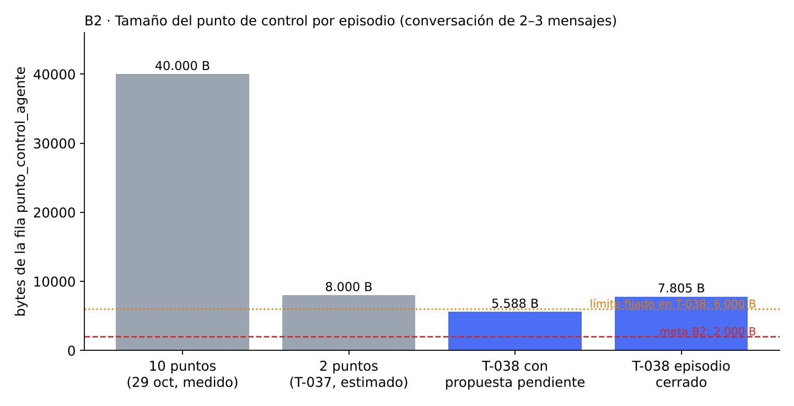
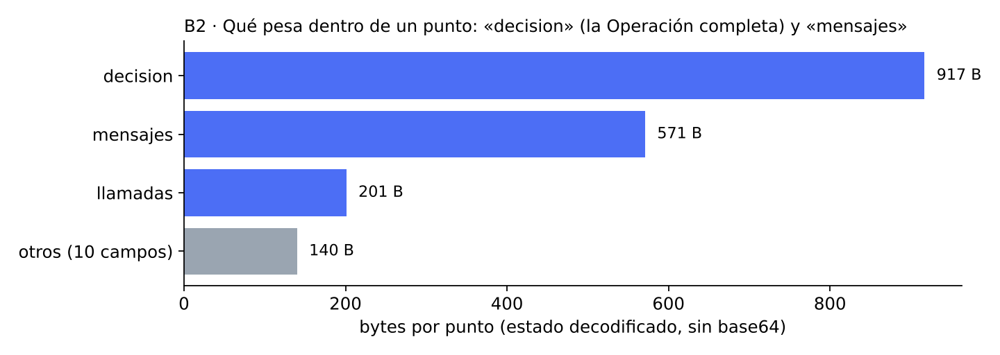
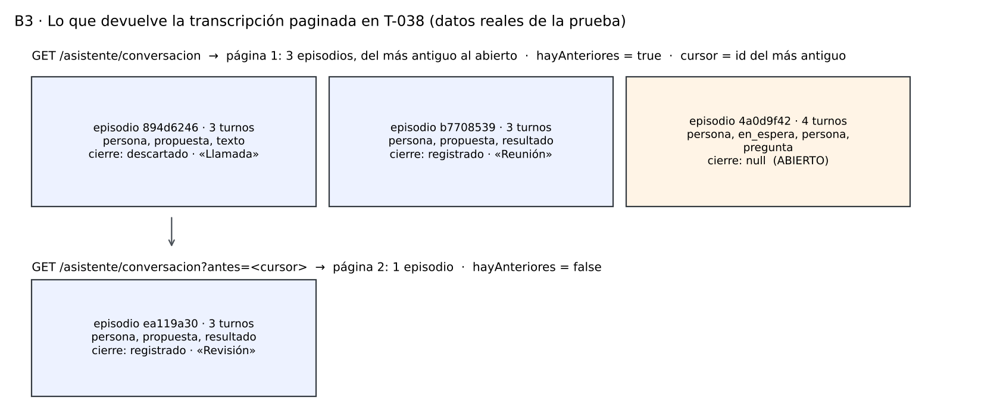
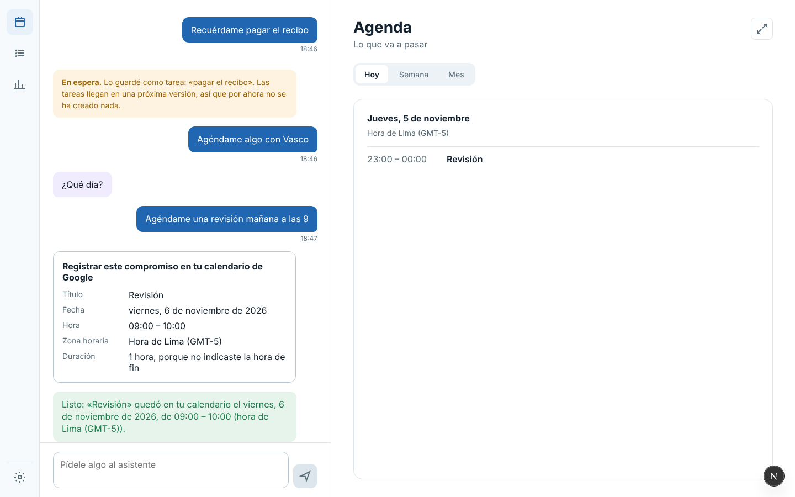
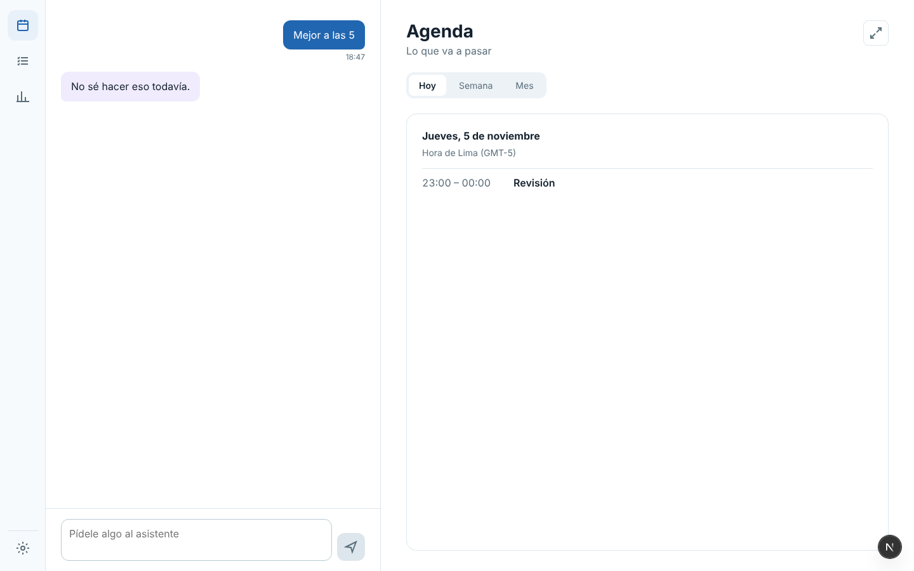

# Pruebas B1–B4 sobre T-038 — transcripción fuera del estado del grafo

**Fecha:** 5 de noviembre de 2026
**Commit probado:** `9217a68` en `modificacion/vision-nexoai` (copia exacta del commit, con `git archive`; nada del árbol de trabajo).
**Entorno:** contenedor aparte, PostgreSQL 16, Redis, API con el modelo simulado y el calendario simulado. Migraciones aplicadas con `psql` desde `prisma/migrations/`, porque el binario de Prisma no se puede descargar desde aquí; el cliente de Prisma se generó con el esquema del commit.
**Qué es:** el resultado del bloque B1–B4 de `PLAN-PRUEBAS-VISUAL-Y-AGENTE.md`, con una comprobación independiente por HTTP además de las pruebas del repositorio. Las imágenes están en `img/`; los datos crudos (respuestas de la API, desglose del punto de control, resultados) en esta misma carpeta.

---

## 1. Veredicto

**T-038 cumple su «Hecho cuando» y se puede avalar**, con una corrección pequeña en una prueba y dos decisiones para el equipo.

| Bloque | Resultado |
|---|---|
| B0 · regresión | **232 de 232** pruebas de la API en verde (24 archivos), igual que lo reportado. Las 5 de `agente/` y la de aislamiento: 89 de 89 |
| B1 · la interrupción sobrevive sin `turnos` | **Pasa.** Proponer → confirmar en otra petición → el resultado sale de la Operación; `episodioCerrado = true` |
| B2 · el punto de control adelgaza | **Pasa a medias.** Ya no contiene `turnos`. Pero mide **7 805 bytes con el episodio cerrado** (5 588 con la propuesta pendiente): la meta de 2 000 no se alcanza y **el límite de 6 000 que fijó T-038 también se supera** al cerrar. La prueba del repositorio mide antes de confirmar, por eso pasa |
| B3 · transcripción y paginación | **Pasa.** 13 de 13 comprobaciones: contrato, orden, cierres, cursor, límites, sin duplicados, todos los turnos visibles |
| B4 · aislamiento | **Pasa.** Otro perfil no ve nada; la tabla guarda organización y perfil en cada turno |

Comprobaciones por HTTP: **21 de 23** en verde; las 2 que fallan son las dos cotas de B2 (`resultados-b1-b4.json`).

---

## 2. B1 · La interrupción sobrevive a la reconstrucción del grafo

Es el cambio más delicado de la rama (riesgo 1 de `INFORME-ESTRUCTURA-Y-REESTRUCTURACION-AGENTE.md` §7): al sacar `turnos` del estado, lo que quedaba por comprobar era que la pausa en `esperar_decision` siguiera viva entre dos peticiones HTTP distintas, que es donde el grafo se reconstruye desde el punto de control.

| Paso | Resultado |
|---|---|
| `POST /asistente/mensajes` «Agéndame una revisión hoy a las 23» | 200; un turno `propuesta`; `pendiente` con el id de la Operación |
| `POST /asistente/decisiones` confirmar (petición nueva, grafo reconstruido) | 200; un turno `resultado` que empieza por «Listo:»; `episodioCerrado = true` |
| Descartar en otro episodio | `episodioCerrado = true`, cierre `descartado` |

La prueba del repositorio `agente.interrumpe-hasta-decidir` cubre lo mismo con el calendario simulado contando escrituras: ninguna antes de confirmar.

---

## 3. B2 · El punto de control adelgaza, pero no hasta la meta

| Estado del episodio | Bytes en `punto_control_agente.datos` | Puntos |
|---|---|---|
| Con la propuesta pendiente (lo que mide la prueba de T-038) | **5 588** | 2 |
| Cerrado tras confirmar (lo que queda guardado 7 días) | **7 805** | 2 |
| Antes de T-038, 2 puntos (estimado por Claude Code) | ~8 000 | 2 |
| El 29 de octubre, 10 puntos (medido) | 36 000 – 46 000 | 10 |

**Por qué no baja de 2 KB.** El estado real decodificado son 4 958 bytes para 2 puntos (~2,5 KB por punto), y la fila lo guarda en **base64 dentro de JSON**, que añade un tercio. Dentro de cada punto, lo que pesa no son los mensajes:

- `decision` (917 B): la **Operación completa** con su `vistaConfirmacion`, que el nodo `comunicar` recibe al reanudar y queda persistida en el punto final.
- `mensajes` (571 B): los mensajes del episodio para el modelo. Esto es lo que debe estar ahí.
- `llamadas` (201 B) y 10 campos pequeños (~140 B).

**Qué significa.** `turnos` salió del estado (comprobado: ninguna copia contiene `"turnos"`), que era el objetivo del cambio. La meta de 2 000 bytes del plan de pruebas fue una estimación mía sin contar el base64 ni los metadatos de LangGraph, y no es alcanzable con dos puntos completos. Dos opciones, para el equipo:

| Opción | Efecto | Costo |
|---|---|---|
| **a. Revisar la meta** a «menos de 10 KB con el episodio cerrado» y medir **después de confirmar**, no antes | Honesto con lo que hay; la prueba de T-038 pasa a medir el estado que de verdad se conserva | Cambiar una aserción |
| **b. Guardar en el estado solo el id de la Operación**, no la Operación entera, y que `comunicar` la relea | ~1 KB menos por punto (unos 2,5 KB menos por fila) | Un cambio en `grafo-asistente.ts` y en `asistente.service.ts`; conviene hacerlo en T-041, que ya toca la retención |

Lo que **hay que corregir ya** en T-038: la aserción `< 6 000` mide con la propuesta pendiente y pasa; con el episodio cerrado da 7 805 y fallaría. O se mide tras confirmar con una cota realista (opción a), o el límite queda vacío de sentido.

---

## 4. B3 · Transcripción y paginación

Se crearon cuatro episodios con el simulado (registrar y confirmar; proponer y descartar; registrar y confirmar; una tarea en espera seguida de una pregunta) y se pidió la conversación por páginas.

| # | Comprobación | Resultado |
|---|---|---|
| B3.c | Forma del contrato `{ episodios, episodioAbierto, pendiente, hayAnteriores, cursor }` | Pasa |
| B3.d | Cada episodio trae `turnos[]` y `cierre` | Pasa |
| B3.e | El abierto va último, con `cierre = null` y su id en `episodioAbierto` | Pasa |
| B3.f | Los cerrados llevan `desenlace` y `titulo` | `descartado · Llamada`, `registrado · Reunión`, `registrado · Revisión` |
| B3.g | Turnos en orden cronológico dentro de cada episodio | Pasa |
| B3.h | Página por defecto: 3 episodios, `hayAnteriores = true`, `cursor` | Pasa |
| B3.i | `antes=<cursor>` trae episodios más antiguos, sin repetir | Pasa: 1 episodio, `hayAnteriores = false` |
| B3.k / B3.l | `limite=1` respeta; `limite=0` y `limite=21` dan 400 | Pasa |
| B3.m | Todos los turnos guardados son visibles por páginas | 13 en la tabla, 13 en las páginas |
| B3.b | Una pregunta por dato que falta **no** cierra el episodio | Pasa (correcto: el episodio sigue hasta que haya acción) |

Un reintento con el mismo id de turno no duplica (prueba del repositorio «un reintento no duplica turnos», en verde).

**Decisión para el equipo (B3.n).** Una **tarea guardada en espera** no cierra el episodio: «Recuérdame pagar el recibo» y «Agéndame algo con Vasco» quedaron en el **mismo** episodio. Es coherente con la definición de episodio (una intención con su acción, y guardar una tarea no es una acción confirmada), pero en pantalla significará que no habrá separador entre una tarea guardada y lo siguiente. Opciones: dejarlo así (el episodio se cerrará por inactividad con T-041) o cerrar con `desenlace = en_espera` y mostrar «Tarea guardada» como separador. Afecta al diseño del separador en T-039.

---

## 5. B4 · Aislamiento

| Comprobación | Resultado |
|---|---|
| `asistenteEspera` (otra cuenta de la misma base de prueba) pide la conversación | 0 episodios; ninguno de los ids de `asistente` |
| La tabla `turno_asistente` guarda `organizacion_id` y `perfil_id` en cada fila | Sí |
| Prueba del repositorio `plataforma.aislamiento-entre-organizaciones`, ampliada con la tabla nueva | En verde |
| Prueba del repositorio «otra persona, de la misma organización o de otra, no ve la transcripción» | En verde |

La cuenta `armazon` no se pudo usar por HTTP porque tiene el primer ingreso pendiente; la prueba del repositorio cubre ese caso.

---

## 6. Lo que se ve en pantalla con T-038 (sin T-039)

Como se esperaba, **nada cambia todavía para la persona**: el vaciado sigue, porque la web y el móvil no se tocan hasta T-039. Queda como referencia intermedia.

| Tras confirmar | Siguiente mensaje | Tras recargar |
|---|---|---|
|  |  |  |

Un detalle útil: tras recargar ya se ve el episodio abierto («Mejor a las 5» y su respuesta) porque `GET /asistente/conversacion` lo devuelve; antes de T-038, tras un cierre, la pantalla volvía al blanco inicial (W13). Es el primer efecto visible de la transcripción persistente, aunque el historial completo llegue con T-039.

---

## 7. Lo que le toca a Claude Code antes de T-039

1. **B2:** medir el punto de control **después de confirmar** y poner una cota realista (opción a), o anotar la opción b para T-041. Hoy la aserción `< 6 000` solo se cumple antes de confirmar.
2. **Decidir con el equipo B3.n** (tarea en espera y cierre del episodio), porque T-039 pinta el separador a partir del `cierre`.
3. Nada más bloquea T-039.

---

## 8. Archivos de esta carpeta

| Archivo | Qué es |
|---|---|
| `resultados-b1-b4.json` | Las 23 comprobaciones con su detalle |
| `conversacion-pagina1.json`, `conversacion-pagina2.json` | Respuestas reales de la API paginada |
| `desglose-punto-control.json` | Bytes por campo de un punto de control |
| `img/` | Las tres gráficas y las tres capturas de §6 |
| `herramientas/probar-b1-b4.mjs`, `capturar-t038.mjs`, `arrancar-api-t038.mjs` | Los scripts, para repetirlo sobre el siguiente commit |
