# Pulido de interfaz — 6 de noviembre de 2026

**Qué es:** los hallazgos de pantalla de `AVANCE-NEXOAI-2026-11-06.md` §8 (puntos 3, 4, 5 y 7) y la tarjeta en conflicto más corta.
**Entorno:** API con el modelo y el calendario simulados; web (Next.js) a 1440×900; móvil (Expo web) a 390×844. Capturas tomadas el 6 de noviembre de 2026 (viernes) con la cuenta de pruebas `semanaLlena` (seis compromisos cada día de la semana) y, para la franja, `asistenteEspera`.
**Capturas:** `web/` y `movil/`, con sufijo `-antes` (commit base `4a2b3f7`) y `-despues`.

## Resumen

| # | Cambio | Plataforma | Prueba que lo cubre |
|---|---|---|---|
| 1 | La franja «en espera» solo en el nivel Hoy | Móvil (la web ya lo hacía) | `movil.en-espera-visible` (ampliada) |
| 2 | La opacidad al cargar sale de un token, `--estado-cargando-opacidad` | Web | Sin cambio visible; comprobado a mano: el lienzo ocupado sigue en 0,6 |
| 3 | Semana abre con el día de hoy a la vista | Web y móvil | `web.agenda-semana-y-mes`, `movil.agenda-semana-y-mes` (ampliadas) |
| 4 | El choque de horario, en una línea: «Se cruza con «título»» | Web y móvil | `web.asistente-agenda-y-confirma`, `movil.captura-propone-y-confirma` (ampliadas) |
| 5 | La prueba «volver desde otro sitio» lee el puerto de `baseURL` | Pruebas web | `acceso.recorrido-web`: fallaba con otro puerto; ahora pasa |

## 1. Franja «en espera» solo en Hoy (móvil)

REQ-CAP-25 la pone «sobre la agenda de hoy»; la decisión 26 de `specs/02-agenda/spec.md` ya lo decía. Antes se veía también en Semana y Mes.

| Antes | Después |
|---|---|
| 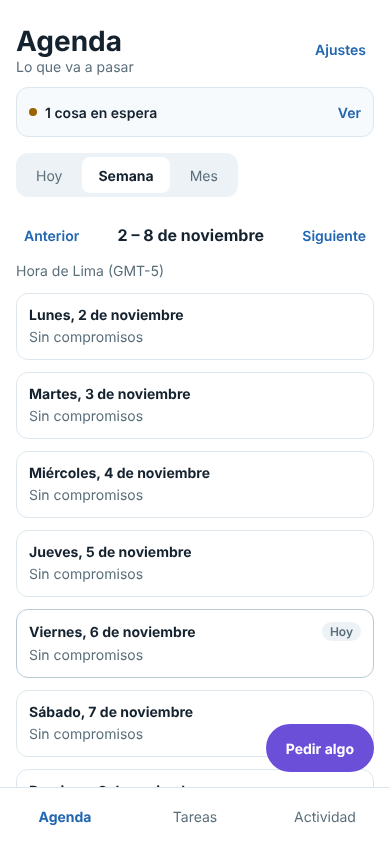 | 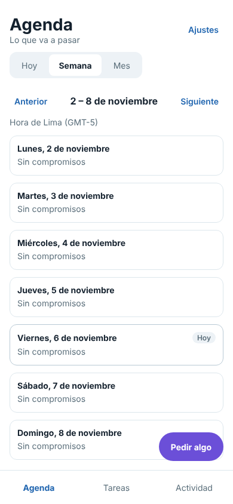 |
| 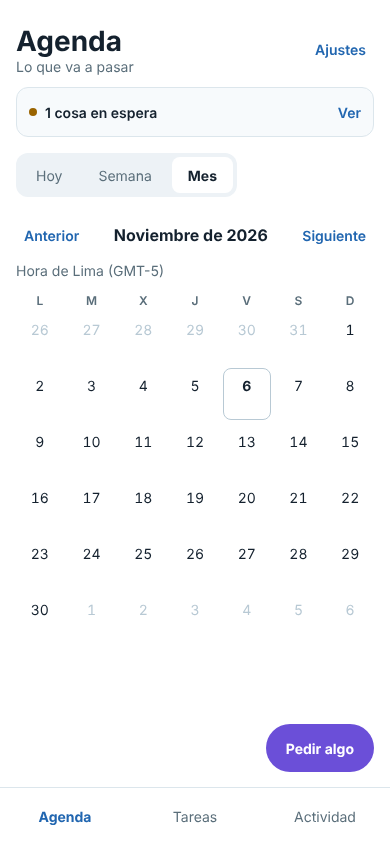 | 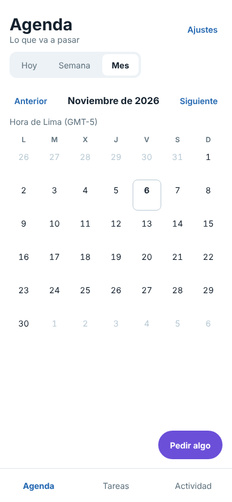 |

En Hoy sigue igual: 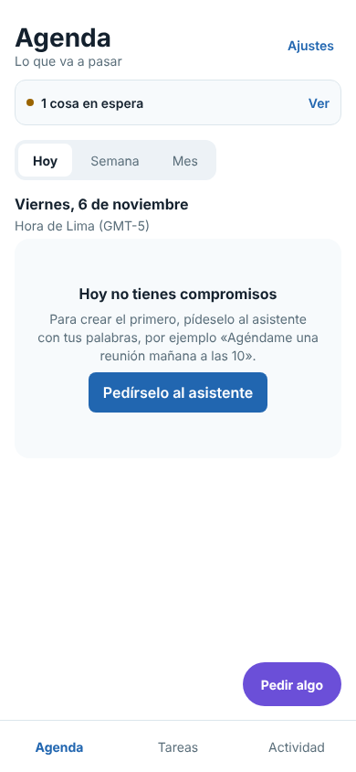

La web ya la mostraba solo en Hoy: 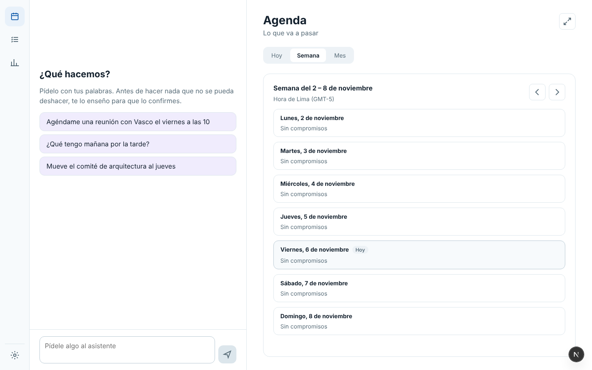

## 2. Opacidad al cargar (web)

`globales.css` atenuaba el lienzo a 0,6 con el número escrito a mano. Ahora usa `--estado-cargando-opacidad: 0.6`, junto a los tokens de estado. El valor no cambia, así que no hay captura. El móvil no atenúa al cargar (escribe «Leyendo tu agenda…»), por eso `tokens.ts` no lleva equivalente.

## 3. Semana con hoy a la vista

Al entrar en Semana, si el día de hoy no se ve entero, la lista se coloca sin animar con hoy arriba. Si ya se ve, no se mueve. Pasa una vez por semana mostrada; después manda la persona.

| | Antes | Después |
|---|---|---|
| Web | 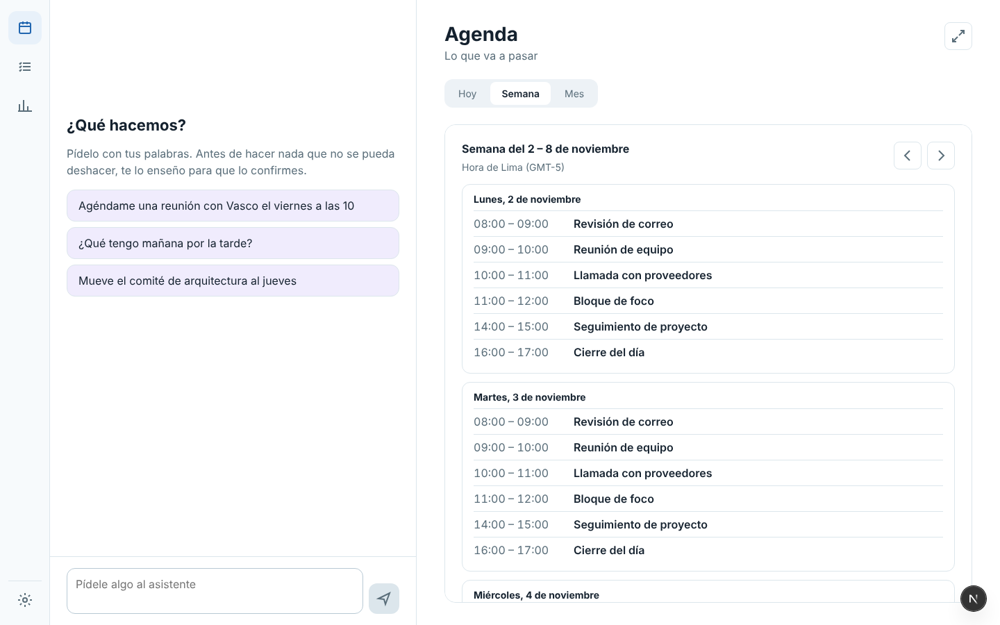 | 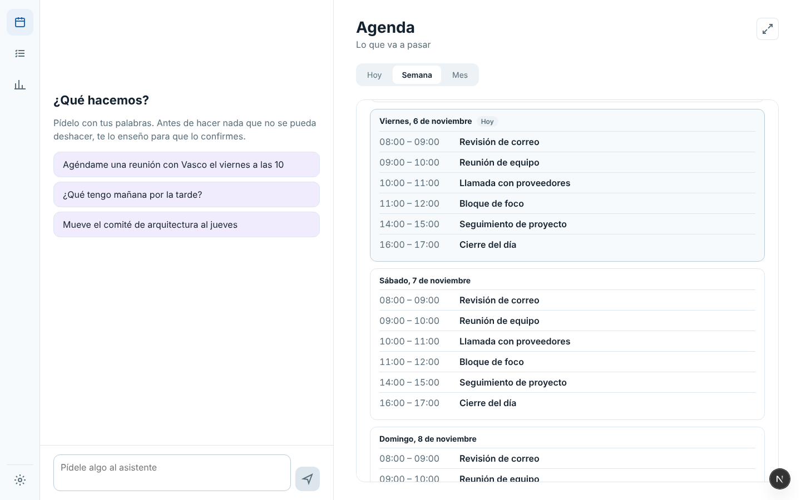 |
| Móvil | 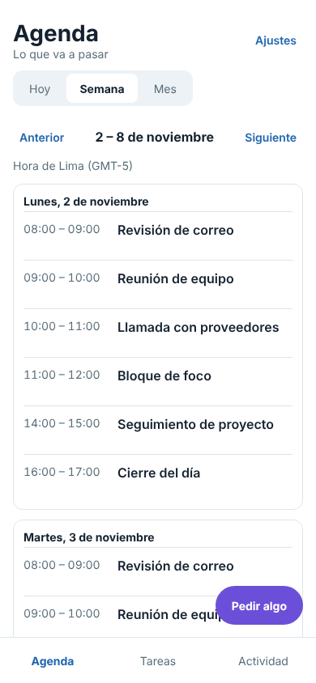 | 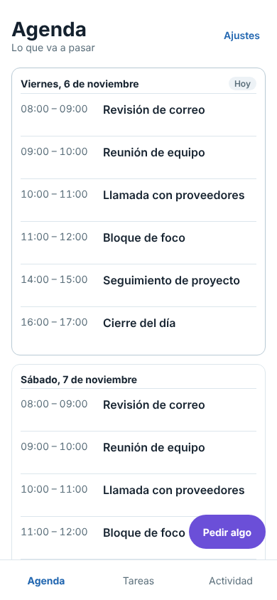 |

En el móvil, con hoy arriba, el selector Hoy/Semana/Mes queda fuera de la vista hasta que se sube.

## 4. Tarjeta en conflicto más corta

Antes: «Se superpone con «Llamada con proveedores», de 10:00 – 11:00. Elige una de las alternativas u otro horario.», en dos líneas (web) o tres (móvil). Después: «Se cruza con «Llamada con proveedores»», una línea. En la web el texto largo queda al pasar el puntero. Es la decisión 27 de `specs/02-agenda/spec.md`.

| | Antes | Después |
|---|---|---|
| Web | 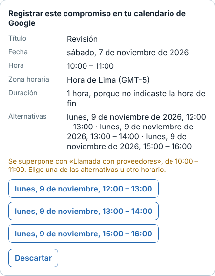 | 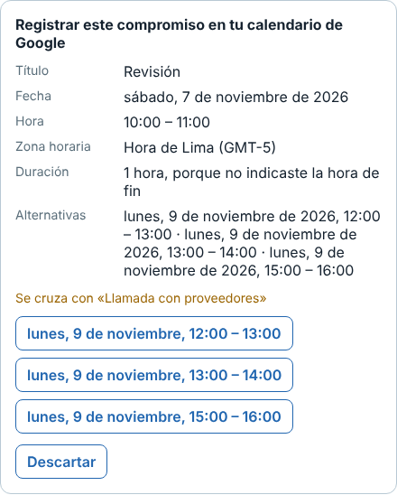 |
| Móvil | 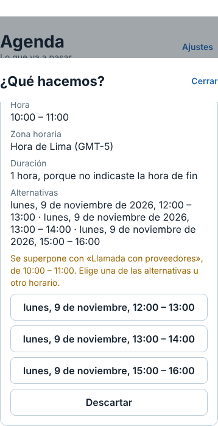 | 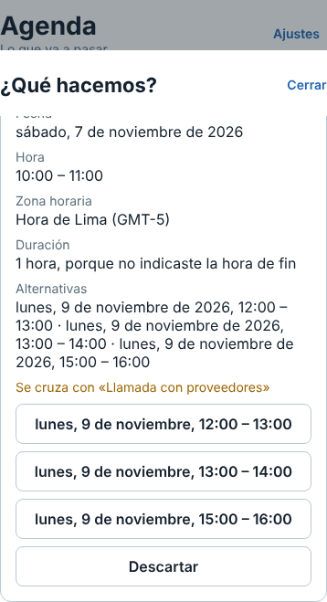 |

Pantalla completa: `web/web-conflicto-*.png`, `movil/movil-conflicto-*.png`.

**Sigue larga por otra razón:** el dato «Alternativas» repite en texto los mismos horarios que los botones de debajo. Lo arma el servidor en `datos`; no se tocó.

## 5. Puerto escrito a mano

`apps/web/e2e/acceso.spec.ts` tenía `localhost:3101` en el enlace de vuelta. Con la web en otro puerto, la prueba fallaba (`chrome-error://chromewebdata/`). Ahora la dirección sale de `baseURL`.

## Resultado de las pruebas

| Suite | Resultado |
|---|---|
| Web, extremo a extremo (puertos 3302/3301, base `nexoai_e2e_ui_prueba`) | 24 de 24 |
| Móvil, extremo a extremo (puertos 3203/3303, base `nexoai_e2e_uimovil_prueba`) | 13 de 13 |
| `tsc --noEmit` en `apps/web` y `apps/movil` | Sin errores |
