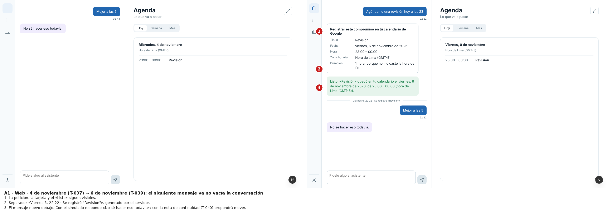
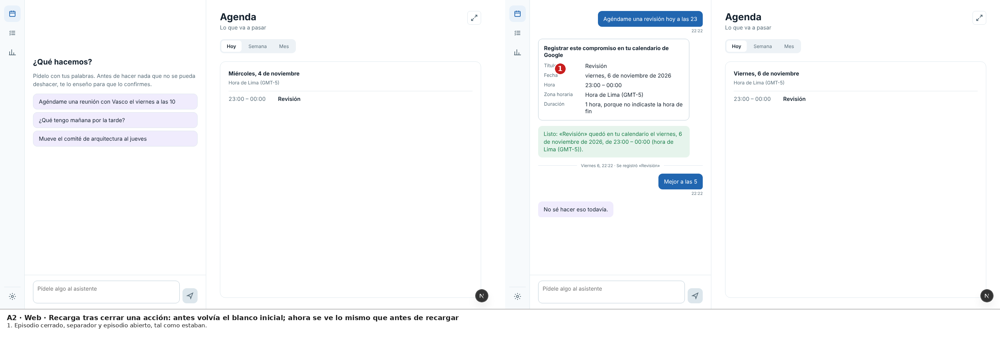
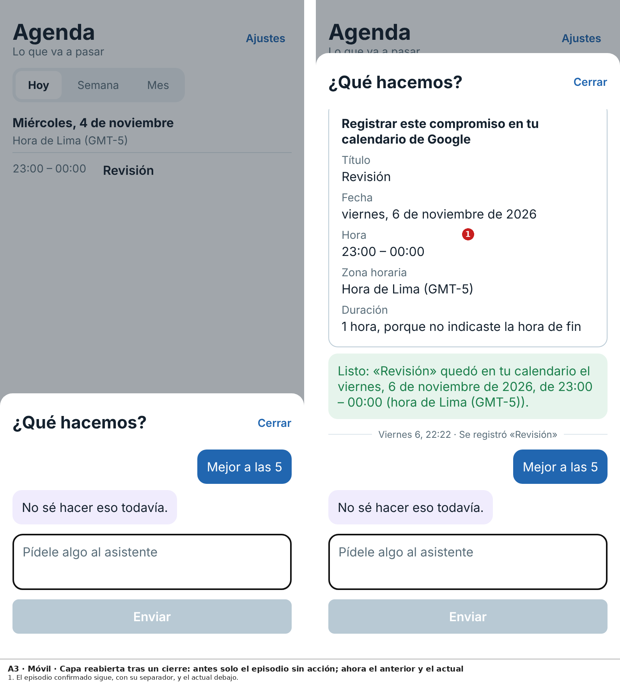
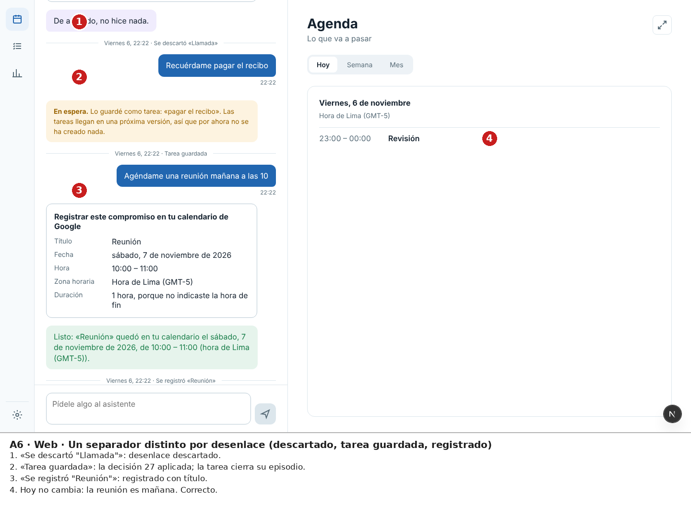
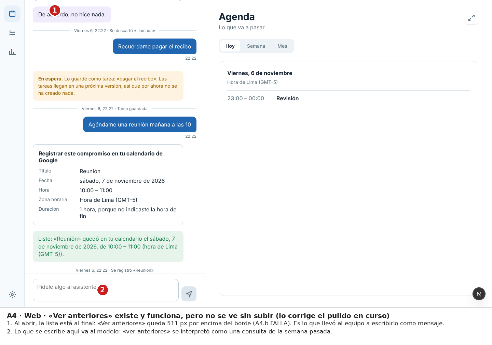
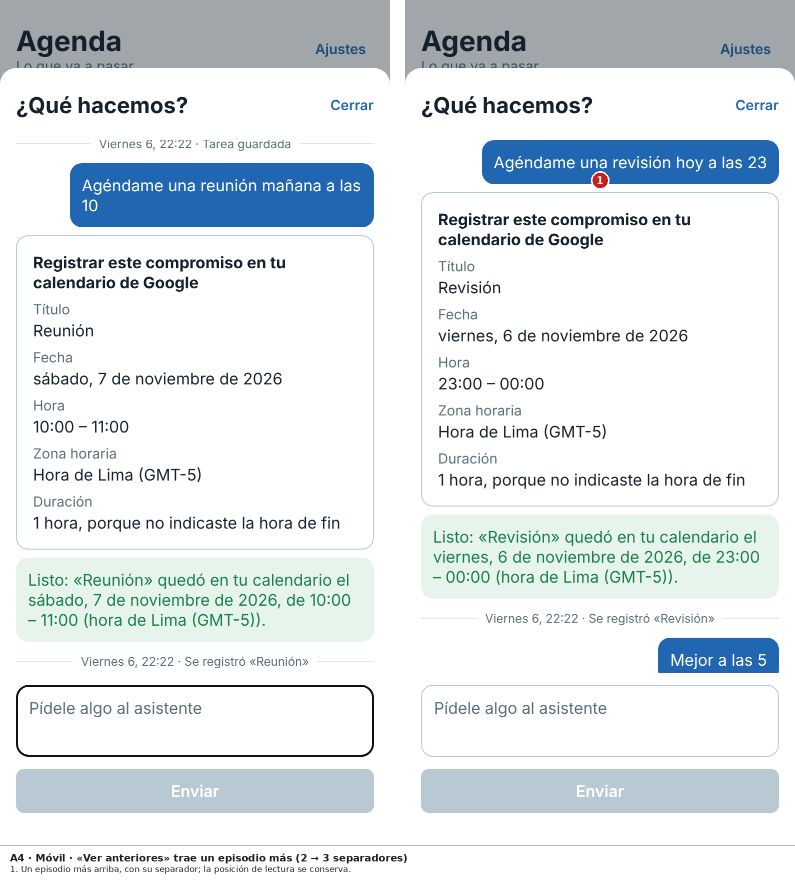

# Pruebas visuales A1–A6 sobre T-039 — la conversación ya no se vacía

**Fecha:** 6 de noviembre de 2026
**Commit probado:** `36a9551` en `modificacion/vision-nexoai` (copia exacta del commit).
**Entorno:** contenedor aparte; API con el modelo y el calendario simulados; web (Next.js) a 1440×900; móvil (Expo web) a 390×844 ×2. Mismos scripts que la línea base del 4 de noviembre, ampliados (`herramientas/capturar-a1-a6.mjs`).
**Qué es:** el bloque A1–A6 de `PLAN-PRUEBAS-VISUAL-Y-AGENTE.md`. Las comparaciones antes/después están en `anotadas/`; las capturas sin anotar en `web/` y `movil/`; las 20 comprobaciones en `resultados-a1-a6.json`.

---

## 1. Veredicto

**T-039 cumple lo que prometía: 19 de 20 comprobaciones en verde.** La que falla es la que el equipo sufrió en vivo: «Ver anteriores» existe y funciona, pero al abrir la conversación queda **511 px por encima del borde visible**, porque la lista se coloca al final. Por eso se escribió «ver anteriores» como mensaje y Groq lo entendió como una consulta. Ya está en corrección (pulido del carril B).

| Prueba | Web | Móvil |
|---|---|---|
| A1 · Confirmar y escribir otra cosa: nada desaparece; separador | Pasa | Pasa |
| A2 · Recargar: se ve lo mismo | Pasa | — |
| A3 · Cerrar y reabrir la capa: episodio anterior y actual | — | Pasa |
| A4 · «Ver anteriores» existe, trae un episodio más, desaparece al no haber más | Pasa | Pasa |
| A4.b · «Ver anteriores» a la vista sin subir | **Falla** (y = −511) | No medido: en la capa pasa lo mismo |
| A5 · Blanco inicial solo para quien no tiene historial | Pasa | — |
| A6 · Separador por desenlace: registrado, descartado, **tarea guardada** | Pasa | Pasa |
| R-40 · Sin «episodio», «turno», «transcripción» en pantalla | Pasa | Pasa |

## 2. Antes y después

## 3. Los separadores

Textos reales generados por el servidor: «Viernes 6, 22:22 · Se registró "Revisión"», «Se descartó "Llamada"», «Tarea guardada», «Se registró "Reunión"». La decisión 27 (tarea en espera cierra el episodio) está aplicada; el separador «Tarea guardada» no dice «registrado», que era la condición.

## 4. «Ver anteriores»

Funciona: en la web pasa de 3 a 4 separadores y el botón desaparece al no quedar más; en el móvil, de 2 a 3. El problema es solo de visibilidad al abrir.

## 5. Lo que sigue

1. **Pulido «Ver anteriores» visible** (en curso en el carril B, web y móvil).
2. **T-040**: con la nota de continuidad, «Mejor a las 5» dejará de responder «No sé hacer eso todavía» y propondrá mover «Revisión». Es el siguiente cambio que la persona va a notar en esta misma pantalla.
3. Repetir A1–A6 sobre el commit del pulido y añadir A7–A11 cuando entren la tarjeta en conflicto, Semana y Mes, y la franja «en espera».
