# Sección Actividad — informe de capturas

**Fecha:** 7 de noviembre de 2026. **Carril:** actividad. **Base:** `base-tanda3`.
**Marcos:** web 1440 × 900 (Next.js en desarrollo, Chromium) y móvil 390 × 844 (Expo web, Chromium).
**Requisitos:** REQ-CUN02-25 a 35, `specs/02-jornada/spec.md` §8 bis. **Decisiones:** H-JOR-01 a 13, mismo archivo, §11.
**Datos:** la semilla de `apps/web/e2e/arrancar-api.mjs` (cuentas `actividad`, `actividadVacia` y `actividadSinCalendario`). La zona del perfil es una en la que era de día al arrancar; en estas capturas, Tokio (GMT+9). Las horas de los compromisos son relativas al momento de la siembra, por eso no caen en punto.

## Antes

| Web | Móvil |
|---|---|
| 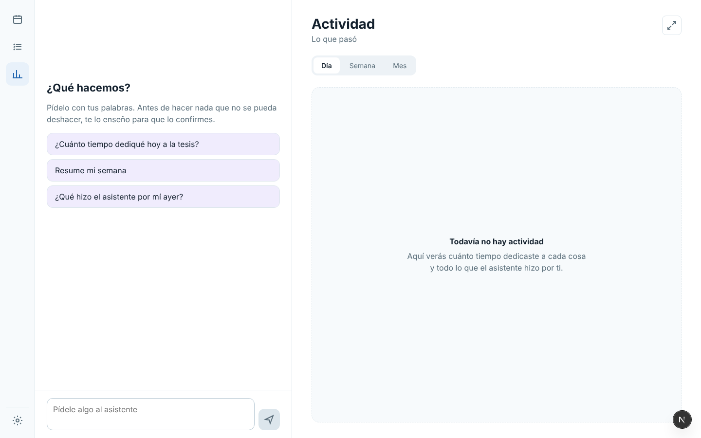 | 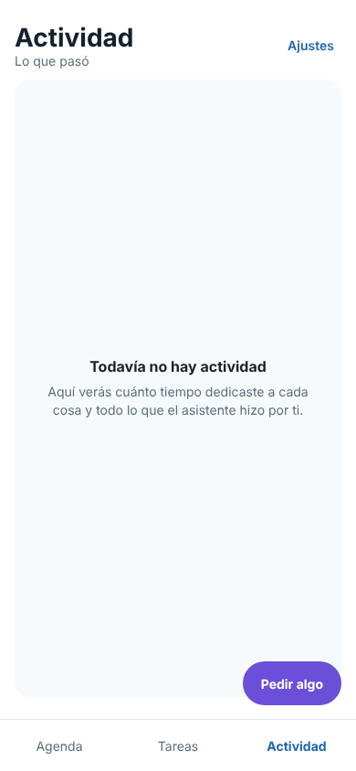 |

La sección existía en la navegación con un vacío fijo, «Todavía no hay actividad», en los tres niveles.

## Día (hoy)

| Web | Móvil |
|---|---|
| 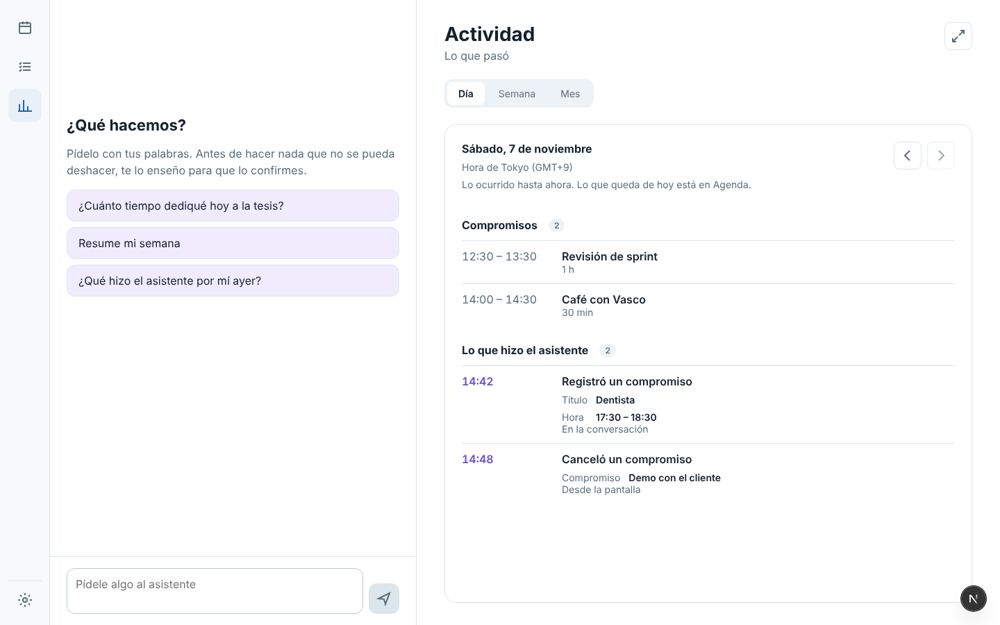 | 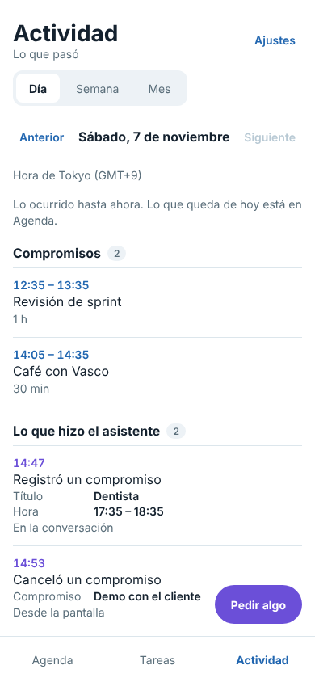 |

- Rótulo «Lo ocurrido hasta ahora. Lo que queda de hoy está en Agenda.» (REQ-CUN02-28).
- **Compromisos (2):** solo los terminados, con horario y duración. No salen el cancelado («Demo con el cliente»), el que está en curso ni el que viene (REQ-CUN02-26).
- **Lo que hizo el asistente (2):** hora de ejecución en el tinte del asistente, la frase en pasado, los datos de la tarjeta que se confirmó y desde dónde: «En la conversación» o «Desde la pantalla». La propuesta descartada no sale (REQ-CUN02-27).
- «Siguiente» apagado: lo que viene está en Agenda (H-JOR-08). Ningún botón de acción (REQ-CUN02-31).

## Semana

| Web | Móvil |
|---|---|
| 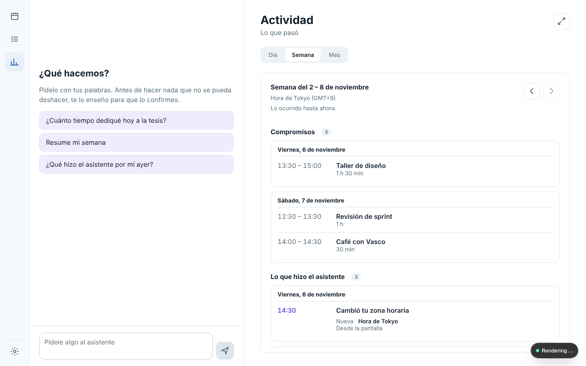 | 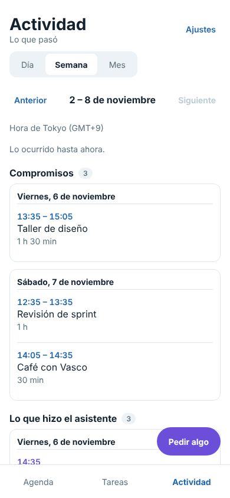 |

Un recuadro por día con algo, sin días vacíos; la cantidad de cada bloque en su cabecera (REQ-CUN02-33, H-JOR-09). Ayer, viernes 6, con el taller y el cambio de zona.

## Mes

| Web | Móvil |
|---|---|
|  | 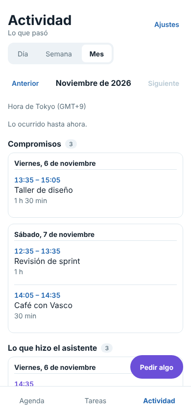 |

La misma lista por días que Semana. No es la rejilla de Agenda: Actividad contesta «cuánto», y en esta versión el «cuánto» es la cantidad, sin barras ni horas sumadas (R-21).

## Vacío

| Web | Móvil |
|---|---|
| 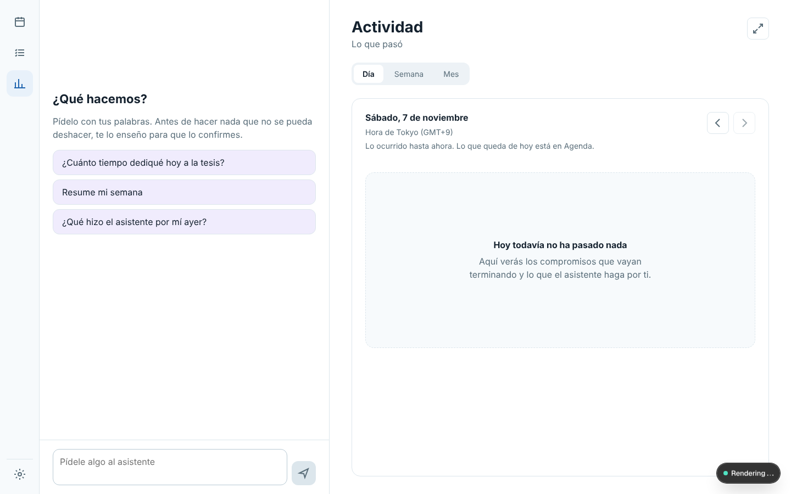 | 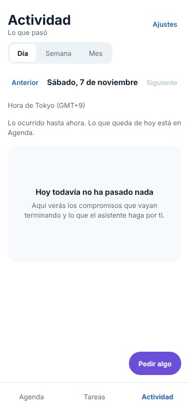 |

«Hoy todavía no ha pasado nada»; en Semana y Mes, «Esta semana…» y «Este mes…»; en un período anterior, «Ese mes no pasó nada» (REQ-CUN02-30). No ofrece crear nada.

## Sin calendario conectado

| Web | Móvil |
|---|---|
| 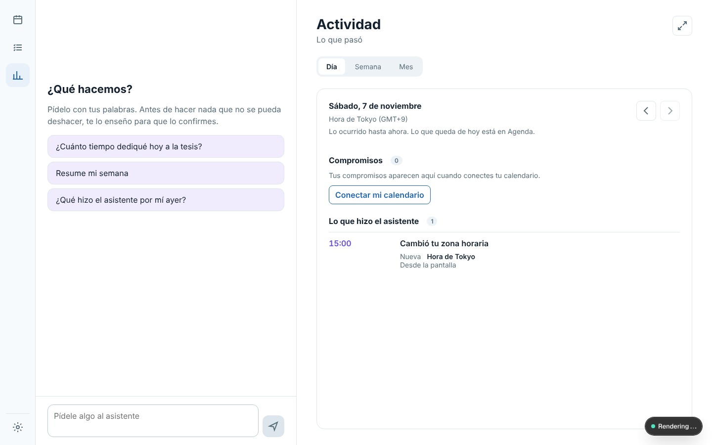 | 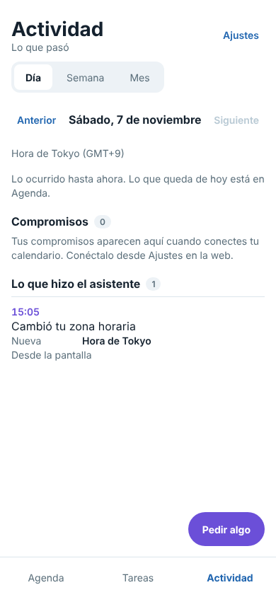 |

El registro del asistente se ve igual; en el lugar de los compromisos, «Tus compromisos aparecen aquí cuando conectes tu calendario» (REQ-CUN02-29). En la web, «Conectar mi calendario» abre Ajustes; en el móvil remite a Ajustes en la web, como Agenda.

## Pruebas

| Prueba | Archivo | Resultado |
|---|---|---|
| `web.actividad` | `apps/web/e2e/actividad.spec.ts` | 4/4; la web entera 28/28 |
| `movil.actividad` | `apps/movil/e2e/actividad.spec.ts` | 4/4; el móvil entero 18/18 |

Las capturas las guardan esas mismas pruebas con `CAPTURAS_ACTIVIDAD=<carpeta>`. Las de «antes» se tomaron con `aplicacion.tsx` de `base-tanda3` (web y móvil), sin commitear el cambio.

## Lo que no se ve aquí

- Tareas completadas (REQ-CUN02-32): hueco reservado, T-084.
- El indicador de desarrollo de Next.js abajo a la derecha de la web no es parte de la pantalla.
- El rótulo de la zona dice «Hora de Tokyo»: sale del nombre de la zona, igual que en Agenda.
