# Conversación del móvil — informe de capturas

**Fecha:** 7 de noviembre de 2026. **Carril:** movil-chat. **Base:** `base-tanda2`.
**Marco:** 390 × 844, Expo web, Chromium, zona America/Lima. Mismas cuentas y frases antes y después, con la base de pruebas recién sembrada.
**Decisiones:** H-CAP-01 a H-CAP-04 en `specs/01-captura/spec.md` §12. H-CAP-01 se revisó el mismo día con la auditoría MC-17 y MC-18 del carril de diseño.

## Medidas

| Medida | Antes | Después |
|---|---|---|
| Tarjeta de un compromiso, sin cruce | 418 px (50 % del alto) | 282 px (33 %) |
| La misma, con «Ver detalles» abierto | — | 494 px (59 %) |
| Tarjeta ya confirmada | 418 px, con sus datos desplegados | 203 px (24 %), plegada y sin botones |
| Tarjeta con cruce y **3** alternativas | 658 px (78 %) | 414 px (49 %) |
| Tarjeta con cruce y **1** alternativa | — | 310 px (37 %), calculada: 414 − 2 × (44 + 8) |
| Barra de escritura vacía | 128 px, en dos filas | 50 px, una fila |
| Barra con cinco líneas escritas | 128 px (el campo se desplaza) | 122 px: crece hasta cuatro líneas y se desplaza |

El tope del 40 % con una alternativa se cumple (37 %). No se midió con una alternativa real: la cuenta sembrada con cruce siempre recibe tres. Con tres alternativas la tarjeta llega al 49 %; no se recortó ningún dato para bajarla.

## 1. Tarjeta de confirmación compacta (H-CAP-01)

| Antes | Después |
|---|---|
| 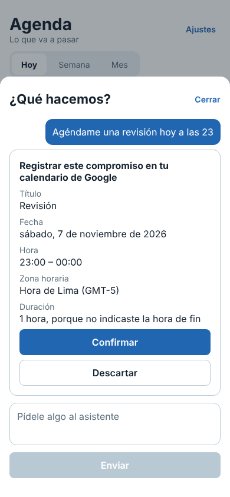 | 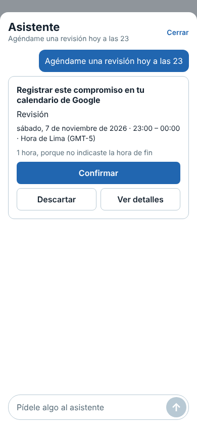 |
| 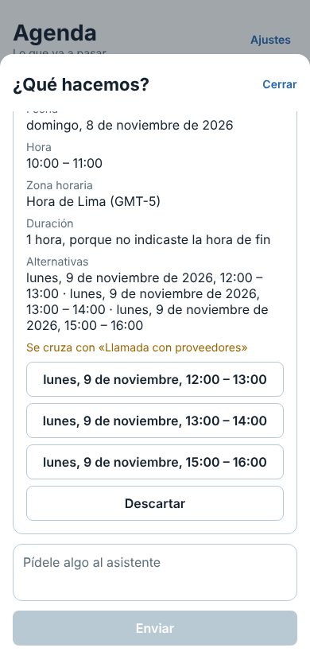 | 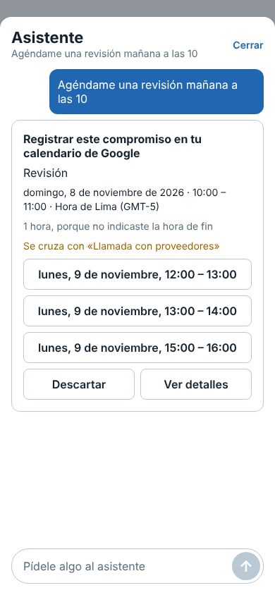 |

| Ver detalles | Ya confirmada |
|---|---|
| 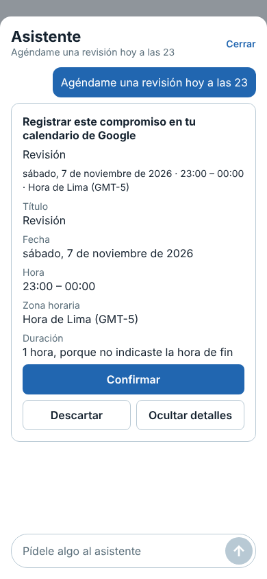 | 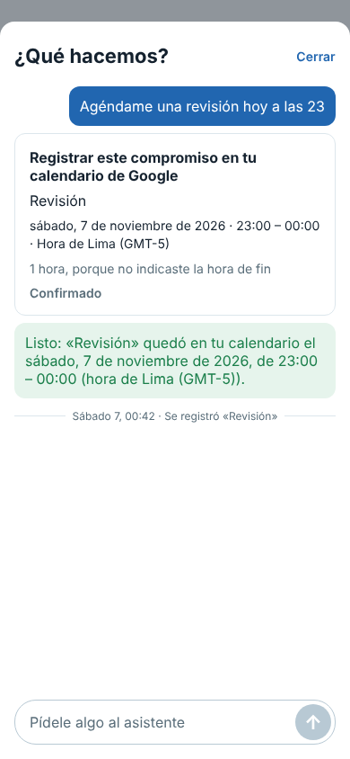 |

- Plegada por defecto: la acción; el compromiso, si la acción no lo nombra; cuándo, con la zona horaria (P-05), con los datos tal como llegan; y, enteros, los datos que el sistema puso por su cuenta («1 hora, porque no indicaste la hora de fin», decisión 19 de `02-agenda`).
- «Confirmar» a ancho completo; debajo, en una fila, «Descartar» y «Ver detalles». «Ver detalles» despliega los pares etiqueta y valor en la misma tarjeta y pasa a «Ocultar detalles».
- Con botones de alternativa, el dato «Alternativas» ya no se repite en texto.
- Al llegar una propuesta, la lista se desplaza hasta que la tarjeta entera, con sus botones, queda a la vista; si no cabe, se alinea su parte de arriba.
- Ya decidida: plegada, sin botones, con el borde base y una línea con lo que se decidió («Confirmado», «Descartado», «Cambiado por otro horario» o «No se pudo hacer»), leída de lo que vino después en la conversación.

**Pruebas:** `movil.captura-propone-y-confirma`, en `apps/movil/e2e/captura.spec.ts` (las dos primeras).

## 2. Barra de escritura de una fila (H-CAP-02)

| Antes | Después |
|---|---|
| 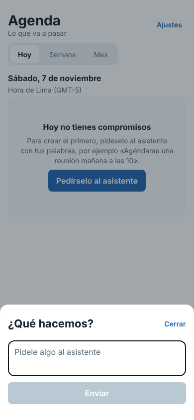 | 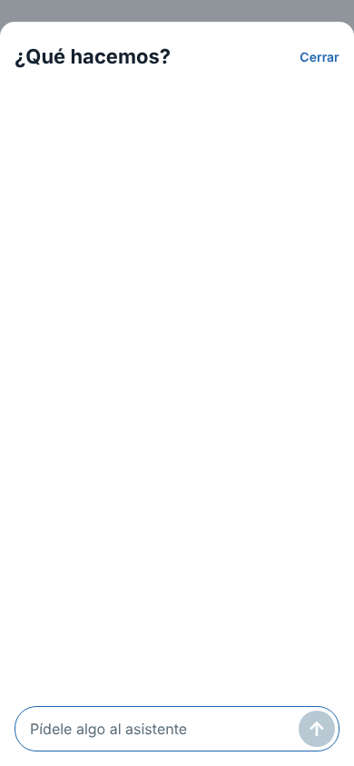 |
| 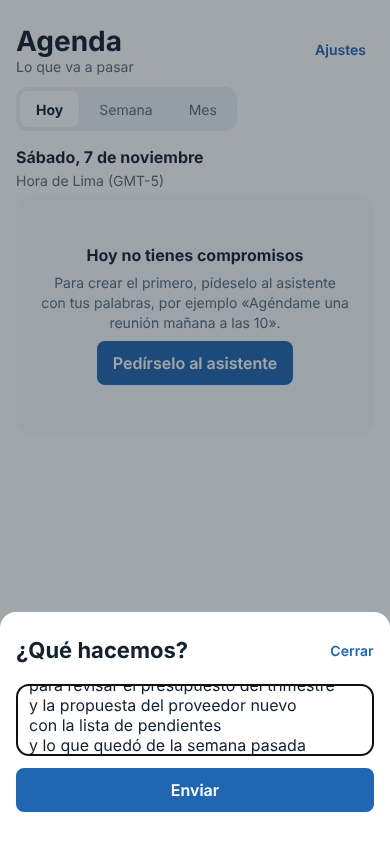 | 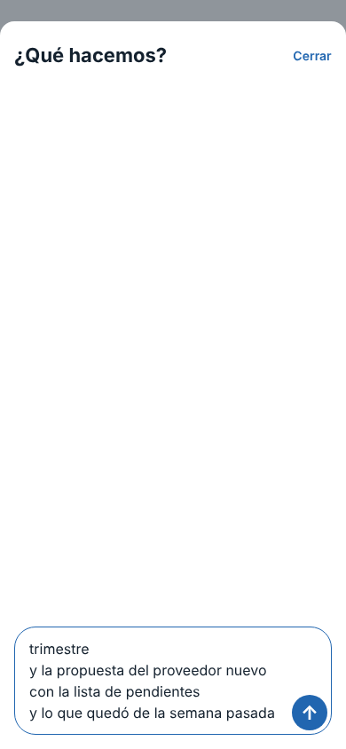 |

- Campo y botón de enviar dentro del mismo contorno; el botón conserva el nombre accesible «Enviar» y, con el campo vacío, se atenúa sin cambiar el alto.
- El campo empieza en una línea y crece hasta cuatro. Fija abajo; sube con el teclado en el teléfono. Al enviar, la lista baja hasta el final.
- Expo web no tiene teclado en pantalla: la captura muestra el campo enfocado y lleno. El comportamiento con teclado no se pudo comprobar aquí.

**Prueba:** «la barra de escritura es una sola fila con el botón de enviar dentro», en `captura.spec.ts`.

## 3. La capa y su cabecera (H-CAP-03, H-CAP-04)

| Antes | Después |
|---|---|
| 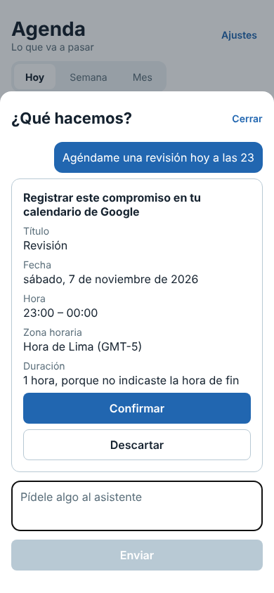 |  |

- La capa arranca donde empieza la cabecera de la sección y la tapa: ya no se leen «Agenda · Lo que va a pasar» ni «Ajustes» detrás. El velo usa el token `color.velo.capa` (0,48, provisional).
- Cabecera en una fila: «¿Qué hacemos?» si no hay nada dicho en lo que se pide ahora; si lo hay, «Asistente» y debajo la primera petición, en una línea.
- «Ver anteriores», los separadores y el no vaciado (T-039) no cambian.

**Prueba:** `agenda.estado-vacio-abre-captura`, en `apps/movil/e2e/agenda.spec.ts`.

## 4. El asa (H-CAP-04)

| Antes | Después |
|---|---|
| 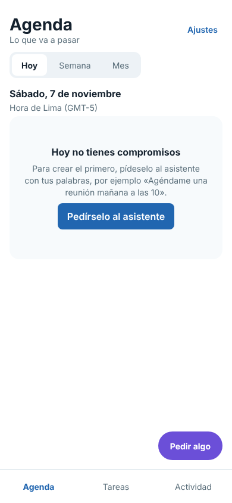 |  |

- Con una propuesta esperando decisión, el asa lleva un punto (`estado.advertencia`) y su nombre accesible añade «hay algo esperando tu decisión».
- Se sabe por lo que la capa ya leyó, sin otra llamada a la API. **Límite:** al abrir la aplicación, hasta que la capa se abre por primera vez, el asa no lo señala. Saberlo desde el arranque exige pedir la conversación al entrar.

**Prueba:** `agenda.estado-vacio-abre-captura`.

## Contradicciones con el diseño, para el equipo

| Documento | Regla | Qué hace ahora el móvil |
|---|---|---|
| `design/ARQUITECTURA-VISUAL-MOVIL.md` §3, Botones | Siempre a ancho completo y apilados | «Descartar» y «Ver detalles» van en una fila |
| `design/ARQUITECTURA-VISUAL-MOVIL.md` §3, Datos estructurados | Nunca en una línea corrida con puntos | Cuándo y zona van en una línea; los pares, bajo «Ver detalles» |
| `design/ARQUITECTURA-VISUAL-MOVIL.md` §2 | Velo de opacidad 0,16 | 0,48, y la capa tapa la cabecera |
