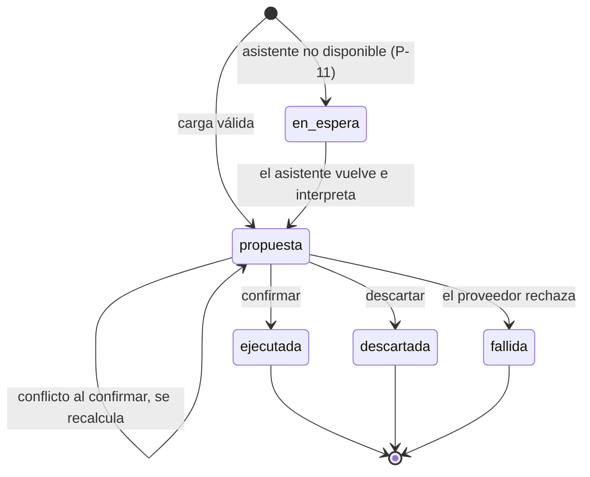

# Plan técnico — Agenda (CUN-01)

**Especificación:** `specs/02-agenda/spec.md` (REQ-CUN01-01 a 12)
**Fase:** 1 para el dominio, la API y las Operaciones; 2 para las herramientas del agente
**Decisiones que aplica:** AD-04, AD-05, AD-06, AD-08, AD-09, AD-10 · P-01, P-02, P-03, P-05, P-07, P-11 · DP-01, DP-02
**Depende de:** `specs/06-acceso/plan.md`, por la sesión, el contexto de organización y `@RequiereGoogle`
**Estado:** **aprobado** por el equipo el 22 de octubre de 2026, con sus hallazgos tal como están (DP-02 sigue siendo provisional; H-AG-01 y H-AG-08 siguen abiertos)

Este plan dice **dónde y cómo** se cumple cada requisito. Lo que la especificación no decide está en §9 como hallazgo.

---

## 1. Qué se construye en cada fase

| Fase | Entrega | Cómo se usa |
|---|---|---|
| 1 | Réplica de la agenda, sincronización con Google, conflictos, alternativas, Operaciones y consulta | **Solo consulta y controles directos** (cancelar, DP-01). Registrar y modificar existen en la API, pero ninguna pantalla los ofrece como formulario (R-42); se ejercitan con pruebas de integración |
| 2 | Herramientas del agente sobre las mismas Operaciones | El agente interpreta, propone y la persona confirma |

Separar así no es un camino manual: la fase 1 construye exactamente lo que el agente usará en la fase 2.

## 2. Módulos

| Módulo / componente | Responsabilidad |
|---|---|
| `AgendaModule` | Réplica, consulta por rango, ejecución de las operaciones de agenda |
| ├ `ReplicaEventosRepositorio` | Lectura y escritura de `evento_agenda`, siempre filtrada por propietario (REQ-CUN01-09) |
| ├ `SincronizadorCalendario` | Sincronización inicial e incremental desde Google (AD-10) |
| ├ `detectarConflictos()` | **Función pura**: solapes de un rango contra los eventos existentes (P-02) |
| └ `generarAlternativas()` | **Función pura**: huecos libres según DP-02 (P-02) |
| `OperacionesModule` | Transversal, AD-09. §3 |
| `IntegracionesModule` → puerto `ProveedorCalendario` | Única vía hacia Google Calendar. Tiene una implementación real y una **simulada** para pruebas y demostración |
| `AgenteModule` (fase 2) | Herramientas `agenda.*`, que solo crean Operaciones |

## 3. Operaciones (transversal, AD-09)

Es la pieza que hace verificables, en el servidor, la confirmación previa (P-03, REQ-CUN01-03), la idempotencia (P-07) y el modo degradado (P-11).

### 3.1 Tabla `operacion`

| Campo | Contenido |
|---|---|
| `id` | UUID. **Es también la clave de idempotencia**: confirmar dos veces ejecuta una vez |
| `perfil_id`, `organizacion_id` | Propietario |
| `tipo` | `agenda.registrar` · `agenda.modificar` · `agenda.cancelar` · `perfil.cambiar_zona_horaria` · … |
| `origen` | `agente` · `control_directo` (DP-01) |
| `solicitud_original` | Texto de la persona, solo cuando el origen es el agente |
| `carga` | Datos de la operación, validados con el esquema de su `tipo` en `packages/contratos` |
| `vista_confirmacion` | Lo que muestra la tarjeta: la acción exacta, sus datos y qué parte es irreversible (RN-ER-03) |
| `estado` | §3.2 |
| `resultado`, `error` | Tras ejecutar |
| marcas de tiempo | `creada_en`, `confirmada_en`, `ejecutada_en`, `capturada_en` |

`capturada_en` guarda el momento de la captura, que es la referencia para resolver «mañana» en lo encolado (REQ-CAP-24).

### 3.2 Estados

Reglas, cada una con su prueba:

- **Ninguna escritura sobre `evento_agenda` ni sobre Google ocurre fuera de la transición `propuesta → ejecutada`** (REQ-CUN01-03). Ningún otro servicio llama a `ProveedorCalendario` para escribir.
- La transición se hace con un bloqueo de fila (`SELECT … FOR UPDATE`). Una segunda confirmación de una operación ya `ejecutada` devuelve el mismo resultado sin volver a ejecutar. *Ajuste de T-012: en lugar de `SELECT … FOR UPDATE`, que exigiría SQL escrito a mano (prohibido en `AGENTS.md`), la primera confirmación «reclama» la operación con una actualización condicional atómica de `confirmada_en`, de nulo a ahora. Solo una la consigue; las demás reciben el resultado si ya terminó, o `OPERACION_EN_CURSO`.*
- **Al confirmar se vuelven a consultar los solapes** (REQ-CUN01-02). Si apareció un conflicto desde que se propuso, la operación no se ejecuta: vuelve a `propuesta` con el conflicto y las alternativas nuevas (hallazgo H-AG-07).
- Cuánto tiempo puede estar una propuesta sin respuesta queda sin resolver (hallazgo H-AG-08).

### 3.3 Rutas

| Ruta | Requisitos |
|---|---|
| `POST /operaciones` `{ tipo, carga, origen }` → propuesta, o error de validación | CUN01-02, 05, 07 |
| `POST /operaciones/:id/confirmar` → resultado | CUN01-04, 06 |
| `POST /operaciones/:id/descartar` | CUN01-03 |
| `GET /operaciones?estado=en_espera,propuesta` | CUN01-11, REQ-CAP-23 |

## 4. Modelo de datos de la agenda

### `evento_agenda` (EN-02) — réplica de Google (AD-10)

| Campo | Notas |
|---|---|
| `id`, `perfil_id`, `organizacion_id` | RN-EST-01: cada evento corresponde a un perfil |
| `google_calendario_id`, `google_evento_id`, `etag` | Solo el calendario principal en esta versión (hallazgo H-AG-06) |
| `titulo` | |
| `inicio`, `fin` | `timestamptz` (P-05) |
| `zona_horaria` | IANA del evento, tal como viene de Google |
| `todo_el_dia` | Hallazgo H-AG-03 |
| `es_organizador` | Hallazgo H-AG-05 |
| `serie_id` | Si es instancia de un evento recurrente (hallazgo H-AG-04) |
| `estado` | `confirmado` · `cancelado` |
| `sincronizado_en` | |

Índices: `(perfil_id, inicio, fin)` para las consultas por rango y `(perfil_id, google_evento_id)` único.

### `sincronizacion_calendario`

`perfil_id`, `sync_token`, `ventana_desde`, `ventana_hasta`, `ultima_sincronizacion`.

### Sincronización

- **Inicial**, al conectar Google: los eventos desde 30 días atrás hasta 365 días adelante, con `singleEvents=true` para que cada repetición de una serie llegue como evento propio.
- **Incremental**: con `syncToken`, en un trabajo de BullMQ cada 5 minutos por perfil conectado, y también bajo demanda al consultar un rango si la última sincronización tiene más de 2 minutos.
- Si Google responde `410 Gone`, se repite la sincronización inicial.
- Si el consentimiento está revocado, no se sincroniza y se aplica REQ-ACC-09.
- **El asistente nunca borra de la réplica por su cuenta.** Lo que se borra en Google se marca `cancelado` y queda a la vista como tal (R-25).
- *Ajustes de T-014:*
  - *La sincronización inicial no se dispara al conectar Google, sino en la primera consulta de la agenda o en la siguiente pasada del trabajador, lo que ocurra antes. Así la API no necesita la cola ni Redis, y el módulo de integraciones no depende del de agenda.*
  - *Tras una lectura completa, lo que la réplica tenía en la ventana y Google ya no devuelve se marca `cancelado`. Cubre lo borrado mientras el token estaba caducado.*
  - *El trabajador lista los perfiles con el calendario conectado de todas las organizaciones con `sinAislar`: no atiende a nadie en concreto. Solo lee perfil y organización; cada sincronización se hace después con `deOrganizacion`.*
  - *Un solo intento por trabajo: si Google falla, lo vuelve a intentar la siguiente pasada, sin bucles (REQ-ACC-09).*
  - *La ventana se renueva con una lectura completa cada 30 días (H-AG-09).*

## 5. Rutas de consulta

| Ruta | Requisitos |
|---|---|
| `GET /agenda/eventos?desde=&hasta=` → `EventoAgenda[]` con su zona horaria | CUN01-09, 10, 11, 12 |
| `GET /agenda/eventos/:id` | CUN01-06 |

Las dos llevan `@RequiereGoogle('calendar.events')`. Sin ese permiso responden `PERMISO_GOOGLE_FALTANTE` (REQ-CUN01-08, REQ-ACC-08).

*Ajustes de T-015:* la clave del permiso en el código es `calendario`, que apunta a `calendar.events`. El rango pedido lleva desfase y no pasa de 366 días. Si Google no responde y ya hay réplica, se devuelve la réplica; si nunca se sincronizó, `GOOGLE_NO_DISPONIBLE`. El colaborador no usa estas rutas (REQ-ACC-13).

## 6. Requisito por requisito

| REQ | Dónde se cumple | Fase |
|---|---|---|
| CUN01-01 | Herramienta `agenda.registrar_evento`: el modelo extrae fecha, inicio, fin y título como argumentos del contrato `PropuestaEvento`. **Si falta el fin, no lo inventa el modelo**: lo calcula el código con la duración por defecto, que todavía está sin decidir (decisión 1 del spec) | 2 |
| CUN01-02 | `POST /operaciones` llama a `detectarConflictos()` sobre la réplica, tras sincronizar el rango, antes de devolver la propuesta. Se repite al confirmar | 1 |
| CUN01-03 | Máquina de estados de §3.2; nada se escribe antes de `ejecutada` | 1 |
| CUN01-04 | `confirmar` escribe en Google, actualiza la réplica con la respuesta y devuelve el evento tal como quedó. La tarjeta de resultado se construye con esos datos, no con los propuestos | 1 |
| CUN01-05 | La propuesta incluye `conflicto { eventos[] }` y `alternativas[]` de `generarAlternativas()`, y queda sin poder confirmarse hasta que se elija otro horario | 1 |
| CUN01-06 | Operaciones `agenda.modificar` y `agenda.cancelar` sobre un `evento_id` de la réplica. Cancelar es además un control directo (DP-01) y lleva confirmación (decisión 2 del spec) | 1 |
| CUN01-07 | El esquema de `PropuestaEvento` marca qué campos faltan y la API responde `DATOS_FALTANTES { campos[] }` sin crear la operación. En la fase 2 el agente pregunta por ellos de uno en uno (R-20) | 1 y 2 |
| CUN01-08 | `@RequiereGoogle`: no se invoca ninguna herramienta ni se llama a Google. Lo capturado se conserva como captura (REQ-ACC-08) | 1 |
| CUN01-09 | `ReplicaEventosRepositorio` filtra por `perfil_id` del contexto, además del filtro de organización | 1 |
| CUN01-10 | `timestamptz` y `zona_horaria` en cada evento; la API devuelve ISO 8601 con desfase y la zona; el cliente muestra el huso (por ejemplo «GMT-5») | 1 |
| CUN01-11 | La consulta no depende del proveedor del modelo. Con el asistente caído, el agente deja lo pedido como Operación `en_espera`. Cancelar sigue funcionando (DP-01) | 1 y 2 |
| CUN01-12 | El cliente muestra el estado vacío cuando la consulta del día no devuelve eventos. Su acción abre la capa de captura (R-36), no un formulario | 1 |

## 7. Herramientas del agente (fase 2)

Su contrato vive en `packages/contratos/agenda`; la API y el agente usan los mismos esquemas (AD-08).

| Herramienta | Qué hace | Confirmación |
|---|---|---|
| `agenda.consultar` | Lee la réplica en un rango | No |
| `agenda.registrar_evento` | Crea una Operación `agenda.registrar` | Sí: el grafo se interrumpe hasta que se confirme la operación |
| `agenda.modificar_evento` | Crea una Operación `agenda.modificar` | Sí |
| `agenda.cancelar_evento` | Crea una Operación `agenda.cancelar` | Sí |

**Ninguna herramienta escribe.** Solo proponen; la ejecución es siempre `POST /operaciones/:id/confirmar`, la pida la persona desde la tarjeta o desde un control directo.

## 8. Verificación

| REQ | Prueba prevista | Tipo |
|---|---|---|
| CUN01-02 | `agenda.consulta-solapes-antes-de-proponer` | Integración |
| CUN01-03 | `agenda.sin-confirmar-no-escribe-ni-notifica` | Integración, con el proveedor simulado que cuenta llamadas |
| CUN01-04 | `agenda.confirmar-registra-lo-mostrado` | Integración |
| CUN01-04 | `operaciones.confirmar-dos-veces-ejecuta-una` | Integración |
| CUN01-05 | `agenda.conflicto-identifica-causa-y-ofrece-alternativas` | Integración |
| CUN01-05 | `alternativas.dp02` (casos de la tabla de DP-02) | Unitaria |
| CUN01-06 | `agenda.cancelar-requiere-confirmacion` | Integración |
| CUN01-07 | `agenda.datos-faltantes-no-crea-operacion` | Integración |
| CUN01-08 | `agenda.sin-permiso-no-invoca-proveedor` | Integración |
| CUN01-09 | `agenda.solo-eventos-propios` | Integración |
| CUN01-10 | `agenda.horas-con-zona-horaria` | Unitaria y extremo a extremo |
| CUN01-11 | `agenda.consulta-sin-proveedor-de-modelo` | Integración |
| CUN01-12 | `agenda.estado-vacio-abre-captura` | Extremo a extremo |
| CUN01-01 | `agente.agenda.extrae-sin-inventar-fin` | Evaluación del agente, fase 2 |

## 9. Hallazgos — vuelven a la especificación

Registrados en `SPEC.md` §8 y en la tabla de decisiones de `spec.md`. **No son definitivos** hasta que el equipo los acepte.

| # | Hallazgo | Lo que asume este plan |
|---|---|---|
| H-AG-01 | Duración por defecto cuando no se indica fin (decisión 1 del spec, ya abierta) | Un parámetro `DURACION_POR_DEFECTO`, sin valor hasta que se decida. La propuesta de una hora sigue pendiente |
| H-AG-02 | REQ-CUN01-05 exige ofrecer alternativas, pero no dice cuáles | **DP-02**, provisional |
| H-AG-03 | Los eventos de todo el día no se mencionan | Se muestran, pero **no cuentan como conflicto** |
| H-AG-04 | Modificar o cancelar un evento que se repite: ¿una vez o toda la serie? | Solo la instancia elegida |
| H-AG-05 | Un evento al que el usuario fue invitado, sin ser su organizador | Se muestra; modificarlo o cancelarlo se rechaza con explicación. No se declina la invitación por él |
| H-AG-06 | Varios calendarios de Google | Solo el principal |
| H-AG-07 | La agenda puede cambiar entre proponer y confirmar | Se vuelve a comprobar al confirmar; si hay conflicto, no se ejecuta y se propone de nuevo |
| H-AG-08 | Una propuesta que nadie confirma ni descarta | Queda en `propuesta`, sin caducar. Falta decidir si caduca |
| H-AG-09 | La lectura incremental solo trae lo que cambia: un evento que ya existía más allá de los 365 días no entra en la réplica aunque la ventana avance (detectado en T-014) | Se vuelve a leer completo cuando la ventana ha avanzado 30 días, así siempre cubre al menos 335 días por delante. Parámetro `RENOVAR_VENTANA_DIAS` |

### DP-02 — alternativas ante un conflicto (provisional)

Se generan con `generarAlternativas(eventos, rangoPedido, banda, zonaHoraria)`:

1. **Misma duración** que la pedida.
2. **Dentro de la banda horaria** de la plataforma, 08:00–20:00 (`05-equipos` §1).
3. **Primero el mismo día**, ordenadas por cercanía a la hora pedida. Después, los días siguientes, empezando por la misma hora.
4. **Se saltan el sábado y el domingo**, como en el cuadro `CUN-01 / Móvil / FA-01 / 01 Conflicto detectado`.
5. **Hasta tres alternativas**, como en ese mismo cuadro, buscando como mucho siete días adelante.
6. Los eventos de todo el día no bloquean (H-AG-03).
7. **Añadido al implementarla (T-016):** los horarios candidatos van **cada 15 minutos**, las alternativas **no se solapan entre sí** y **nunca se propone un horario que ya pasó**.

**Para revertirla o cambiarla:** es una función pura con sus parámetros. Cambiar el criterio es cambiar esta lista y sus pruebas unitarias, sin tocar ninguna otra pieza.
