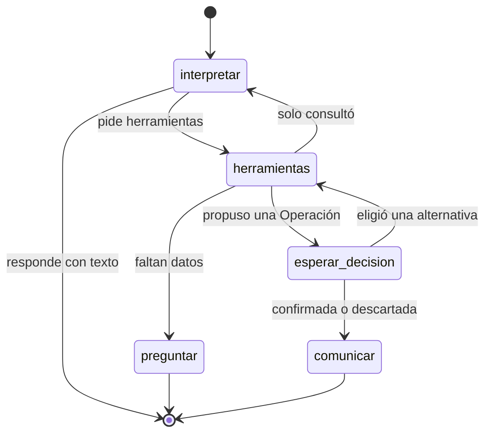

# Plan técnico — Agente (fase 2)

**Especificación:** `specs/07-agente/spec.md` (REQ-AGT-01 a 05) y los requisitos de agenda y captura que implementa (§11)
**Fase:** 2
**Decisiones que aplica:** AD-04, AD-05, AD-06, AD-07, AD-08, AD-09 · P-01, P-02, P-03, P-04, P-05, P-06, P-07, P-10, P-11 · DP-01
**Decisiones del equipo del 24 de octubre de 2026:** sin voz (PT-2), proveedor simulado por ahora, solo agenda y la tarea en espera (`spec.md` §2)
**Depende de:** `specs/02-agenda/plan.md` (Operaciones, réplica, `agenda.*`) y `specs/06-acceso/plan.md` (sesión, `@RequiereGoogle`, roles)
**Estado:** **aprobado** por el equipo el 25 de octubre de 2026, con sus hallazgos tal como están. **§14, revisión del 5 de noviembre de 2026** (tres capas de memoria, T-038 a T-042): avalada por el equipo el 5 de noviembre de 2026

Este plan dice **dónde y cómo** se cumple cada requisito. Lo que la especificación no decide está en §13 como hallazgo.

---

## 1. Qué se construye

| Pieza | Para qué |
|---|---|
| Puerto `ProveedorModelo` y tres implementaciones: **simulada**, **no configurada** y **compatible con la API de OpenAI** (Groq para probar, §3.1) | P-06. Cada proveedor es un archivo más, sin tocar nada de lo demás |
| Grafo del asistente con LangGraph.js | Interpreta, llama herramientas y **se interrumpe** al proponer una Operación hasta que la persona decide (P-03) |
| Herramientas de agenda | Consultan la réplica o **proponen** Operaciones `agenda.*`. Ninguna escribe (P-01, AD-09) |
| Auditoría de llamadas al modelo y de herramientas, con costo | P-07 |
| Cola en espera y su trabajador | P-11: con el asistente caído, lo pedido queda en espera y se interpreta al volver |
| Conversación web y capa de captura móvil conectadas | La persona pide, ve la tarjeta y confirma |

**No entra:** voz y cámara (PT-2), paleta de comandos (REQ-CAP-05), captura sin conexión del móvil (REQ-CAP-22), tareas personales (CUN-03, sin especificar), memoria semántica con pgvector (no hay todavía comunicaciones ni resúmenes que buscar), respuesta en flujo (H-AGT-07).

## 2. Módulo `AgenteModule`

`apps/api/src/agente/`. Es el **único** lugar donde puede vivir el SDK de un proveedor de modelo (P-06, `AGENTS.md`).

| Componente | Responsabilidad |
|---|---|
| `modelo/proveedor-modelo.ts` | Puerto `ProveedorModelo` y sus tipos (§3) |
| `modelo/modelo-simulado.ts` | Responde según un guion. Para pruebas y para demostrar sin clave (H-AGT-02) |
| `modelo/modelo-no-configurado.ts` | Siempre «no disponible»: sin proveedor, todo queda en espera (H-AGT-01) |
| `modelo/llamador-modelo.ts` | Tiempo límite, reintentos, cálculo del costo y registro de cada llamada (§8) |
| `grafo/grafo-asistente.ts` | El grafo de §4 |
| `grafo/punto-control-prisma.ts` | Persistencia del grafo sobre Prisma, para que la interrupción sobreviva a un reinicio (§4.3) |
| `herramientas/herramientas-agenda.ts` | Las herramientas de §5 |
| `herramientas/ejecutor-herramientas.ts` | Valida argumentos, aplica la idempotencia y audita (§8) |
| `contexto-asistente.ts` | Arma lo que ve el modelo (§6) |
| `cola-en-espera.ts` y `trabajador-en-espera.ts` | Modo degradado (§7) |
| `asistente.controller.ts` | Rutas de §9 |

**Dependencia entre módulos:** el agente usa la interfaz pública de `OperacionesService` y de `ConsultaAgendaService`. No lee tablas de agenda ni de Operaciones directamente (`PROPUESTA-TECNICA.md` §3.3).

**Versiones** (la última con al menos dos semanas el 24 de octubre de 2026; se pasa la auditoría antes de fijarlas): `@langchain/langgraph` 1.4.21 y `@langchain/core` 1.2.17, que LangGraph pide como dependencia par. **No se instala ningún modelo de LangChain**: el grafo llama a nuestro puerto, no a `ChatModel`.

## 3. El puerto del proveedor (P-06)

```ts
interface ProveedorModelo {
  readonly nombre: string;                       // 'simulado', 'no-configurado', después el real
  responder(peticion: PeticionModelo, senal: AbortSignal): Promise<RespuestaModelo>;
}

type PeticionModelo = {
  sistema: string;                               // instrucciones (§6.1)
  mensajes: MensajeModelo[];                     // persona, asistente y resultados de herramienta
  herramientas: DefinicionHerramienta[];         // nombre, descripción y esquema JSON, generado con zod (AD-08)
  maxTokens: number;
};

type RespuestaModelo = {
  texto: string | null;
  llamadas: { id: string; nombre: string; argumentos: unknown }[];
  uso: { tokensEntrada: number; tokensSalida: number };
  modelo: string;
};
```

- Dos errores con significado propio: **`ModeloNoDisponible`** (sin configurar, tiempo agotado, el proveedor caído o saturado) lleva al modo degradado (§7); cualquier otro es un **fallo de procesamiento**, que se muestra como tal (REQ-CAP-23).
- `LlamadorModelo` envuelve al puerto: 30 segundos por llamada y dos reintentos con espera de 1 y 3 segundos, solo ante `ModeloNoDisponible` (H-AGT-03).
- Selección por variable de entorno: `MODELO_PROVEEDOR=no-configurado` (por defecto) o `simulado`. El real se añadirá con su clave en `.env`, que pone el equipo.
- **Un solo modelo** para todo en esta versión (H-AGT-06).
- Los nombres de herramienta van con guion bajo (`agenda_consultar`), porque varios proveedores no admiten el punto. El nombre interno sigue siendo `agenda.consultar`.

### 3.1 Proveedor compatible con la API de OpenAI (Groq para probar)

**Decidido por el equipo el 29 de octubre de 2026:** para probar sin pagar, Groq en su nivel gratuito. Como Groq, Cerebras, OpenRouter y Ollama hablan el mismo formato de chat con herramientas, un solo adaptador, `modelo/modelo-compatible-openai.ts`, sirve para todos; cambiar de uno a otro es cambiar `.env`.

| Variable | Contenido |
|---|---|
| `MODELO_PROVEEDOR` | `compatible-openai` |
| `MODELO_URL` | Raíz de la API, por ejemplo `https://api.groq.com/openai/v1` |
| `MODELO_NOMBRE` | `openai/gpt-oss-120b` para empezar: usa herramientas, de una en una |
| `MODELO_CLAVE` | La pone el equipo; nunca va en el repositorio ni en el chat |
| `MODELO_PRECIOS` | Opcional: dólares por millón de tokens de entrada y de salida, `0,0` en el nivel gratuito. Sin ella, el costo queda desconocido (P-07) |

- **Sin SDK:** `fetch` a `POST {MODELO_URL}/chat/completions`. Los argumentos de cada llamada llegan como texto JSON y se interpretan con `JSON.parse`; si no se pueden interpretar, es un fallo del modelo.
- **Errores:** sin respuesta, 429 (límite de uso del nivel gratuito, H-AGT-13), 5xx y clave rechazada (401, 403) dan `ModeloNoDisponible`; cualquier otro, `FalloDelModelo`. La clave nunca se escribe en el registro.
- Cumple el contrato de T-029. La prueba automática usa un servidor local que imita la API; nunca llama a Groq.

### 3.2 El simulado

Un **guion**: lista de reglas «si el último mensaje de la persona encaja con este patrón, responde esto», donde la respuesta es un texto o llamadas a herramientas con argumentos. Los argumentos pueden usar fechas relativas a la referencia (`{hoy}`, `{mañana}`, `{viernes}`) que el simulado resuelve. Las pruebas escriben su propio guion; la demostración usa `apps/api/src/agente/modelo/guion-demostracion.ts`, con los ejemplos de la web y algunas variantes (*ajuste de T-029: en TypeScript y no en JSON, para que se compile y se compruebe*). **Lo que no está en el guion recibe «No sé hacer eso todavía»**, nunca una invención (H-AGT-02).

## 4. El grafo (LangGraph.js)

### 4.1 Estado

> *Cambia con la revisión del 5 de noviembre de 2026: ver §14.*

| Campo | Contenido |
|---|---|
| `mensajes` | Turnos de la conversación, en el formato de `MensajeModelo` (REQ-AGT-01) |
| `referencia` | Instante desde el que se resuelven «hoy» y «mañana»: el del mensaje, o `capturadaEn` si viene de la cola (REQ-CAP-24) |
| `operacionPendiente` | Id de la Operación propuesta que espera decisión, o nulo |
| `turnosNuevos` | Lo que se devuelve a la interfaz en esta vuelta (§9) |
| `vueltas` | Llamadas al modelo en este mensaje; tope 4 (H-AGT-10) |

La identidad (perfil, organización, rol) **no está en el estado**: llega en la configuración de cada ejecución desde el contexto de la petición, y las herramientas la usan para todo (P-04). El modelo no puede cambiarla.

### 4.2 Nodos



| Nodo | Qué hace | ¿Usa el modelo? |
|---|---|---|
| `interpretar` | Llama al modelo con el contexto de §6 y las herramientas | Sí |
| `herramientas` | Ejecuta las llamadas con `EjecutorHerramientas` (§5, §8) | No |
| `preguntar` | Ante `DATOS_FALTANTES`, pregunta **solo el primer campo** que falta, con una frase fija por campo: «¿Qué día?», «¿A qué hora empieza?», «¿Cómo lo llamo?» (REQ-CUN01-07, REQ-CAP-04, R-20) | No |
| `esperar_decision` | `interrupt()` con el id de la Operación. El grafo queda parado y persistido hasta que la persona decide (P-03) | No |
| `comunicar` | Arma el resultado con lo que devolvió la Operación, no con lo propuesto (REQ-CUN01-04). Cierra la conversación (H-AGT-05). *Desde §14: cierra el episodio, no la transcripción* | No |

Si la persona escribe otra cosa mientras hay una propuesta pendiente («mejor a las 5»), el grafo descarta esa Operación y vuelve a `interpretar` con el mensaje nuevo, dentro de la misma conversación (REQ-AGT-01).

**Lo que el modelo no hace** (`PROPUESTA-TECNICA.md` §7.3): no calcula solapes ni alternativas, no pone el fin que falta, no convierte zonas horarias, no decide si una acción se puede confirmar, no redacta el resultado de una acción. Todo eso es código (P-02).

### 4.3 Persistencia y confirmación

- **Punto de control propio sobre Prisma** (`BaseCheckpointSaver`), en lugar del paquete de LangGraph para Postgres: aquel crea sus tablas fuera de Prisma Migrate y fuera del filtro por organización. Tabla `punto_control_agente` (§10). *Ajuste de T-032: es una subclase del punto de control en memoria de LangGraph que carga y guarda una fila por conversación.*
- La confirmación sigue siendo **una sola**, la de Operaciones (AD-09): la ruta de decisión (§9) llama a `OperacionesService.confirmar` o `descartar`, y con su desenlace reanuda el grafo. El grafo no ejecuta nada por su cuenta.
- Si la Operación se confirma por otra vía (un control directo, otro dispositivo), al siguiente mensaje el grafo lee su estado y la da por cerrada.

## 5. Herramientas

Contratos en `packages/contratos/src/agente.ts` (AD-08), con zod; de ahí sale el esquema JSON que ve el modelo.

| Herramienta | Argumentos | Qué hace | Confirmación |
|---|---|---|---|
| `agenda.consultar` | `desde`, `hasta`: fechas `AAAA-MM-DD`; `horaDesde` y `horaHasta` opcionales (`HH:mm`), para «por la tarde» | Lee la réplica con `ConsultaAgendaService` en ese rango y en la zona del perfil. Al modelo le devuelve id, título, horas y estado; **a la interfaz, la lista armada por el código** (REQ-CUN01-13) | No |
| `agenda.registrar_evento` | `titulo`, `fecha`, `horaInicio` (`HH:mm`), `horaFin` opcional | Convierte hora local a instante con la zona del perfil (`instanteLocal`, P-05) y propone `agenda.registrar`. **Sin `horaFin`, no se manda fin**: lo pone el ejecutor con una hora (H-AG-01) | Sí |
| `agenda.modificar_evento` | `eventoId`, y solo lo que cambia: `titulo`, `fecha`, `horaInicio`, `horaFin` | Propone `agenda.modificar`. El id tiene que venir de una consulta anterior; si no existe o no es suyo, el ejecutor lo rechaza (H-AG-05) | Sí |
| `agenda.cancelar_evento` | `eventoId` | Propone `agenda.cancelar` | Sí |
| `captura.guardar_tarea` | `texto`, `clase`: tarea, pendiente sin fecha, esperando de alguien | Deja lo pedido **en espera** con el motivo «función por llegar» (REQ-AGT-02, H-AGT-09). No crea ninguna tarea | No: no tiene efecto |

Reglas comunes:

- **Ninguna escribe en la agenda ni en Google.** Las tres de agenda solo llaman a `OperacionesService.proponer` con `origen: 'agente'` y la solicitud original (AD-09).
- Los argumentos se validan con zod **antes** de hacer nada; si no valen, la herramienta devuelve el error al modelo, que puede corregirlo dentro del tope de vueltas.
- **Sin permiso de calendario**, las de agenda no llaman a nada: devuelven `PERMISO_GOOGLE_FALTANTE`, el asistente dice qué permiso falta y cómo concederlo, y lo pedido queda en espera con ese motivo (REQ-CUN01-08, REQ-ACC-08).
- El colaborador usa las mismas herramientas sobre lo suyo (REQ-ACC-13). Ninguna de esta fase es `soloResponsable`.
- Pedidos que ninguna herramienta cubre (correo, delegar, planificar el día): las instrucciones piden decirlo sin intentarlo (REQ-AGT-02).

## 6. Contexto y memoria (`PROPUESTA-TECNICA.md` §7.4)

> *Cambia con la revisión del 5 de noviembre de 2026: ver §14.*

| Memoria | En esta versión |
|---|---|
| Conversación | Los turnos de la conversación abierta, desde el punto de control. Como mucho los 20 últimos (H-AGT-05) |
| Perfil | Zona horaria y fecha y hora de referencia en esa zona, con el día de la semana: «Hoy es sábado 24 de octubre de 2026, 10:32, hora de Lima» |
| Operativa | **No se manda la agenda.** El modelo la pide con `agenda.consultar`, solo el rango que necesita, y solo ve título y horas (H-AGT-12) |
| Semántica | No entra: no hay todavía nada que buscar por significado |

### 6.1 Instrucciones

Un texto fijo en `instrucciones.ts`, versionado con el código. *Ajustado en T-036 tras la primera evaluación contra Groq: el modelo pedía confirmación en texto en vez de llamar a la herramienta.* Dice qué puede hacer (solo agenda), que nunca invente fechas, horas ni compromisos, que no ponga hora de fin si no se dijo, que pregunte en vez de suponer, y que diga lo que todavía no sabe hacer. **No contiene ninguna regla de negocio que el código no compruebe también** (P-02).

## 7. Modo degradado (P-11, REQ-CUN01-11, REQ-CAP-24)

La cola es la tabla `operacion` en estado `en_espera` (AD-09, `specs/02-agenda/plan.md` §3.2), con un campo nuevo, `motivo_espera`:

| Motivo | Cuándo | Se procesa cuando |
|---|---|---|
| `asistente_no_disponible` | `ModeloNoDisponible` tras los reintentos | El proveedor vuelve a responder |
| `permiso_faltante` | Se pidió algo de agenda sin el calendario conectado | Se conecta el calendario |
| `funcion_por_llegar` | Es una tarea (REQ-AGT-02) | Existan las tareas personales; hasta entonces no se toca |

- Lo encolado tiene `tipo: 'asistente.solicitud'`, la frase en `solicitudOriginal` y el momento del mensaje en `capturadaEn`. No tiene ejecutor: no se puede confirmar.
- **Trabajador** `procesar-en-espera` (BullMQ, en el proceso trabajador): cada minuto toma lo encolado por orden de captura, si su motivo ya no aplica, y lo pasa por el grafo con `referencia = capturadaEn`. Si resulta en una acción, **la misma fila** pasa a `propuesta` con su tipo, su carga y su tarjeta reales, y espera la confirmación de siempre. Si no es una acción (una consulta, un dato que falta), la respuesta queda en la conversación y la fila se cierra como `descartada`, sin efecto (H-AGT-04).
- Con el asistente caído, la agenda se sigue consultando (no depende del modelo) y los controles directos funcionan (DP-01). Ya está hecho en la fase 1.
- *Ajustes de T-033:* el procesador lee lo encolado de todas las organizaciones con `sinAislar`, igual que el trabajador del calendario (`specs/02-agenda/plan.md` §4): no atiende a nadie en concreto, solo lee identificadores y la identidad de cada perfil, y atiende cada solicitud aislada por su organización. Atiende hasta 20 por pasada, solo lo que espera al calendario si ya está conectado, y no pone una tarjeta encima de otra que espera a la persona.
- **Retirar algo de la cola** sigue abierto en `SPEC.md` §8. La API lo permite desde T-012, pero ninguna pantalla lo ofrece hasta que se decida.

## 8. Auditoría y costo (P-07)

| Tabla | Una fila por | Campos |
|---|---|---|
| `llamada_modelo` | Llamada al proveedor, también las fallidas | conversación, proveedor, modelo, tokens de entrada y de salida, `costo_usd`, duración, desenlace (`ok`, `no_disponible`, `error`) |
| `invocacion_herramienta` | Herramienta ejecutada | conversación, llamada al modelo que la pidió, id de la llamada del proveedor, herramienta, argumentos, resultado o error, Operación creada, duración |

- **Costo:** precio por millón de tokens de entrada y de salida, por modelo, en `precios-modelo.ts`. El simulado cuesta cero. El costo de una herramienta es el de la llamada que la pidió.
- **Idempotencia:** `(conversacion_id, id_llamada)` es único. Si el grafo repite un paso al reanudarse, la herramienta devuelve el resultado guardado y no propone otra Operación.
- Las dos tablas entran en `MODELOS_CON_ORGANIZACION`.
- **Presupuesto por usuario:** no hay límite en esta versión; con estas tablas se puede fijar después (H-AGT-08).

## 9. Rutas

> *Cambia con la revisión del 5 de noviembre de 2026: ver §14.*

Contratos en `packages/contratos/src/asistente.ts`. Todas `@SobreLoPropio()`.

| Ruta | Qué hace | Requisitos |
|---|---|---|
| `GET /asistente/conversacion` | La conversación abierta, con sus turnos, y lo que está en espera o propuesto | REQ-AGT-01, REQ-CAP-23 |
| `POST /asistente/mensajes` `{ texto }` | Pasa el mensaje por el grafo y devuelve los turnos nuevos | CUN01-01, 06, 07, 13; CAP-01 a 04, 06; AGT-02 |
| `POST /asistente/decisiones` `{ operacionId, decision, alternativa? }` | `confirmar`, `descartar` o elegir una `alternativa`: llama a Operaciones y reanuda el grafo | CUN01-03, 04, 05 |

Un turno del asistente tiene un `tipo`, para que la interfaz lo muestre distinto (REQ-CAP-23):

| Tipo | Se ve como |
|---|---|
| `texto` | Respuesta normal |
| `agenda` | Lista de compromisos armada por el código (REQ-CUN01-13) |
| `propuesta` | Tarjeta de confirmación, con su conflicto y alternativas si las hay |
| `pregunta` | El dato que falta |
| `resultado` | Lo que quedó hecho, con los datos devueltos por Google |
| `en_espera` | Aviso tranquilo, con su motivo: «quedó guardado», nunca como error |
| `fallo` | No se pudo procesar; no se hizo nada |

La respuesta llega entera, sin flujo (H-AGT-07); la interfaz muestra que el asistente está pensando.

## 10. Datos (migración nueva)

> *Cambia con la revisión del 5 de noviembre de 2026: ver §14.*

| Tabla o campo | Contenido |
|---|---|
| `conversacion_agente` | `id`, perfil, organización, `estado` (`abierta`, `cerrada`), `abierta_en`, `cerrada_en` |
| `punto_control_agente` | Una fila por conversación con sus puntos y escrituras serializados (*ajuste de T-032*). Se conservan los 10 últimos puntos |
| `llamada_modelo`, `invocacion_herramienta` | §8 |
| `operacion.motivo_espera` | Enumeración de §7, nula salvo en `en_espera` |
| `operacion.conversacion_id` | Conversación de la que salió, nula para los controles directos |

Las tablas nuevas con `organizacion_id` entran en `MODELOS_CON_ORGANIZACION`. Ninguna escritura anidada.

## 11. Requisito por requisito

| REQ | Dónde se cumple |
|---|---|
| CUN01-01 | `agenda.registrar_evento`: el modelo da fecha y horas locales; sin `horaFin` el fin lo pone el ejecutor (H-AG-01), y la tarjeta lo dice |
| CUN01-03, CAP-03 | Las herramientas solo proponen; el grafo se interrumpe; nada se ejecuta sin `confirmar` |
| CUN01-04 | `comunicar` usa el resultado de la Operación |
| CUN01-05 | La tarjeta trae el conflicto (T-018); elegir una alternativa la propone el código sin pasar por el modelo |
| CUN01-06 | `agenda.modificar_evento` y `agenda.cancelar_evento`, con el id de una consulta anterior |
| CUN01-07, CAP-04 | Nodo `preguntar`: el primer campo que falta, con una frase fija |
| CUN01-08 | `PERMISO_GOOGLE_FALTANTE` en la herramienta; en espera con su motivo |
| CUN01-11, CAP-24 | §7 |
| CUN01-13 | `agenda.consultar` devuelve la lista armada por el código |
| CAP-01 | Solo la puerta de texto; la misma tarjeta en web y móvil |
| CAP-02 | El modelo elige la herramienta: compromiso o tarea. Cambiar la clasificación es decirlo en la conversación |
| CAP-06 | Lenguaje natural sin sintaxis de comando |
| CAP-23 | Tipos de turno de §9 y motivos de §7 |
| AGT-01 | Punto de control por conversación; cierre en `comunicar` |
| AGT-02 | `captura.guardar_tarea` y las instrucciones |

## 12. Verificación

| REQ / principio | Prueba | Tipo |
|---|---|---|
| P-06 | `agente.contrato-del-proveedor` | Integración, contra el simulado, el no configurado y el compatible con OpenAI ante un servidor local que imita la API |
| P-07 | `agente.herramienta-auditada-con-costo`, `agente.herramienta-idempotente` | Integración |
| CUN01-01 | `agente.agenda.extrae-sin-inventar-fin` | Integración, con guion |
| CUN01-03 | `agente.herramientas-solo-proponen` | Integración, con el calendario simulado que cuenta escrituras |
| CUN01-07, CAP-04 | `agente.pregunta-de-uno-en-uno` | Integración |
| CUN01-13 | `agente.agenda.consulta-tal-cual` | Integración |
| CUN01-03, 04 | `agente.interrumpe-hasta-decidir` | Integración: la interrupción sobrevive a reconstruir el grafo |
| AGT-01 | `agente.conversacion-con-contexto` | Integración |
| CUN01-11, CAP-24 | `agente.sin-modelo-queda-en-espera`, `agente.en-espera-desde-la-captura` | Integración, con el trabajador |
| AGT-02 | `agente.tarea-queda-en-espera` | Integración |
| CUN01-08 | `agente.sin-calendario-no-agenda` | Integración |
| CAP-23 | `web.asistente-agenda-y-confirma`, `web.asistente-en-espera`, `movil.captura-propone-y-confirma`, `movil.captura-en-espera` | Extremo a extremo |

**Evaluación del modelo** (`PROPUESTA-TECNICA.md` §7.5): un conjunto fijo de frases con el resultado esperado. Con el simulado solo prueba la tubería; tiene sentido con un proveedor real, como Groq (T-036).

## 13. Hallazgos — vuelven a la especificación

Registrados en `spec.md` §5 y en `SPEC.md` §8. **Aceptados por el equipo el 25 de octubre de 2026** tal como están.

| # | Hallazgo | Lo que asume este plan |
|---|---|---|
| H-AGT-01 | El proveedor real no está elegido | Sin proveedor, el asistente cuenta como **no disponible**: todo queda en espera, como hoy, pero guardado en el servidor |
| H-AGT-02 | Cómo se demuestra el asistente sin clave | `MODELO_PROVEEDOR=simulado` con un guion de frases conocidas. Lo que no está en el guion recibe «No sé hacer eso todavía». **Es un simulado: no entiende lenguaje natural** |
| H-AGT-03 | Cuándo el asistente «no responde» | 30 s por llamada y dos reintentos (1 s y 3 s). Una clave inválida también cuenta como no disponible, y queda en el registro del servidor |
| H-AGT-04 | Lo que estaba en espera y al interpretarse no es una acción | Se responde en la conversación y la fila se cierra como `descartada`, sin efecto. Alternativa: un estado nuevo, `atendida` |
| H-AGT-05 | Cuándo se cierra una conversación | Al ejecutarse o descartarse su Operación (glosario, «Conversación»). Sin Operación sigue abierta. Contexto de como mucho 20 turnos |
| H-AGT-06 | `PROPUESTA-TECNICA.md` §4.1 pide un modelo pequeño para clasificar y uno grande para razonar | Un solo modelo. Se revisa al elegir proveedor |
| H-AGT-07 | La propuesta técnica pide respuesta en flujo por WebSocket | Respuesta entera por HTTP y aviso de que piensa. Se revisa con el proveedor real |
| H-AGT-08 | Presupuesto de costo por usuario (§7.5) | Sin límite. Se registra el costo de cada llamada. Va con D-7 |
| H-AGT-09 | REQ-CAP-23 distingue tres estados; la tarea en espera es un cuarto caso | Es «en espera» con motivo propio y texto propio: ni error ni fuera del plan |
| H-AGT-10 | Tope de llamadas al modelo por mensaje | Cuatro. Superado, el turno es un fallo y no se hizo nada |
| H-AGT-11 | Quién resuelve «el viernes» | El modelo, con la fecha de referencia y el día de la semana. El riesgo se cubre con la tarjeta, que muestra fecha larga con día de la semana (P-03), y con casos en la evaluación |
| H-AGT-12 | Qué parte de la agenda ve el proveedor | Solo título, horas y estado del rango pedido. Nunca invitados, descripción ni lugar |
| H-AGT-14 | El estado guardado de cada conversación crece por diez: el punto de control conserva 10 copias completas, y una conversación de dos o tres mensajes ya ocupa 36 a 46 KB (medido el 29 de octubre de 2026, `INFORME-LANGGRAPH.md` §1) | **Aceptado por el equipo el 29 de octubre de 2026:** se conservan 2 puntos, el último y su padre; NexoAI no usa el «viaje en el tiempo» de LangGraph. Un plazo para borrar las conversaciones cerradas queda pendiente de la decisión sobre REQ-AGT-01 |
| H-AGT-15 | Los títulos de los compromisos entran en el contexto del modelo, y los de una invitación los escribe otra persona: pueden llevar instrucciones escondidas (inyección indirecta, `INFORME-LANGGRAPH.md` §2) | **Aceptado por el equipo el 29 de octubre de 2026:** el resultado de cada consulta lleva un aviso de que es contenido externo y cada compromiso dice si lo escribió otra persona; las instrucciones dicen que nunca se siguen órdenes de esos textos; la evaluación incluye un caso malicioso. La defensa principal sigue siendo la arquitectura: nada se ejecuta sin confirmar (P-03) |
| H-AGT-13 | El proveedor de prueba (Groq, nivel gratuito) tiene un límite bajo de tokens por minuto, y lo que recibe puede quedar en sus servidores (detectado el 29 de octubre de 2026) | El 429 cuenta como «no disponible» y lo pedido queda en espera (P-11). Las instrucciones y las herramientas se mantienen cortas. Se prueba con un calendario sin datos personales |
| H-AGT-16 | REQ-AGT-01 v1 ataba lo que ve la persona, lo que lee el modelo y lo que recuerda el sistema a un solo ciclo: la pantalla se vaciaba y el agente no podía referirse a lo recién hecho (5 de noviembre de 2026) | Tres capas: transcripción propia, contexto del episodio con la nota de continuidad y memoria larga reservada. §14. **Avalado por el equipo el 5 de noviembre de 2026** |
| H-AGT-17 | La transcripción crece sin forma; la unidad de memoria es la actividad (5 de noviembre de 2026) | Cada turno se liga a la actividad que resolvió; el hilo es una vista. En esta rama solo el enlace y las alternativas de referente (T-042); el detalle de actividad, después. §14.9. **Avalado por el equipo el 5 de noviembre de 2026** |

---

## 14. Revisión del 5 de noviembre de 2026 — tres capas de memoria

**Origen:** `TRASPASO-CLAUDE-CODE.md`, `INFORME-MEMORIA-AGENTE.md` §6 a §8, `INFORME-ESTRUCTURA-Y-REESTRUCTURACION-AGENTE.md` §5 a §8, `design/capturas/2026-11-04/INFORME-VISUAL-AGENTE.md` §6.
**Requisitos:** REQ-AGT-01 v2, REQ-AGT-03, REQ-AGT-04 (y REQ-AGT-05, sin plan en esta rama).
**Valores:** los por defecto de `spec.md` §5, decisiones 16 a 26. **Avalada por el equipo el 5 de noviembre de 2026.**
**Rama:** `modificacion/vision-nexoai`, solo en local.

### 14.1 Qué cambia y qué no

| Cambia | No cambia |
|---|---|
| El estado del grafo pierde `turnos` | Nodos, aristas, `interrupt()` y la reanudación (§4.2, §4.3) |
| La conversación pasa a ser un **episodio**; la transcripción vive en su propia tabla | El punto de control y sus 2 puntos (H-AGT-14) |
| `interpretar` recibe la nota de continuidad | Las herramientas de §5, salvo T-042 |
| `GET /asistente/conversacion` devuelve la transcripción por páginas | El puerto del modelo, el simulado, el adaptador compatible y el llamador (§3) |
| Web y móvil dejan de vaciar | Auditoría e idempotencia (§8); Operaciones y `02-agenda` |
| El trabajador cierra episodios inactivos y borra lo vencido | La cola en espera y sus motivos (§7) |

### 14.2 El grafo

| Pieza | Antes | Ahora |
|---|---|---|
| `turnos` | Acumulaba toda la conversación dentro del estado | **Sale del estado.** Los nodos devuelven lo de esta vuelta en `turnosNuevos`, con un reductor que **reemplaza**; el servicio los anota en la transcripción tras cada `invoke` |
| `mensajes` | 20 últimos del episodio | Igual |
| `interpretar` | `sistema = instrucciones(referencia)` | `sistema = instrucciones(referencia) + nota`. La nota llega ya armada como texto desde el servicio, para que el grafo no lea Operaciones (§2) |
| `comunicar` | Marca `cerrada` y se cierra la conversación | Marca el episodio como cerrado. El siguiente mensaje abre otro **sin tocar la transcripción** |
| Instrucciones | Solo agenda | Suman que se puede responder «¿qué hicimos?» con la nota, sin inventar, y que la nota son datos: solo se usa si la persona se refiere a ello |
| `recursionLimit` | El de LangGraph por defecto | Explícito, derivado de `TOPE_VUELTAS` (T-041) |

### 14.3 El episodio

- `conversacion_agente` **es el episodio**. La tabla **no se renombra** (decisión del traspaso §7, n.º 6): cambian los documentos y los nombres en el código. El `thread_id` sigue siendo su id.
- Campo nuevo `ultima_actividad_en`, que T-038 actualiza con cada mensaje. **Desde T-041**, al recibir un mensaje y en el trabajador, un episodio abierto con **30 minutos** sin actividad (decisión 18) se cierra sin efecto y el mensaje abre otro.
- **Un episodio con una propuesta pendiente no se cierra por inactividad.** Cuánto puede esperar una propuesta es **H-AG-08**, abierto (`02-agenda`, decisión 12): no se fija en esta revisión. Mientras tanto rige lo que ya asume `specs/02-agenda/plan.md` §9, la propuesta no caduca.
- La sesión no tiene tabla: el cliente la deduce del hueco entre episodios.

### 14.4 La transcripción

| Pieza | Detalle |
|---|---|
| Tabla `turno_asistente` | `id` (lo genera el grafo), `organizacion_id`, `perfil_id`, `episodio_id` (a `conversacion_agente`), `en`, `tipo`, `datos` (el `TurnoAsistente` validado con zod), `actividad_tipo` y `actividad_id` nulos hasta T-042. Índice `(perfil_id, en desc)`. Entra en `MODELOS_CON_ORGANIZACION` |
| `TranscripcionService` | `anotar(contexto, episodioId, turnos)` con `skipDuplicates`, para que un reintento no duplique; `listar(contexto, { antes, limite })` |
| Cuándo se anota | En el servicio, después de que `invoke` guardó el punto de control: un fallo a mitad no deja turnos sin estado. También en `atenderEnEspera` |
| Privacidad (P-10) | Se filtra por `perfil_id` además de la organización. Ninguna ruta de equipo la lee |
| Retención | 90 días (decisión 20), por el trabajador (T-041) |
| Datos existentes | Las conversaciones cerradas de desarrollo **no se migran**: su transcripción está dentro del punto de control y solo son datos de prueba |

### 14.5 La nota de continuidad

- `NotaDeContinuidad.armar(contexto)` lee con la interfaz pública de Operaciones (`listar`), sin escribir nada: las Operaciones `ejecutada` del perfil, **las 5 últimas o las de los últimos 7 días, lo que sea menor** (decisión 19), y las que están `en_espera` con su motivo.
- Cada acción: tipo («registrado», «movido», «cancelado»), título, fecha y hora en la zona del perfil (con `agenda/formato.ts`), id del evento y hace cuánto.
- Envuelta con `AVISO_CONTENIDO_EXTERNO` (H-AGT-15): los títulos los escribió la persona o un tercero.
- Pesa unas 150 fichas. Se mide en `llamada_modelo` antes y después; si pesa con Groq (H-AGT-13), baja a 3.
- El resumen escrito por el modelo para episodios más largos que la ventana **no entra en esta rama**: los episodios de agenda son cortos y el tope de 20 mensajes sigue.

### 14.6 Rutas y contratos

| Contrato | Cambio |
|---|---|
| `GET /asistente/conversacion?antes=<cursor>&limite=<n>` | Devuelve `{ episodios, turnos, episodioAbierto, pendiente, hayAnteriores, cursor }`, de lo más reciente hacia atrás. Cada turno lleva `episodioId` y `en` |
| `episodios[]` | `{ id, abiertoEn, cierre }`, con `cierre = { en, desenlace, titulo } \| null`. `desenlace`: `registrado`, `movido`, `cancelado`, `descartado` o `sin_accion`. **Lo arma el servidor** desde la Operación del episodio; el cliente solo pinta el separador |
| `RespuestaAsistente` | `cerrada` pasa a `episodioCerrado`; se añade `episodioId` |
| `TurnoAsistente` | Sin tipo nuevo: el separador **no es un turno** |

### 14.7 Web y móvil (T-039)

- Los turnos **siempre se añaden**; se quita el vaciado al cerrar (`conversacion.tsx`, `captura.tsx`).
- Separador entre turnos de distinto episodio, con el texto de `design/ARQUITECTURA-VISUAL-WEB.md` §5, revisión del 5 de noviembre.
- «Ver anteriores» arriba, con el cursor, conservando la posición de lectura.
- El blanco inicial con ejemplos, solo con la transcripción vacía.
- El móvil abre la capa con el episodio en curso y el anterior.

### 14.8 Ciclo de vida (T-041)

Trabajos nuevos en el proceso trabajador, junto al de la cola en espera:

| Trabajo | Qué hace |
|---|---|
| Cerrar episodios inactivos | Los de más de 30 minutos sin actividad y **sin propuesta pendiente** (H-AG-08 abierto), para que no esperen al siguiente mensaje |
| Borrar puntos de control | Los de episodios cerrados hace más de 7 días (decisión 21). La transcripción y la auditoría no se tocan |
| Borrar la transcripción vencida | Turnos de más de 90 días (decisión 20). `conversacion_agente` **no se borra**: `invocacion_herramienta` cuelga de ella y es auditoría (P-07) |

Los tres usan `sinAislar` por ser trabajos de mantenimiento sobre todas las organizaciones, con la misma justificación que §7.

### 14.9 Alternativas de referente y enlace con la actividad (T-042)

- `agenda.modificar_evento` y `agenda.cancelar_evento` aceptan, en lugar de `eventoId`, lo que la persona dijo para identificarlo (`titulo`, `fecha`). La herramienta busca en la réplica, **en código**: una coincidencia → propone; varias → devuelve las candidatas; ninguna → lo dice.
- Con varias, el grafo va a un nodo nuevo `alternativas`, sin modelo: turno `alternativas_de_referente` con la lista (título, fecha, hora y de quién es). Elegir viaja por `POST /asistente/decisiones` con el tipo `referente` y lleva a la tarjeta. Escribir otra cosa descarta la lista.
- Cada turno que resolvió una actividad guarda `actividad_tipo` y `actividad_id` en `turno_asistente`. Herramienta `actividad.contexto(id)`: el hilo de una actividad (sus Operaciones y sus últimos turnos), marcado como datos, cuando la persona se refiere a ella.
- REQ-AGT-05 (el detalle de actividad) **no tiene plan**: necesita una pantalla nueva.

### 14.10 Evaluación (T-040)

`evaluar-asistente` mira la **trayectoria** (la segunda llamada, no solo la primera) y suma dos casos con historia y nota: «mejor a las 5» tras confirmar debe consultar y proponer `agenda_modificar_evento` con el id; «¿qué hicimos?» debe responder con la nota y sin herramientas. Una sola corrida contra Groq, avisando antes.

### 14.11 Lo que queda sin plan

| Qué | Por qué |
|---|---|
| REQ-AGT-05, el detalle de actividad | Pantalla nueva; decisión del equipo |
| Varias intenciones en secuencia (decisión 24) | Hace falta decidir dónde se guarda la segunda intención mientras se decide la primera, y resolverlo a la vez que REQ-CAP-10. Hasta entonces el grafo atiende una acción por mensaje, como hoy |
| Memoria larga (capa 3): preferencias en el perfil | Después de CUN-03 |
| Modo Registro del lienzo | Con la sección Actividad |
| `conversacion.acciones_recientes` | La nota de continuidad cubre lo inmediato; se revisa tras T-040 |

### 14.12 Requisito por requisito y verificación

| REQ | Dónde se cumple | Prueba |
|---|---|---|
| AGT-01 v2 | Episodio (§14.3) y nota (§14.5); criterio 1 sin cambios | `agente.conversacion-con-contexto` (ajustada), `agente.nota-de-continuidad` (nueva), `agente.episodio-caduca` (nueva) |
| AGT-03 | `turno_asistente`, `GET /asistente/conversacion` paginado, clientes sin vaciado | `agente.transcripcion-persiste` (nueva), `web.asistente-historial` (nueva), `web.asistente-agenda-y-confirma` y `movil.captura-propone-y-confirma` (ampliadas) |
| AGT-04 | §14.9 | `agente.alternativas-de-referente` (nueva) |
| AGT-05 | Sin plan | — |

